# Architecture

How ferrum-gpu is built and why. For usage see the [user guide](user-guide.md); for the workflow of
changing it see [developing.md](developing.md). Measured claims link to the report that holds the numbers.

## 1. Layers

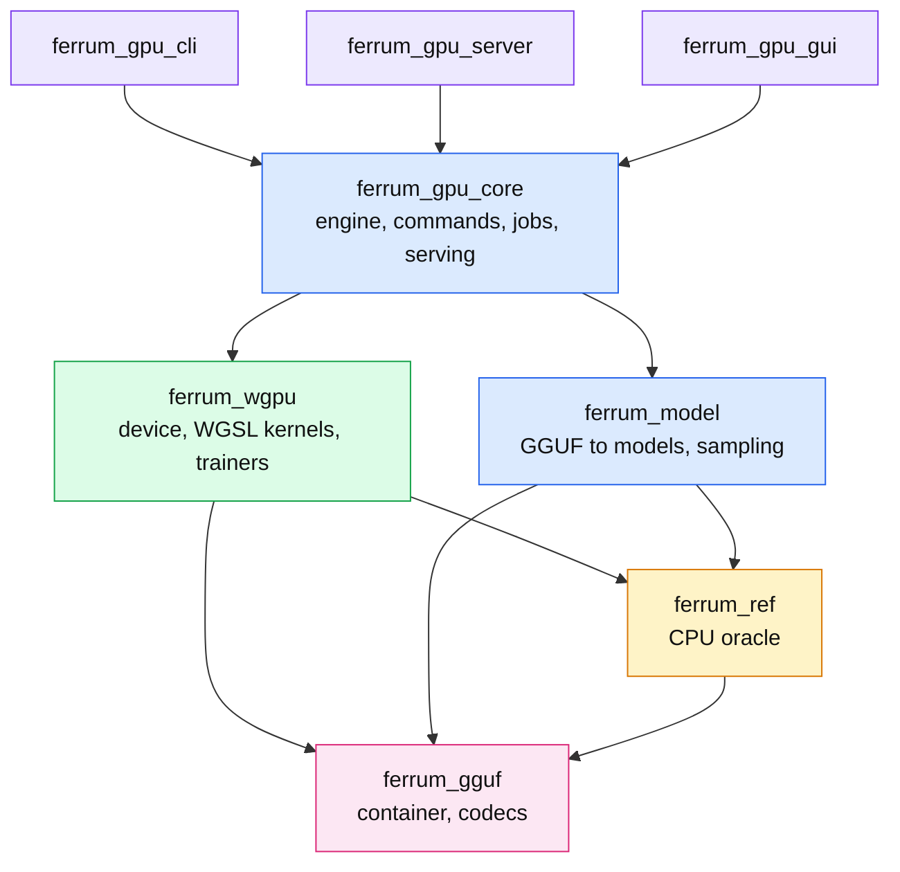


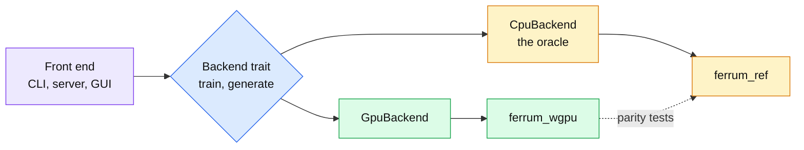


```
                 ferrum-gpu (CLI)   ferrum-gpu-server   ferrum_gpu_gui (+ browser page)
                        \                 |                  /
                         +--------- engine layer ------------+      ferrum_gpu_core::engine
                                  Backend trait: train / generate
                              /                                \
                    CpuBackend (oracle)                   GpuBackend
                              |                                |
   ferrum_ref  <---- parity ----  ferrum_wgpu  (device runtime, WGSL kernels, resident models, trainers)
        |                              |
        +---------- ferrum_model ------+   (GGUF <-> models, checkpoints, sampling)
                         |
                    ferrum_gguf                 (container, codecs)
```

Dependency direction (each arrow is a Cargo dependency, nothing points back up):
`ferrum_gguf` <- `ferrum_ref` <- `ferrum_model`; `ferrum_wgpu` depends on `ferrum_ref` and `ferrum_gguf`
(and on `ferrum_model` only in tests); **`ferrum_gpu_core`** (2026-11-17) sits on those engine crates and holds
the engine layer (`Backend`, `CpuBackend`, `GpuBackend`), device selection (`Session`), cancel, and the std-only
HTTP, JSON, stop-string and byte-tokenizer helpers, the commands, the jobs, and the JSON server as a library (`serving`: routes, limits, auth, decoders and `boot`); `ferrum_gpu_cli`, `ferrum_gpu_server` and `ferrum_gpu_gui`
each depend on the core and no front end depends on another (`tests/tests/test_architecture.rs` checks the
manifests). The server also uses the CLI crate for the commands. The GUI crate keeps the web page, its HTTP
routes and the browser self-test, and re-exports the core modules under their old paths.

Every crate has `#![forbid(unsafe_code)]` and `#![warn(missing_docs)]`.

## 2. The CPU reference (`ferrum_ref`)

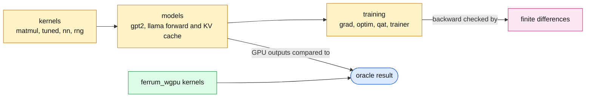


The reference is the **specification the GPU is tested against**, not a product. It holds plain host-`f32`
code with no GPU anywhere:

- `kernels/`: `matmul` (the simple parity oracle), `tuned` (a blocked, multi-threaded matmul that is the
  speed baseline for every GPU gate), `nn` (GPT-2 forward ops), `rng` (seeded xorshift64*).
- `models/gpt2`, `models/llama`: weights (matrices `[in, out]` row-major), a full causal forward, cached
  single-token `feed` with a KV `Cache`, deterministic random initialisation, and for Llama the ops
  (RMSNorm, RoPE with NORM/NEOX pairing and host-built cos/sin tables, grouped-query attention, SwiGLU).
- `training/`: `grad` (hand-written backward passes), `optim` (AdamW, global-norm clip, warmup + cosine
  schedule), `qat` (Q8_0 snapping), `trainer` (the backend-independent loop below).

The backward passes are checked against finite differences, so the oracle itself is not trusted blindly.

## 3. The device layer (`ferrum_wgpu::device`)

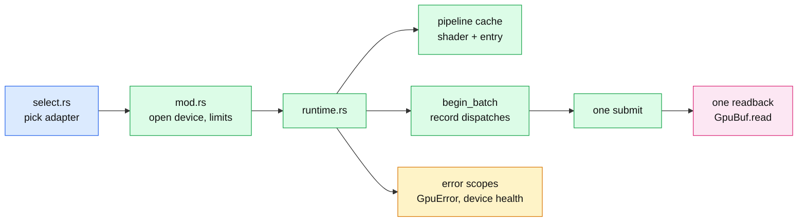


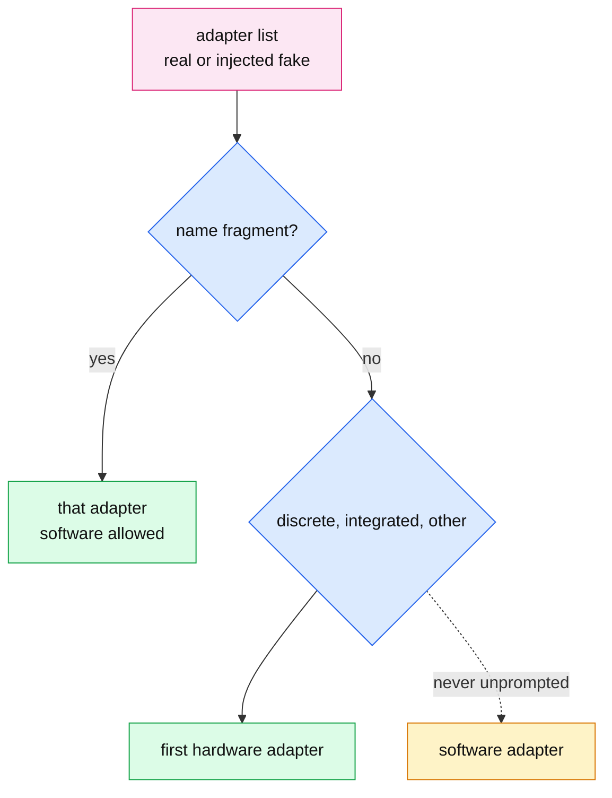


| File | Responsibility |
|---|---|
| `select.rs` | Pure adapter selection over `AdapterSummary` lists. A name fragment wins (and may pick a software adapter); otherwise first discrete, then integrated, then other; **software adapters are never chosen unprompted** |
| `budget.rs` | Memory budget and the plan-then-allocate check (section 6) |
| `mod.rs` | Real adapter enumeration and opening. **All direct `wgpu` device calls are in this file and `runtime.rs`**, so API churn in `wgpu` (pinned to 30.0.1) stays local |
| `runtime.rs` | Error scopes and device health, a pipeline cache keyed by shader and entry, the single generic `dispatch` path, command batching, plan-checked allocation |
| `tensor.rs` | `GpuBuf` (f32 device buffers with a shape): upload, zeros, readback |

Principles:

- **Errors are values.** Allocation failure, validation errors and device loss come back as `GpuError`;
  nothing in the engine panics on a GPU fault. `Gpu::check` reports device health.
- **Limits come from the adapter.** The engine asks for the adapter's limits and never assumes more than
  the WebGPU baseline; one buffer per tensor, and a tensor over the binding limit is refused by name.
- **Batching.** `begin_batch` / `end_batch` record many dispatches into one command encoder so that a whole
  decode token or training step is one submit with one readback. (Measured: batching removes per-kernel
  error-scope work; it was not faster for tiny decode, see the decode report.)
- **Hardware-free logic is pure.** Selection and budgeting take injected inputs (adapter lists, parsed
  `nvidia-smi` output, temp-dir sysfs trees), so the whole suite passes on a machine with no GPU and tests
  that need a real adapter skip with a printed reason. `FERRUM_GPU_ADAPTER=<fragment>` chooses the adapter
  for tests and tools; a fragment that matches nothing makes the GPU tests skip (the coverage script uses
  this to run the "no GPU" paths).

## 4. Kernels (`ferrum_wgpu::ops`, `shaders/`)

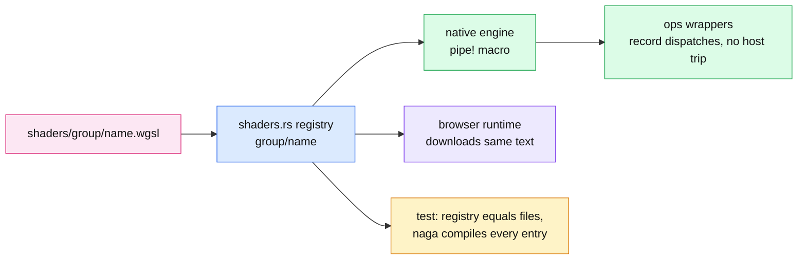


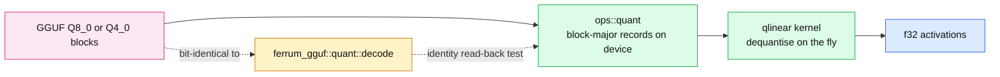


WGSL only, `f32`/`u32`/`i32` only, no optional features. The sources live in
`ferrum_wgpu/src/shaders/<group>/<name>.wgsl` and are registered in `shaders.rs` by `group/name`; a test keeps
the registry equal to the files on disk and compiles every entry through `naga`. The same registry is what
the browser runtime downloads, so the page runs the same shader text as the native engine.

| Group | Kernels |
|---|---|
| `fwd` | embed, layernorm, gemv (K-split), gelu, add, bias_add, attention scores / softmax / PV (full and decode), cross-entropy rows, mean loss, score |
| `bwd` | layernorm, gelu, attention (`dp`, `ds`, `dq`, `dk`, `dv`), column sums, embedding gradients |
| `llama` | rmsnorm, rope, swiglu, gather, grouped-query attention forward and backward, RMSNorm and SwiGLU backward |
| `opt` | deterministic sum of squares, global-norm finish, accumulate, AdamW |
| `quant` | `q8_snap` (QAT), `qlinear` (Q8_0 / Q4_0 matrix-vector with in-kernel dequantisation) |
| `matmul` | naive, tiled 16, blocked 4, blocked 4 transposed (the Phase 0 spike variants) |

Rust wrappers (`ops/mod.rs`, `bwd.rs`, `llama.rs`, `llama_bwd.rs`, `opt.rs`, `qat.rs`, `quant.rs`,
`matmul.rs`) own the buffer plumbing: each function records one or more dispatches on resident buffers and
returns, with no host round trip in between. 1-D launches use `Gpu::dispatch_1d`; pipelines are looked up with
the `pipe!(gpu, "group/name")` macro.

**Quantised weights.** `ops::quant` keeps Q8_0 / Q4_0 matrices packed on the device as block-major records
(an f32 scale plus the quants, indexed `block * n + column`); the kernel dequantises on the fly. The
dequantised values are bit-identical to `ferrum_gguf::quant::decode`, which is tested with an identity
read-back. Finding from [llama-speed](llama-speed.md): the quantised kernel has no K-split, so quantised
decode is not faster on the two real GPUs.

## 5. Determinism and parity

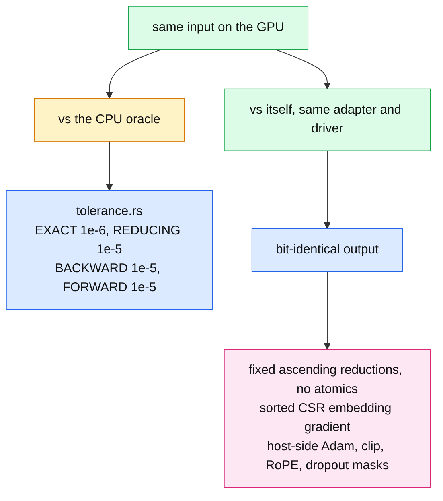


Two different promises:

1. **GPU vs the CPU oracle: tolerance.** Tolerances are frozen in `tolerance.rs`: `EXACT` 1e-6 (add, bias),
   `REDUCING` 1e-5 (softmax, layernorm, GELU, reductions), `BACKWARD` 1e-5, `FORWARD` 1e-5 (whole forward).
   Measured worst cases are well inside them (for example 4.8e-6 against `FORWARD` for the Llama forward).
   A later failure is a bug, not a reason to loosen a tolerance.
2. **GPU vs itself: bit-identical.** Repeat runs on the same adapter, driver and `wgpu` version produce the
   same bits. This is achieved by construction, not by luck: every reduction runs in a fixed ascending order
   with no atomics; the embedding gradient goes through a sorted CSR index instead of scatter-add; Adam bias
   corrections, learning rate, clip scale and RoPE tables are computed on the host; dropout masks come from
   the host RNG. Parity across *different* adapters is by tolerance only.

Other parity rules: Q8_0 snapping rounds half away from zero; f16 scales use integer bit operations; the
attention mask is `-1e9` with a max-subtracted softmax.

## 6. Memory planning (`budget.rs`, `plan.rs`, `cli::preflight`)

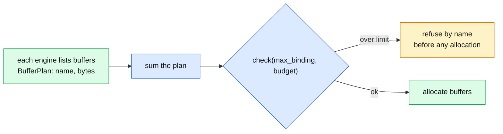


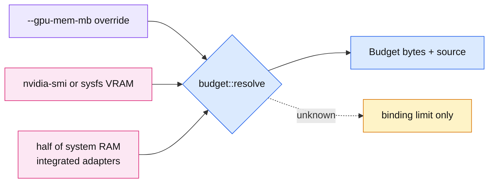


`wgpu` has no portable VRAM query, so the engine uses **plan, sum, then allocate**:

1. Each engine lists every device buffer it will create as a `BufferPlan` (name and bytes):
   `models::llama::plan` for decoding; `training::{gpt2,llama}::plan` (`static_plan`: weights, gradients,
   both Adam moments, norm partials; `activation_plan`: everything a `(batch, t)` step needs).
2. `BufferPlan::check(max_binding, budget)` refuses, **before any allocation**, a buffer over the adapter's
   binding limit or a total over the budget, and the error names the buffer, the sizes and the limit.
3. Only then are buffers created. Activation buffers are re-planned if the step shape changes.

The budget (`Budget { bytes, source }`) resolves as: explicit override (`--gpu-mem-mb`) > `nvidia-smi` or
sysfs VRAM > half of system RAM for integrated / unified-memory adapters > unknown (then only the binding
limit applies). `budget::resolve` implements the whole chain over injected inputs; **the CLI currently wires
in only the override** (marked `ponytail:`). The CLI's `preflight` runs the same plans up front so a run is
refused with advice before the device is even opened for work.

## 7. Models on the device (`ferrum_wgpu::models`)

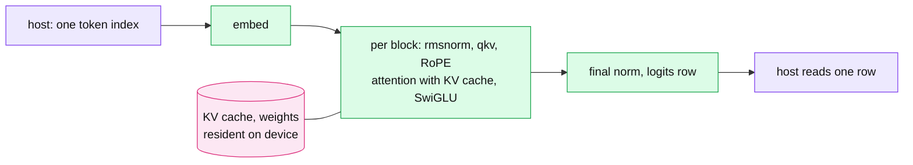


`GpuGpt2` and `GpuLlama` keep every weight, the KV cache and all activations **resident**. Per decoded token
the host sends one token index and receives one logits row; the whole token is recorded as one batch.
`GpuLlama::new(gpu, &Llama, Option<QKind>, Option<Budget>)` optionally packs the weights as Q8_0 / Q4_0;
`feed` decodes one token, `forward_all` runs a whole sequence, `score` returns per-position log-probabilities
and argmax flags (only `2 * (len-1)` floats leave the device), and `dequantised()` returns the CPU model that
a quantised run must match.

## 8. Training

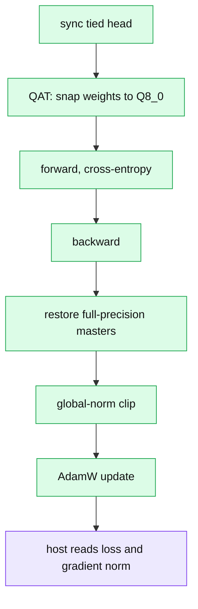


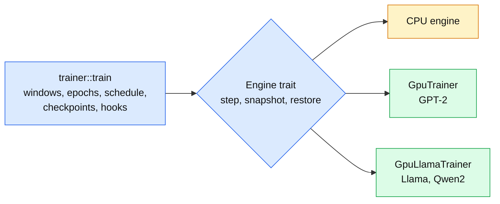


**The loop** (`ferrum_ref::training::trainer`) is backend-independent. An `Engine` runs one step
(`StepConfig` in, `StepStats` out) and can snapshot / restore itself; `train` handles windowing, epoch order,
the schedule (linear warmup then cosine), checkpoint cadence and hooks. The CPU engine, `GpuTrainer` (GPT-2)
and `GpuLlamaTrainer` (Llama / Qwen2) all implement the same interface, so a run is identical in structure on
every backend.

**One step** (batch `B`, context `T`, as one `[B*T, C]` matrix): sync a tied head, optionally snap weights
for QAT, forward, cross-entropy, backward, restore the masters, global-norm clip, AdamW. Weights, gradients,
moments and activations stay on the device; only the loss and gradient norm are read back.

**Quantisation-aware training** snaps the weight matrices onto their Q8_0 values once per step; the forward
and backward passes read the snapped copies, and Adam updates the full-precision masters. The snap is
bit-exact with the CPU reference and with the encoder the GGUF export uses. Measured overhead: 0.1% to 2.3%
([train-speed](train-speed.md)).

**Limits today:** the Llama trainer is f32 AdamW with an untied head only (tied heads are refused), no
micro-batching, no QAT; the CLI's training loop is the simple shared one in `ferrum_gpu_core::engine`
(random windows, warmup + cosine, clip 1.0, weight decay 0.01), not the epoch-based `trainer::train`.

## 9. Sampling and generation

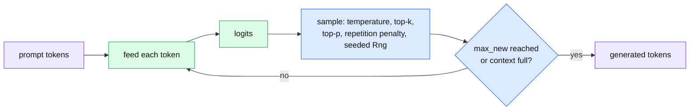


`ferrum_model::sampling::{Params, sample}`: temperature (0 is exact argmax, first maximum wins), top-k,
top-p and a repetition penalty over recent tokens, drawing from the seeded `Rng`. The shared
`engine::generate_with` feeds the prompt, then samples until `max_new` tokens or a full context.

## 10. The front ends

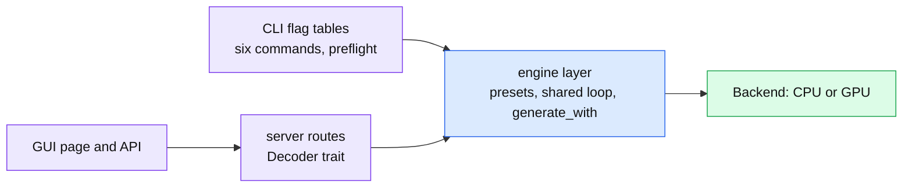


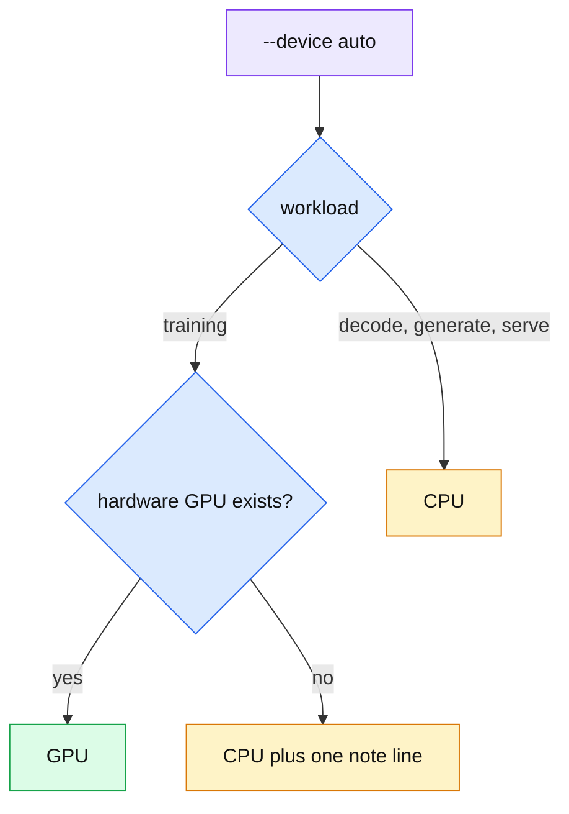


- **Engine layer** (`ferrum_gpu_core::engine`): presets (`tiny`, `small`, `medium`, byte vocabulary), the
  shared training loop, `generate_with`, and `trait Backend { kind, name, train, generate }` with a
  `CpuBackend` (the oracle) and a `GpuBackend`. Everything above this line is device-agnostic.
- **CLI** (`ferrum_gpu_cli`): a flag-table parser (unknown, repeated or valueless flags are errors), the six
  commands, `device::decide` (the `auto` rule, a pure function over an adapter table) and `preflight`.
- **Server** (`ferrum_gpu_server`): routes over a `Decoder` trait (a stub in tests, `ModelDecoder` in the
  binary, which serialises calls). Built on the GUI crate's std-only HTTP server: loopback only, a Host and
  Origin guard, bounded request sizes.
- **GUI and browser** ([gui.md](gui.md), [browser-webgpu.md](browser-webgpu.md)): the page talks to the server
  API and can run inference in the tab on WebGPU using the registry's shaders.

### The `auto` device rule

| Workload | `auto` chooses | Evidence |
|---|---|---|
| Training | a hardware GPU if one exists (software adapters do not count), else the CPU with one `note:` line | [train-speed](train-speed.md): 1.3x to 5.5x over the 8-thread CPU step |
| Decoding, generation, serving | the CPU | [decode-crossover](decode-crossover.md): no GPU win up to 34M parameters on the two adapters tested |

`--device cpu` and `--device gpu` are never overridden. Larger models, other GPUs and multi-token decode
were not measured.

## 11. Testing strategy (summary)

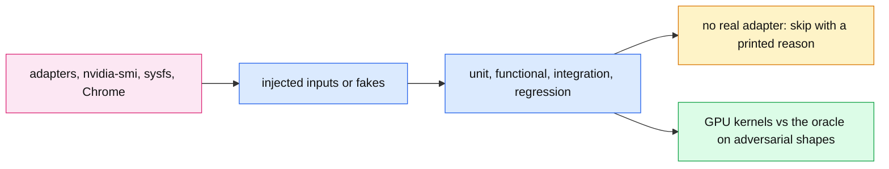


Unit tests per file; functional tests per feature; integration tests per module; a regression test with every
fix. GPU kernels are tested against the oracle on adversarial shapes and with fault sweeps that pin command
counts. External things (adapters, `nvidia-smi`, sysfs, Chrome) are injected or skipped with a printed reason.
Details and coverage are in [developing.md](developing.md) and [coverage.md](coverage.md).

## 12. Non-goals

Per-vendor backends, f16 or mixed precision, multi-GPU, activation recomputation, `wasm` builds of the
engine, training in the browser, and any dependency on ferrum-cpu.
