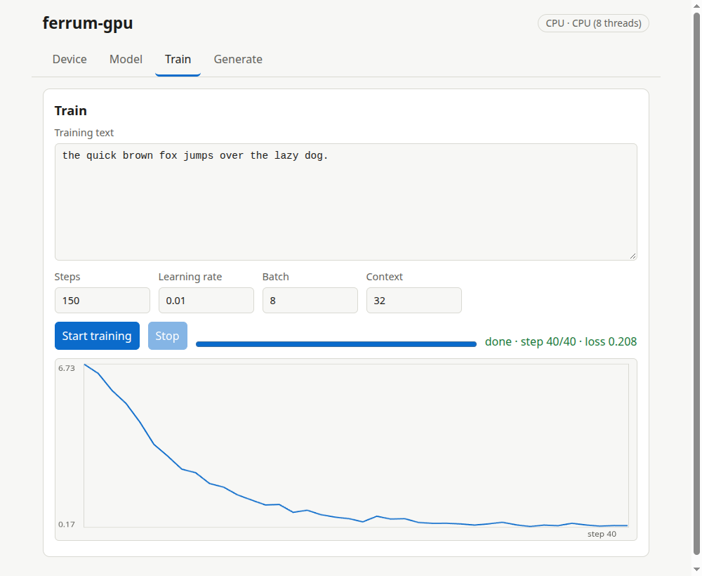

# Phase 5b: inference in the browser on WebGPU (2026-11-11)

**Result: the gate is met.** A small JavaScript runtime runs Llama / Qwen2 inference in a browser tab on WebGPU, using the **same WGSL kernel files** as the native engine, and its logits match the CPU oracle on all 6 test cases at every position of a short context on **three different WebGPU adapters in Chrome**: the NVIDIA GeForce MX330 (reported as `nvidia/pascal`), the Intel Iris Xe (`intel/gen-12lp`) and SwiftShader (software). Worst relative error 6.0e-6 against a 1e-4 tolerance. It is also fast enough to be usable, but, like native decode, it is **slower than one CPU thread**.

## How it works

- `ferrum_wgpu::shaders` lists every kernel by `group/name` plus the `gid` prelude; the GUI server serves them at `/shaders/<group>/<name>.wgsl`. The page compiles exactly those files. A unit test keeps the list equal to the files on disk, and all 51 kernels are compiled and validated with `naga` (no GPU needed).
- `web/gguf.js` reads GGUF v3 (F32, F16, Q8_0, Q4_0): dequantisation is the same two-step arithmetic as `ferrum_gguf::quant::decode`, and `packQ` produces the same device layout as `ferrum_wgpu::ops::quant::pack`.
- `web/webgpu.js` wraps the device: it asks for the adapter's own buffer-size limits (everything else stays at the WebGPU baseline), refuses a tensor larger than the binding limit naming it, builds pipelines from the served kernels, and records one command encoder per token.
- `web/llama.js` (`BrowserLlama`) is the browser twin of `GpuLlama`: the same dispatch sequence and uniform layouts for `feed` (one token with a KV cache) and `forwardAll` (a whole sequence), f32 or packed Q8_0/Q4_0 per matrix as stored in the file, optional q/k/v biases, tied heads, NORM and NEOX RoPE with host-built tables, `rope_freqs.weight` and linear scaling; unsupported RoPE scaling is refused rather than run wrong.
- One deliberate difference: `gemv.wgsl` uses a 1024-invocation workgroup, above the 256 that WebGPU guarantees, so single-row projections in the browser use `matmul_blocked4` (256 invocations) instead. That is the only kernel substitution.
- The Generate tab's *Run on: this browser* downloads the current model from the server as GGUF and decodes on this tab's GPU. Greedy output equals the server's (checked in the Chrome UI run); with a temperature the browser uses its own seeded sampler, so sampled text is not bit-identical to the server's.

## What was verified, and how

| Check | Where it runs | Result |
|---|---|---|
| GGUF reader, f16/Q8_0/Q4_0 decode, device repack, RoPE tables, 1-D dispatch geometry, hostile files | Node 24 (`js_tests/reader.test.mjs`, launched from `tests/browser_webgpu.rs`) | 1085 checks equal to values the Rust side produced from the same bytes (decode and repack bit for bit; RoPE tables within f32 rounding, 2e-7); truncated, bad-magic, wrong-version and absurd-count files are errors |
| Logits vs CPU oracle: 6 cases (llama f32; qwen2 f32 with biases, NEOX and a tied head; MQA with partial rotary; scaled RoPE; llama Q8_0; qwen2 Q4_0 with biases), decode at every position and whole-sequence | headless Chrome, three adapters | all pass; worst 5.99e-6 (MX330), 4.65e-6 (Xe), 5.36e-6 (SwiftShader) |
| Train on the server, download the GGUF, generate in the browser | headless Chrome UI run | the browser's text equals the server's greedy text |

For quantised files the oracle is the model *decoded from the same bytes*, so these tests check the kernels and the repack, not how good Q8_0 or Q4_0 are as approximations.

## Speed (ms per token, single-stream decode)

Chrome (headless, `--use-gl=angle --use-angle=vulkan`) on the same laptop as the native benchmarks, `cargo test -p gpu_gui --test browser_bench -- --ignored`, the three shapes of `docs/llama-speed.md` with random weights, mean of 48 tokens after a 4-token prompt (includes one submit and one readback per token, like the native numbers). One run per adapter; numbers move about 20% run to run.

| adapter (in the browser) | shape | f32 | Q8_0 | Q4_0 |
|---|---|---|---|---|
| NVIDIA MX330 | small | 3.71 | 3.64 | 3.87 |
| NVIDIA MX330 | medium | 8.43 | 4.94 | 4.92 |
| NVIDIA MX330 | large | 17.72 | 9.72 | 9.01 |
| Intel Iris Xe | small | 7.28 | 6.05 | 5.00 |
| Intel Iris Xe | medium | 11.43 | 8.50 | 9.62 |
| Intel Iris Xe | large | 28.97 | 13.33 | 13.11 |
| SwiftShader (software) | small | 67.80 | 5.30 | 4.69 |
| SwiftShader (software) | medium | 452.20 | 28.79 | 23.43 |
| SwiftShader (software) | large | 1890.56 | 122.91 | 88.51 |

Against the native engine on the same machine (from `docs/llama-speed.md`, ms/token; CPU is one thread):

| shape | CPU f32 | native MX330 f32 / Q8_0 | browser MX330 f32 / Q8_0 | native Xe f32 / Q8_0 | browser Xe f32 / Q8_0 |
|---|---|---|---|---|---|
| small | 0.08 | 1.93 / 2.22 | 3.71 / 3.64 | 5.95 / 6.58 | 7.28 / 6.05 |
| medium | 1.65 | 4.87 / 6.36 | 8.43 / 4.94 | 9.66 / 10.24 | 11.43 / 8.50 |
| large | 7.75 | 10.95 / 13.84 | 17.72 / 9.72 | 19.30 / 20.03 | 28.97 / 13.33 |

What to take from it:
- f32: the browser is 1.2x to 1.9x slower than native on the same GPU, as expected (the browser path uses the matmul kernel for one row, adds a layer of validation and an extra copy, and the page's JS orchestrates every token). It is still slower than one CPU thread at every size, the same finding as native.
- Q8_0 and Q4_0: **faster in the browser than native** on the medium and large shapes (for example large Q8_0 on the MX330: 9.72 ms against 13.84 ms). The weights are the same packed layout and the same kernel; the difference most likely comes from the browser's shader compiler and driver path rather than from anything in our code, and it was not investigated further. It is a hint that the native quantised kernel (one invocation per output with a serial loop, see `docs/llama-speed.md`) has headroom, not a claim that browsers beat native in general.
- SwiftShader's f32 numbers are very large (1.9 s per token on the large shape) because a software rasteriser running a 64x64-tile matmul for a single row wastes almost all of its work; quantised weights avoid that kernel and are 15x to 20x faster there.

## What was not run

Firefox and Safari (Firefox's WebGPU is off by default on Linux; Safari needs a Mac); Windows and macOS Chrome (different backends: D3D12 and Metal); any model over about 32M parameters; training in the browser (not implemented; training stays native); models whose single tensor exceeds the adapter's binding limit are refused, not split. The three adapters above were exercised through Chrome's ANGLE/Vulkan path; without `--use-angle=vulkan` Chrome offered only SwiftShader on this machine.
