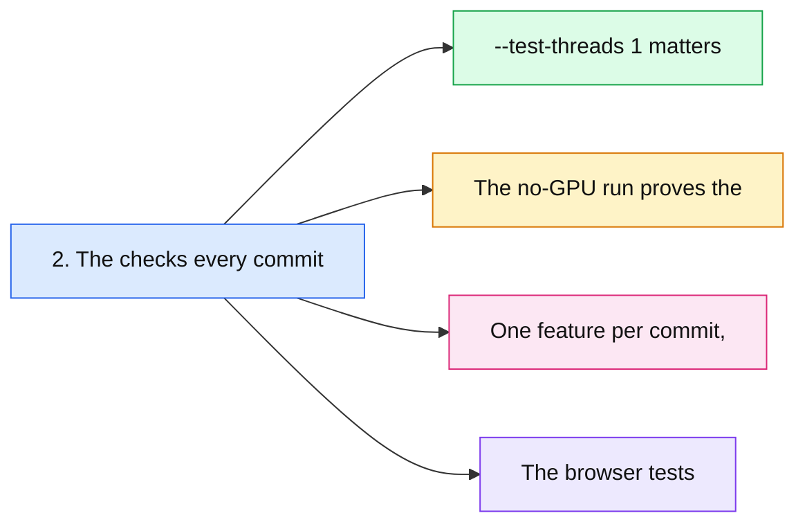
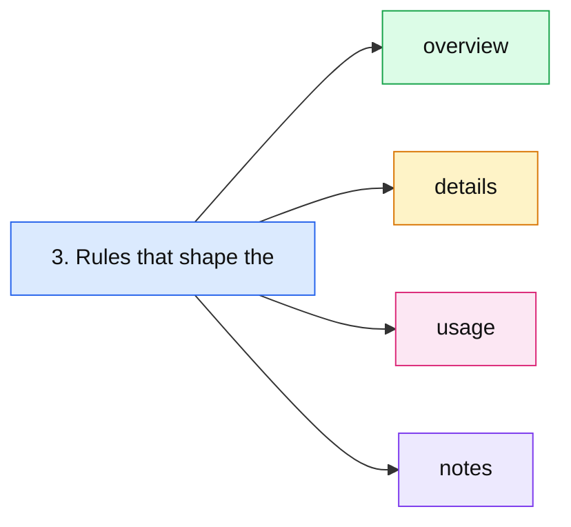
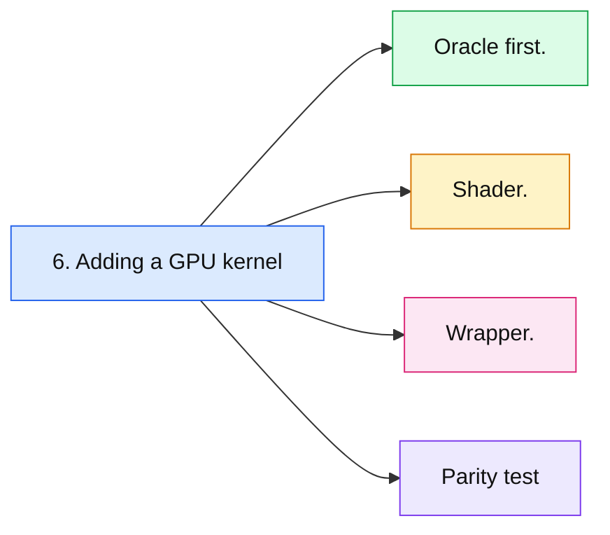
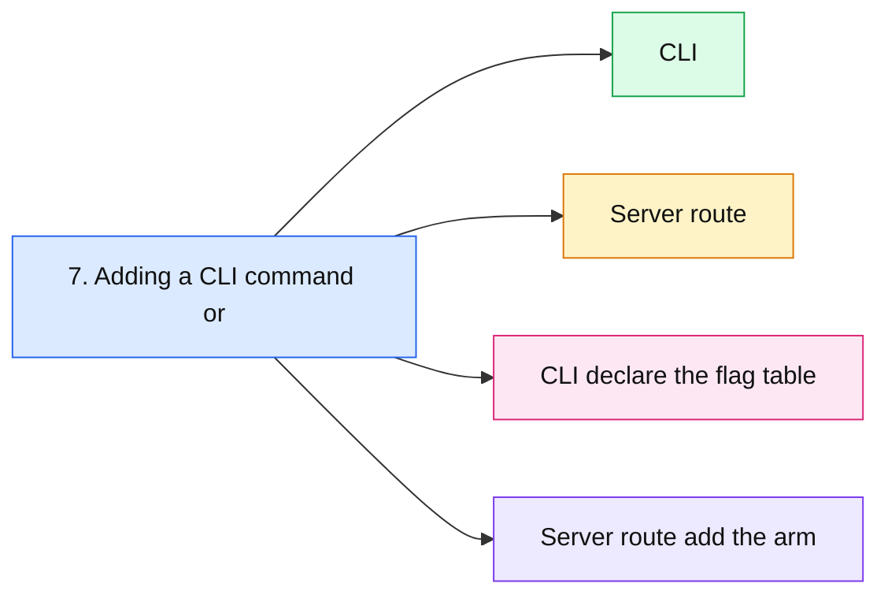
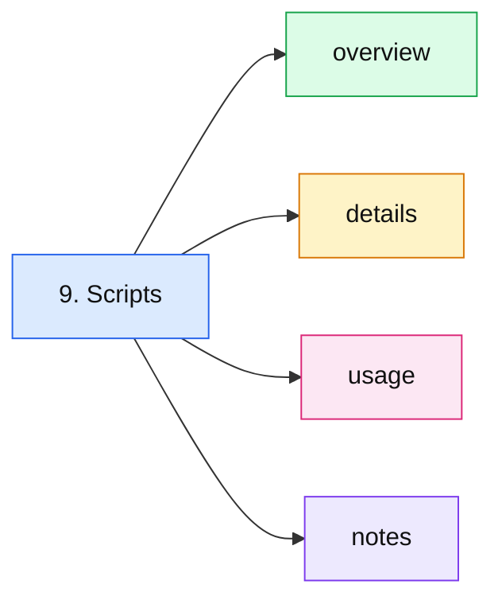
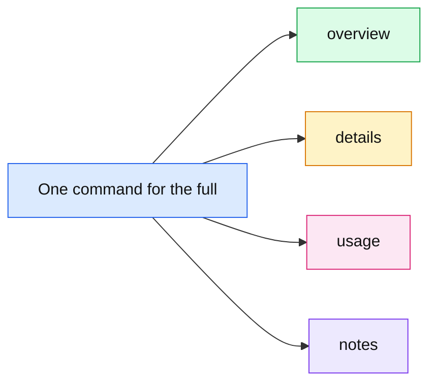
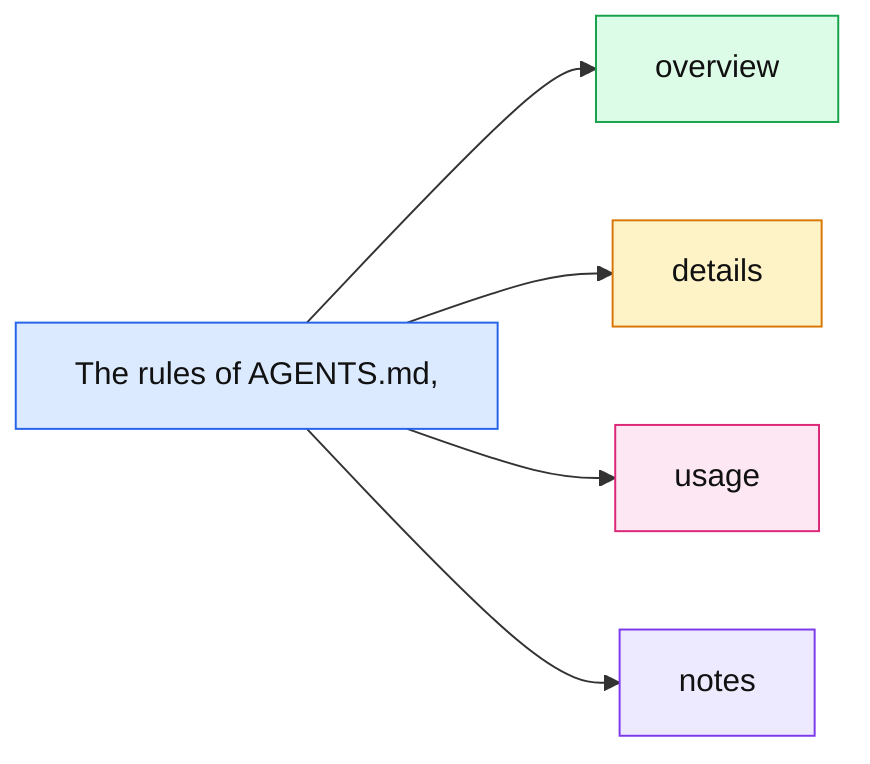

# Developing ferrum-gpu

The binding rules are in [CLAUDE.md](../CLAUDE.md); this page explains how to work within them. For the design
see [architecture.md](architecture.md).

## 1. Setup

```bash
rustc --version        # 1.87 or newer
cargo install cargo-deny cargo-llvm-cov   # optional but used by the gates
git config core.hooksPath scripts/githooks   # once per clone: the commit gate, metrics.md and next-steps.md
git config merge.ours.driver true            # once per clone: a merge keeps its own metrics.md
```

The project assumes a **low-memory machine (15 GB)**: use the settings below, and run one cargo command at a
time.

```bash
export CARGO_BUILD_JOBS=3 CARGO_PROFILE_RELEASE_LTO=off CARGO_PROFILE_RELEASE_CODEGEN_UNITS=16
```

Work in a git worktree on a branch, never directly on `main`; merge and push to `main` only when the owner
asks. Note that some tooling bases new worktrees on `origin/main` rather than the local `main`; check with
`git log` and `git reset --hard main` if the local `main` is ahead.

## 2. The checks every commit must pass




```bash
cargo fmt --all -- --check
cargo clippy --workspace --all-targets -- -D warnings
cargo deny check
cargo test --workspace -- --test-threads 1          # real GPU
FERRUM_GPU_ADAPTER=no-such-adapter cargo test --workspace -- --test-threads 1   # no GPU
```

- `--test-threads 1` matters: concurrent GPU device opens can fault some drivers.
- The no-GPU run proves the suite passes on a machine with no adapter; GPU-only tests skip with a printed
  reason. To exercise other adapters, set `FERRUM_GPU_ADAPTER` to a fragment of the adapter's name (for
  example `llvmpipe` or `Xe`).
- One feature per commit, Conventional Commit subjects (`feat(6.2): ...`, `fix: ...`, `docs: ...`).
- The browser tests (`ferrum_gpu_gui/tests/browser_*.rs`) launch headless Chrome in its own process group and
  kill only that group. They skip when Chrome is absent. Never `pkill` a browser by name: the machine also
  runs yours. The slow benchmark test is `#[ignore]`.

## 3. Rules that shape the code




| Rule | In practice |
|---|---|
| Independence | No dependency or file read reaching outside this repository; copy code in with a provenance header (source path and ferrum-cpu commit). `tests/tests/test_independence.rs` enforces it, including `include_str!` paths |
| Tests first, for everything | Every file has unit tests; stubs and fakes stand in for GPUs, `nvidia-smi`, sysfs and Chrome |
| `#![forbid(unsafe_code)]` | In every crate root; never call a dependency's `unsafe fn` |
| No invented numbers | Every figure in the docs comes from a real run, with adapter, driver, backend, OS, `wgpu` version and date; say what was not run |
| Modular files | One concern per file with a small public surface; split at roughly 500 lines of non-test code; big test modules go in a sibling `tests.rs` |
| Deliberate shortcuts | Marked `// ponytail:` with the ceiling and the upgrade path |
| Hardware-only code | Isolated in small files so the rest stays fully testable |

## 4. Coverage

```bash
FLOOR=99 scripts/coverage.sh    # needs cargo-llvm-cov; run alone
```

It merges a real-GPU run with a no-GPU run (the skip branches only run in the second) and fails below
`FLOOR`. Raise the floor only to a figure a real run has met. Every coverage run also rewrites the coverage section of [metrics.md](../metrics.md) (commit, date, totals, per crate, least covered files). Current numbers and what they do and do not
mean (the browser JavaScript has no line coverage; the thin `main.rs` files are uncovered) are in
[coverage.md](coverage.md). Phase 6 code has not yet been added to that measurement.

## 5. Benchmarks

Std-only, in `ferrum_wgpu/benches/`:

```bash
cargo bench -p ferrum_wgpu --bench matmul          # Phase 0/2 matmul kernels vs the tuned CPU matmul
cargo bench -p ferrum_wgpu --bench decode          # cached single-token decode, CPU vs GPU
cargo bench -p ferrum_wgpu --bench train           # full training step, CPU vs GPU
cargo bench -p ferrum_wgpu --bench llama           # Llama decode, fine-tune, size table
cargo bench -p ferrum_wgpu --bench profile_train   # where a training step spends its time
cargo bench -p ferrum_wgpu --bench capability   # real-size shapes (135M to 1.78B, random weights): what fits and how fast; see capability.md
```

Rules for reporting: record the adapter, backend, driver if known, OS, `wgpu` version, profile and date; give
medians over several runs; label rows that were not run as plan-only; note run-to-run variance (it is real:
see the QAT section of [train-speed](train-speed.md)). Speed gates compare against the **tuned** CPU matmul
in `ferrum_ref::tuned`, never the simple oracle.

## 6. Adding a GPU kernel




1. **Oracle first.** Write the operation in `ferrum_ref` (host `f32`, plain slices) with unit tests; for a
   backward pass, add a finite-difference check.
2. **Shader.** Add `ferrum_wgpu/src/shaders/<group>/<name>.wgsl` (f32/u32/i32 only, fixed reduction order, no
   atomics) and register it in `shaders.rs`. The registry test checks the list equals the files on disk and
   compiles every entry with `naga`.
3. **Wrapper.** Add a function in the matching `ops/*.rs` that takes resident `GpuBuf`s, looks the pipeline up
   with `pipe!(gpu, "group/name")`, launches with `dispatch_1d` or `dispatch`, and returns errors as values.
4. **Parity test** against the oracle on adversarial shapes (sizes of 1, odd, not multiples of the workgroup
   size, non-square), using a tolerance from `tolerance.rs`. A fault sweep that pins the number of commands
   catches accidental extra dispatches. The test must skip, printing why, when no adapter opens
   (`open_for_test()`).
5. **Plan the buffers** in the engine's `BufferPlan` so the pre-flight sees them.
6. **Determinism.** Run twice and assert identical bits.
7. Do not loosen a tolerance to make a test pass; a failure is a bug.

## 7. Adding a CLI command or server route




- **CLI:** declare the flag table (`val`, `switch`) in `ferrum_gpu_cli/src/cmds/mod.rs`, add the match arm in
  `run`, implement the command as `fn(&Args, &mut dyn Write) -> Result<(), String>`, and test it with the CPU
  backend in `cmds/tests.rs`. Put anything that touches a device behind the `Backend` trait so a fake can
  stand in; use `cmds::gate` for the memory pre-flight. Update `USAGE`, [user-guide.md](user-guide.md) and, if
  you have real output, [cli.md](cli.md).
- **Server route:** add the arm in `ferrum_gpu_server/src/routes.rs`, validate every field with a range, return
  `{"error": ...}` with a 4xx status for bad input, and cover it in `routes/tests.rs` against `StubDecoder`.
  Extend the `Decoder` trait only if the route needs the model; implement it in `ModelDecoder` too.
- Keep both loopback-only and bounded (request size, prompt size, token counts).

## 8. Adding a model feature

Add it to the CPU model and the GGUF mapping first (and refuse, rather than approximate, anything you do not
support), then the GPU path with parity tests at every position of a full context. See
[gguf.md](gguf.md) for the refusal policy.

## 9. Scripts




| Script | Purpose |
|---|---|
| `scripts/coverage.sh` | Merged GPU and no-GPU line coverage (section 4); records the run in `metrics.md` |
| `scripts/metrics.py` | Regenerates [metrics.md](../metrics.md): size, tests, structure, dependencies, history, the last gate's timing and the last coverage run. `--next-commit` (the pre-commit hook), `--coverage FILE`, `--gate gate.txt`. Unit tests: `python3 scripts/test_metrics.py` |
| `scripts/githooks/pre-commit` | Runs `metrics.py --next-commit` and adds `metrics.md` to the commit; never blocks a commit |
| `scripts/gate.sh` | The full gate (fmt, clippy, adapters, interop, coverage, deny, desktop app); records its timing in `metrics.md` |
| `scripts/statusline.sh` | Records the context-window usage from the status-line JSON in `.superpowers/context.json`, then delegates to your own status line (`FERRUM_STATUSLINE_DELEGATE`) |
| `scripts/handoff_check.sh` | Hook that, once usage reaches 98% (`HANDOFF_AT` overrides), tells the agent to write `handoff.md` |

Both context scripts have tests in `tests/tests/test_context_scripts.rs`.

## 10. Hand-offs between sessions

`handoff.md` holds the exact state (what is merged, what is in progress, gotchas); `next-session.md` holds the
start procedure and the remaining plan. A fresh session reads them in that order plus `CLAUDE.md`, then adds a
"consumed" line at the top of `handoff.md`. Keep `handoff.md` current at each phase boundary.

## 11. Documentation standards

- Every public item has a doc comment (`#![warn(missing_docs)]`); `cargo doc --workspace --no-deps` should be
  warning-free.
- Docs state what was and was not run. Do not write a number you did not measure; link the report that holds
  it.
- Keep `plan.md`, the phase file and `handoff.md` in step with reality when a phase moves.

## One command for the full test run and coverage




```bash
scripts/test-all.sh            # all tests in all crates, twice (real GPU, then no GPU), plus merged coverage
FLOOR=98 scripts/test-all.sh   # also fail (exit 2) if total line coverage is below 98
```

It prints a per-run test summary and the lowest-covered files to the console and writes two files in the repository root, overwritten on every run: `last-test-results.md` (passed, failed and ignored per test binary for each run, and the names of failed tests) and `last-coverage-results.md` (total and per-file line, region and function coverage). Exit code: 0 all pass, 1 a test failed, 2 coverage below `FLOOR`. Needs `cargo-llvm-cov` and `python3`; run it alone. Test binaries with the same name in different crates (`api`, `e2e`) are summed in one row. JavaScript under `ferrum_gpu_gui/web/` and the `benches/` programs are not instrumented.

## The rules of AGENTS.md, and what enforces them




| Rule | Enforced by |
|---|---|
| No source or test file over 100 lines; Markdown names lowercase kebab-case; the five required files exist | `scripts/rules_check.py` (pre-commit and gate). Files already over the limit are recorded as debt in `scripts/rules-baseline.json`: they may only shrink, new files may not be over. `--report` lists the debt, `--update` records progress |
| No duplicated code | `scripts/dup_check.py` (pre-commit and gate), same ratchet in `scripts/dup-baseline.json` |
| Formatting, lints, static analysis | `cargo fmt --check` in pre-commit; clippy `-D warnings`, `cargo deny` in the gate |
| 100% coverage, all tests green, suite under 30 minutes | `scripts/gate.sh` (floor 100, every test in its own process, per-test times in `test-time-report.md`) |
| CPU and GPU profile | the gate samples every 2 s (`scripts/system_profile.py`) into `system-profile.md` |
| The gate passes before every commit | the pre-commit hook runs `scripts/gate_key.py --check` (a hash of the staged content without the generated reports) and runs `scripts/gate.sh` itself when no passing gate exists for that content; project rule 19 in `AGENTS.md` |
| No push without a passing gate | `scripts/githooks/pre-push` runs `scripts/gate_ok.py`: a gate must have passed on a tree equal to HEAD's apart from the generated reports |
| `metrics.md`, the readme figures, documentation diagrams, `next-steps.md` current | the pre-commit hook regenerates each (`metrics.py`, `readme_stats.py`, `docs_diagrams.py`, `next_steps.py`) and stages what changed; the pre-push hook refreshes `next-steps.md` |

