# Studio plan (version 2, 2026-11-17): a self-contained desktop app, built for small and for very large GPUs

Version 1 of this plan had the GUI run `ferrum-gpu` as a child process. The direction changed the same day:
**the Studio must be self-contained, a desktop application like ferrum-cpu's "SLM Studio", with the changes a GPU
engine needs, and designed to run on very powerful GPUs such as an Apple M5 Max.** This version replaces version 1;
phases 1 to 3 of version 1 are done and kept (they are the page, not the plumbing).

## What ferrum-cpu's Studio is (read from `ferrum-cpu/ferrum_gui`, never modified)

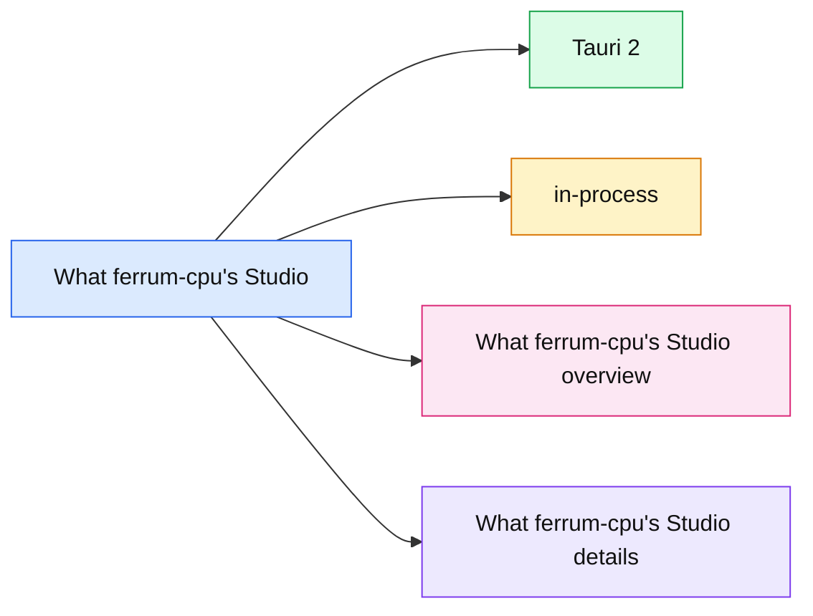


A **Tauri 2** desktop app (`tauri`, `tauri-plugin-dialog`), in its own crate outside the main workspace with its own
lockfile, whose Rust side links the engine **in-process** (no child processes) and exposes it as `#[tauri::command]`
functions; the page is vanilla HTML/CSS/JS under `ui/`, with a strict CSP (`script-src 'self'`, no inline script or
style), twelve tabs, Beginner/Expert mode, a tool-tip on every control, live estimates, native file dialogs, and
progress streamed to the page. Its CLI crate is also a library that the app calls, so there is one implementation of
every command.

## What this repository has now, and what is wrong with it for that goal

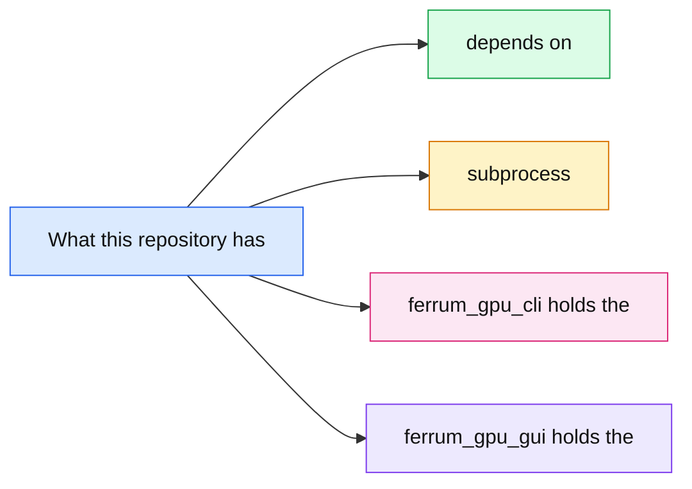

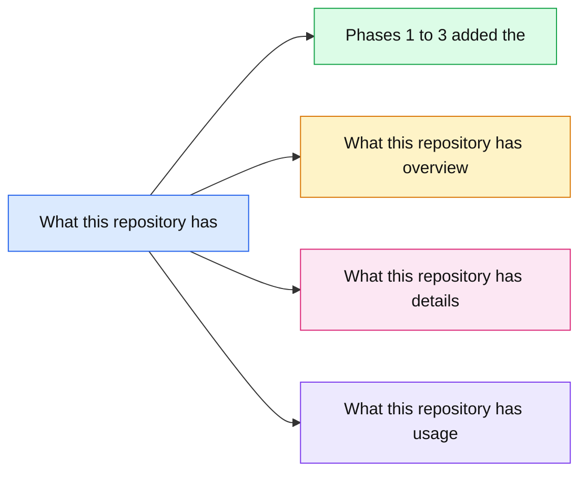


- `ferrum_gpu_cli` holds the commands (train, finetune, eval, generate, prepare, tokenize, exports) behind a flag
  parser, and **depends on** `ferrum_gpu_gui` for the engine layer. The GUI therefore cannot call the commands.
- `ferrum_gpu_gui` holds the engine layer (`Backend`, `CpuBackend`, `GpuBackend`), a std-only HTTP server, JSON, and the
  page embedded with `include_str!`. It trains and generates a byte-level Llama-style model only.
- Phases 1 to 3 added the tabbed shell, a jobs API that runs the CLI as a **subprocess**, a read-only file browser, and the
  Datasets and Prepare tabs. The subprocess runner is the part this plan replaces; the jobs API shape (start, poll with
  `since`, stop; output lines with progress events) and all the page code stay.

## Architecture as built

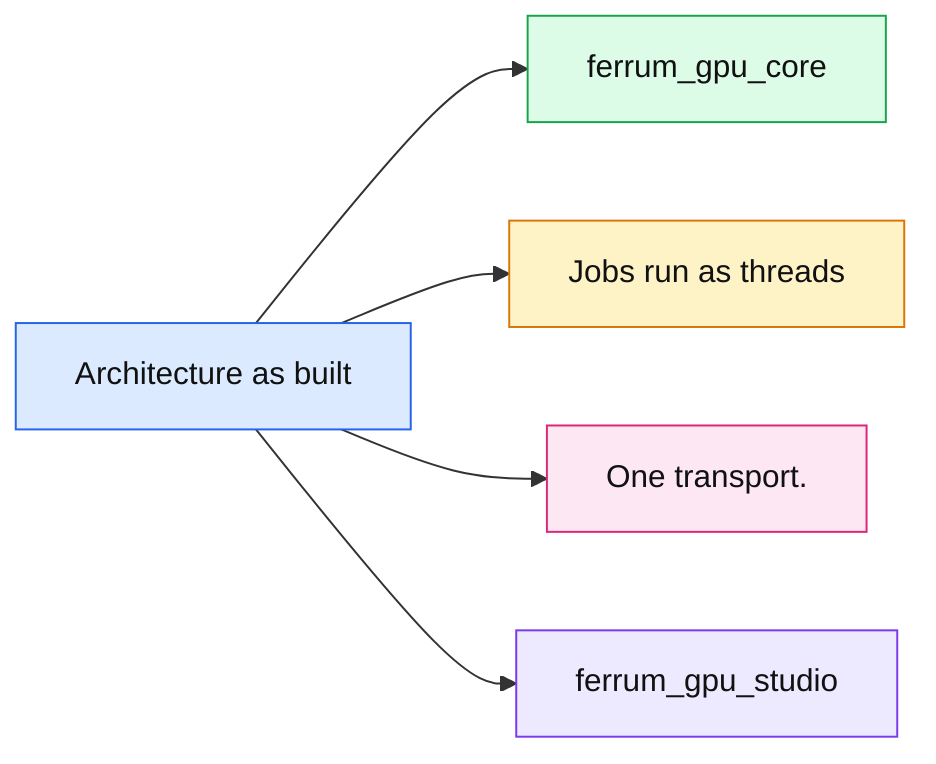

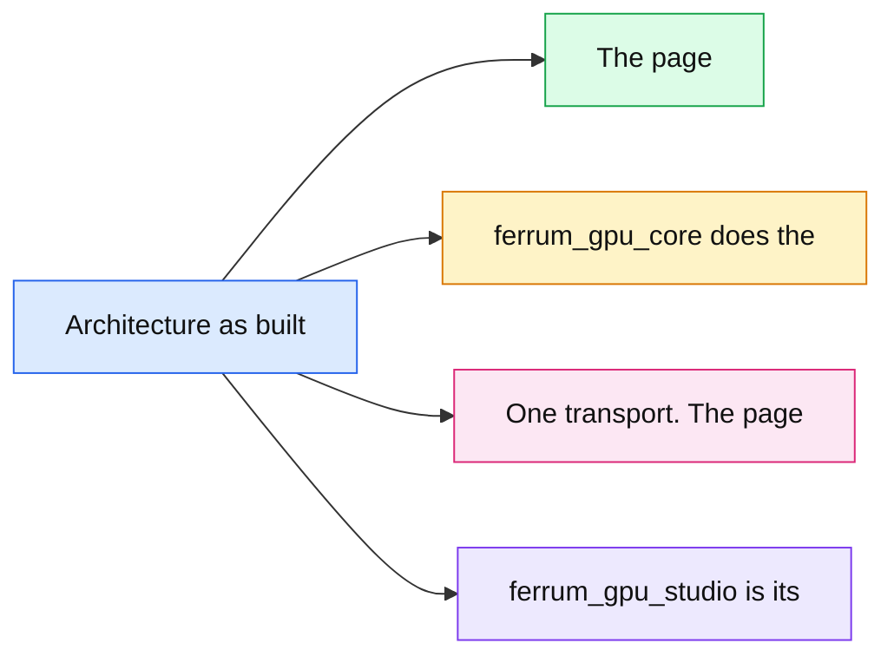


```
  ferrum_gpu_studio                 ferrum-gpu (CLI)          ferrum-gpu-server
  (Tauri 2 desktop app,             a thin main               a thin main
   its own workspace)               over commands::run        over serving::boot::boot
        |                                  |                          |
        | starts the GUI's loopback        |                          |
        | server in-process and            |                          |
        | shows it in a native window      |                          |
        v                                  |                          |
  ferrum_gpu_gui (HTTP routes + the page, embedded)                   |
        |                                  |                          |
        +----------------------------------+--------------------------+
                                           |
                                  ferrum_gpu_core
     commands (argument list in, report out) · jobs (a thread per job, a cancel flag) ·
     serving (the JSON server: routes, auth, decoders, boot, an in-process host) ·
     engine (Backend: CPU and GPU) · session (device choice) · modelinfo (GGUF inspection) ·
     capacity (what fits) · fsapi (read-only file browser) · http, json, cancel, stop, tokenizer
                                           |
              ferrum_wgpu · ferrum_ref · ferrum_model · ferrum_gguf · ferrum_tok
```

- **`ferrum_gpu_core`** does the work. Every command is a function from an argument list and a `Write` to a result, so the
  command line, the server and the Studio run the same code; a test checks that no front end depends on another.
- **Jobs run as threads in-process.** A command that fails returns an error and one that panics is caught, so a device
  fault ends the job, not the application. Stop raises the job's cancel flag, which training and generation poll; the `.stop`
  file stays for the command line.
- **One transport.** The page talks to the loopback HTTP server (Host and Origin guard, strict Content-Security-Policy). The
  desktop app runs that server inside its own process and shows it in a native window; the same page also runs in an
  ordinary browser, which is how it is tested in real Chrome.
- **`ferrum_gpu_studio`** is its own Cargo workspace with its own lockfile, so Tauri and its system libraries (webkit2gtk
  and friends) stay out of the main workspace and its `cargo deny`; it has its own CI job.
- **The page** lives in `ferrum_gpu_gui/web/` (one module per tab under `web/tabs/`) and is embedded in the binary.
- Not planned: a mobile build, auto-update, code signing (steps for the owner).

## Is a desktop app better than a web app for performance?

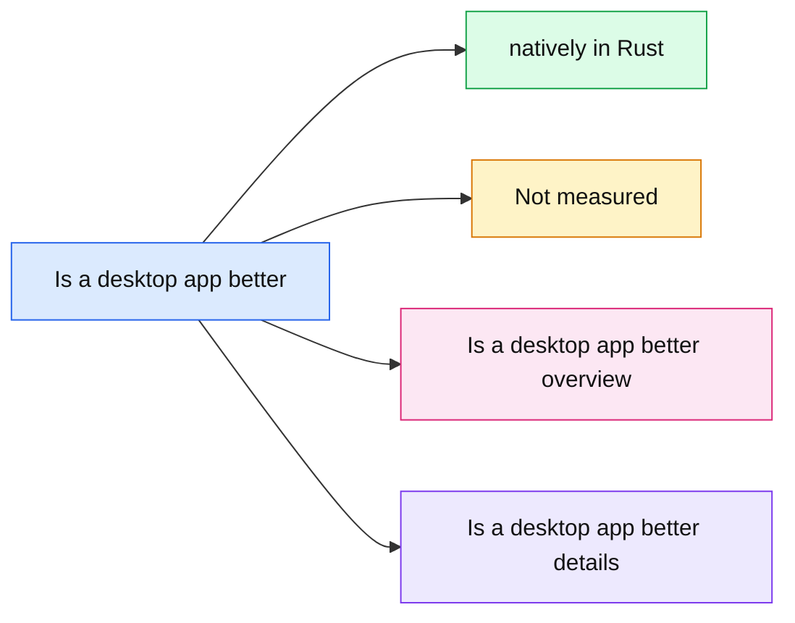

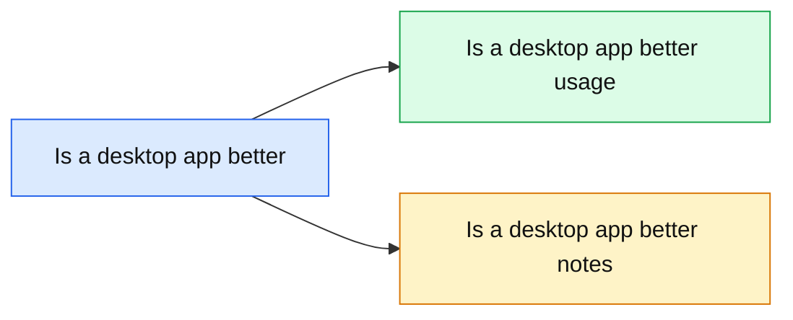


The computation never ran in the page. Training, decoding and the exports run **natively in Rust** (wgpu on the GPU, or the
CPU reference) inside the application process, in both the browser case and the desktop case. The page only draws forms,
tables and the loss chart, and polls for text every few hundred milliseconds. So the limits of a *web app* (the browser's
WebGPU limits, its memory caps, its sandbox) apply only to the optional "this browser (WebGPU)" runner of the Lab tabs, not
to the Studio. The desktop window therefore does not change engine speed; what it changes is packaging (an application you
launch, with no browser to start and no open tab). **Not measured:** the cost of the window itself (webview start-up, loopback
polling, drawing very long charts); at the volumes here it is small, but it has no number. A fully native interface (egui or
iced) would remove the webview at the price of rewriting the tested page, and is worth doing only if a measurement shows the
interface, not the engine, is the bottleneck. Note one practical difference: the Linux window is WebKitGTK, which has no
WebGPU, so the browser runner is unavailable there (generation then runs on the server side of the application).

## Decisions taken while building (2026-11-17)

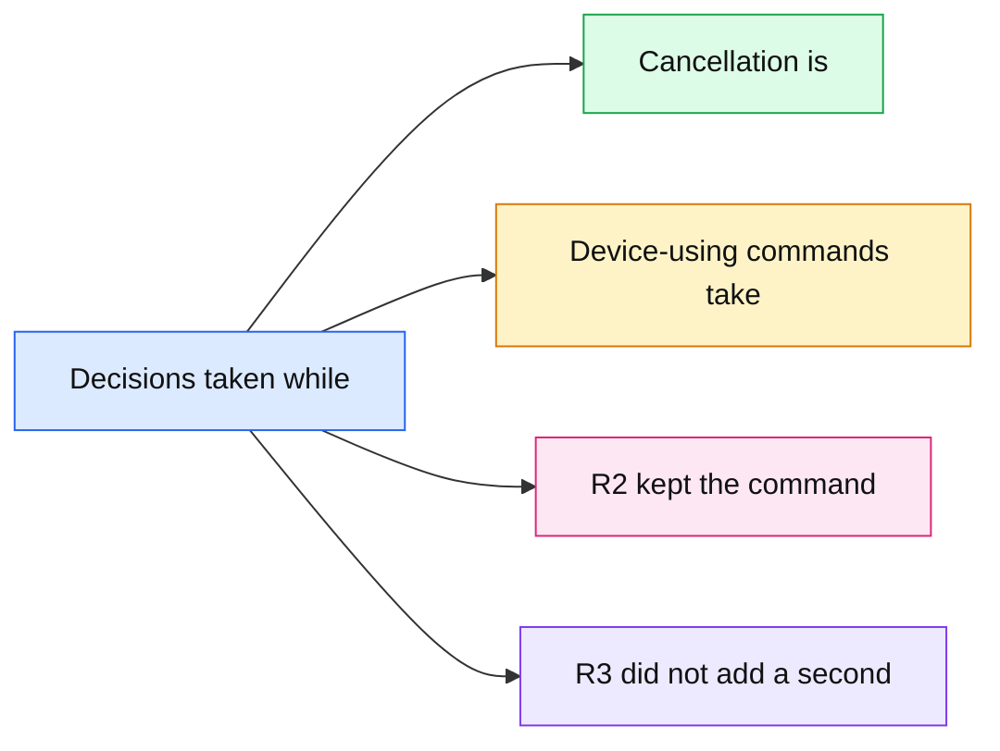

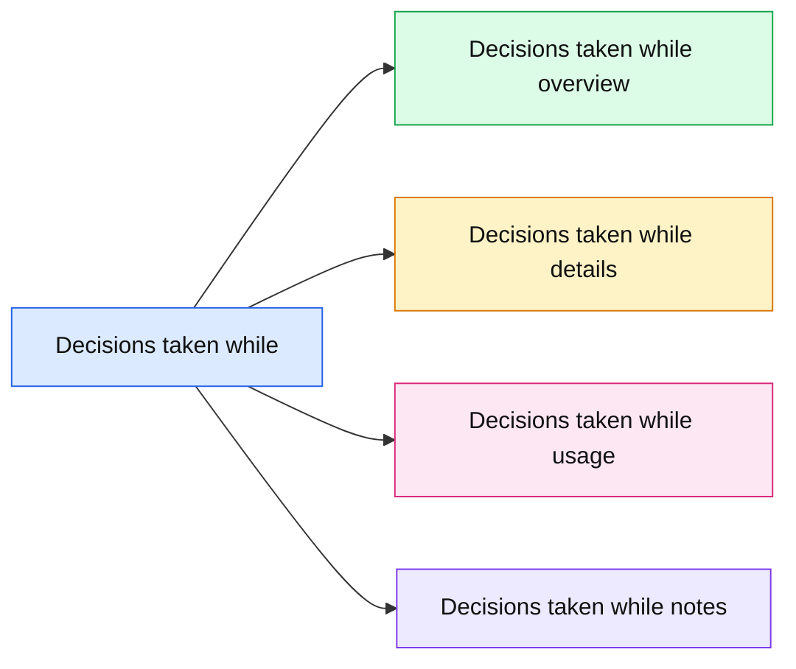


- **R2 kept the command interface as "argument list in, report out".** Instead of a second typed-options layer that
  could drift from the CLI, the whole command layer moved into `ferrum_gpu_core::commands`; a job calls
  `commands::run(argv, &mut sink)`. The CLI is a three-line `main`; the page builds the same argument lists from its
  forms (`web/tabs/args.js`, tested under node).
- **R3 did not add a second transport or move the page.** The desktop app runs the GUI's loopback server in-process
  and points its window at it, so there is one transport (HTTP), one guard (Host/Origin), and one page. What the app
  needed from the page was a strict Content-Security-Policy, now sent on every static response and tested
  (`tests/csp.rs`). `rpc.js` and a `ui/` move are dropped; native file dialogs are not used (the page has its own
  server-side file picker). Revisit if a native-only feature needs Tauri commands.
- **Cancellation is cooperative.** Stop raises the job's flag; training (both trainers), generation and the byte
  model's loop poll it. `prepare`, `tokenize` and the exports have no check and run to their end; the UI says so.
- **Device-using commands take turns** (adapter enumeration is not safe from several threads); the others run beside them.

## Phases

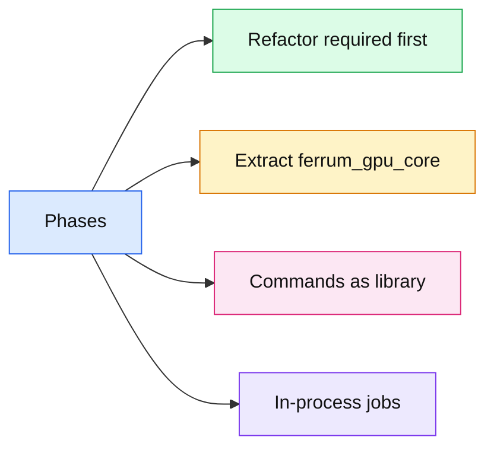

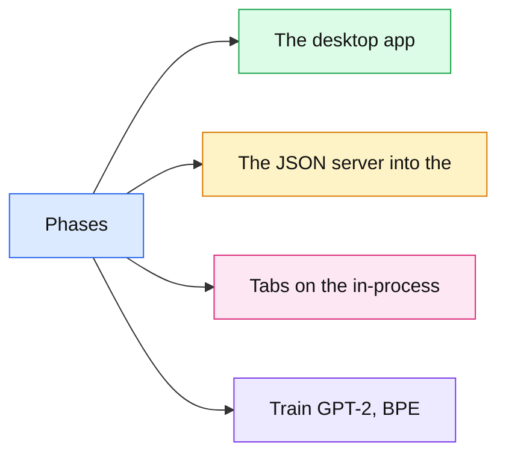


**Refactor (required first)**

| # | Phase | Deliverable | Tests |
|---|---|---|---|
| R1 | **Extract `ferrum_gpu_core`** (done) | Move the engine layer, JSON, tokenizer, cancel and stop helpers out of the GUI crate into the new library; the GUI, CLI and server depend on it | the moved code's tests move with it; workspace stays green; dependency-direction test |
| R2 | **Commands as library functions** (done) | The whole command layer moved into `ferrum_gpu_core::commands` (argument list in, report out); the CLI is a three-line `main` | the CLI's tests moved with the code and stayed green; a dependency-direction test |
| R3 | **In-process jobs** (done) | `core::jobs` (a thread per job, a line sink, a per-job cancel flag, device-using commands take turns), the file browser in core, the subprocess runner deleted, a strict Content-Security-Policy on every page | fake-runner tests; the real commands in-process; cancellation of a real training; `csp.rs`; the Chrome tests |
| R4 | **The desktop app** (done) | `ferrum_gpu_studio`: Tauri 2 window around the in-process loopback server, icons, bundle config; CI job per OS (Windows builds but its unit tests do not start, see `ci.yml`); `cargo deny` for it | mock-runtime tests (no display); one real launch checked by hand: the window opened at 1320 by 880 |
| R5 | **The JSON server into the core** (done) | `ferrum_gpu_core::serving` (routes, auth, decoders, `boot`, an in-process `ServeSlot`); `ferrum_gpu_server` is a thin `main` | the 244 core tests include the moved ones; the 7 end-to-end tests drive the real binary; the Serve tab starts and stops it in a real browser |

**Tabs (on the in-process core)**

| # | Phase | Deliverable |
|---|---|---|
| 4 | **Train (GPT-2, BPE)** (done 2026-11-17) | BPE, tie, dropout, QAT, validation share and patience, checkpoint and resume, stop; live loss and validation chart; device, adapter and GPU memory fields |
| 5 | **Fine-tune, Evaluate, Generate** (done 2026-11-17) | fine-tune a GGUF, loss and perplexity, streamed generation with top-k, top-p, repetition penalty |
| 6 | **GGUF and Models** (done 2026-11-17) | one Models tab: find the `.gguf` files in a folder; inspect any model from the first 64 MiB (type mix, every tensor, all metadata); a type the reader does not support is refused, not guessed; choose it for the other tabs |
| 7 | **Export and Serve** (done 2026-11-17) | export GGUF (f32, int8, int4), Ollama, LM Studio with tool detection; run the server in-process with port, token and live log |
| 8 | **System and Capable** (done 2026-11-17) | The Capable tab: what fits per precision and for a fine-tune, the decode-speed ceiling, and this machine's adapters with their memory budgets; the formulas of hardware-caps.md in Rust, **compared by a test with the script's table**. System is the Device tab (features and budget per adapter) plus the machine table; there is no separate System tab |
| 9 | **GPU lab** (done 2026-11-17; the report itself is `ferrum-gpu lab`, which G4 and G5 reuse) | adapter picker, VRAM budget and live meters, CPU-versus-GPU check, precision comparison, the WebGPU self-test and benchmark, a benchmark report anyone can send back |
| 10 | **Polish and docs** (done 2026-11-17) | `tests/a11y.rs` keeps the page markup accessible (language, unique ids, every control named, buttons with text, tabs and panels pointing at each other, table headers with scope, live regions); the page already satisfied it, so no markup change was needed. `docs/gui.md` rewritten around the Studio and the desktop app, with an accessibility section that says what is **not** checked (contrast, screen-reader behaviour, the browser-built log and charts); README GUI, command and documentation sections brought up to date (the GUI section had still described a byte-level-only page). Empty and error states were built into each tab and are exercised by the real-Chrome chain (refusals before a job starts, no-adapter, no-model) |

**GPU scale (so a very powerful GPU is used, not just supported)**

| # | Phase | Why and what |
|---|---|---|
| G1 | **Features and the memory budget** (done 2026-11-17) | The device is already opened with the adapter's own reported limits (the roughly 2 GiB per-buffer cap on this machine's two Vulkan adapters is what their drivers report; another backend may report more, which is not run here), so this phase is about **features** (f16, subgroups, cooperative matrix where `wgpu` exposes them: detected, shown, and requested only when a kernel uses them) and reading memory honestly: unified memory from the operating system (a stated fraction is usable), discrete from the driver where it can be read, always shown as an estimate; the pre-flight uses it, which fixes the finding in capability.md that a 4 GB plan "fit" a 2 GB card |
| G2 | **Tensors larger than one binding** (done 2026-11-17) | Weights are stored as column blocks and the token embedding as row blocks when they exceed the binding limit; `Lin::Sharded` and `Embedding::Rows` hide this from the forward pass, and the pre-flight plan lists the blocks (`plan_limited`, `decode_buffers_for`). Tested by lowering the limit on a small model: logits equal the whole model's for f32, biased, tied, Q8_0, Q4_0, decode and many-row prefill. **Not sharded:** the KV cache, the prefill logits (`t x vocab`) and the activations stay single buffers, so a context or sequence whose cache exceeds one binding is still refused with the buffer named. **Not run on a real oversized tensor:** nothing here has a tensor above this machine's 2 GiB limit; the equality tests are the evidence. Block outputs are copied into place and their scratch is allocated per call, so a sharded layer is slower than a whole one (not measured) |
| G3 | **f16 weights** (weights done 2026-11-17; activations and KV cache not done) | `QKind::F16`: weights stored as f16 pairs and widened in the kernel with WGSL's core `unpack2x16float`, so it needs **no `shader-f16` feature** and runs on every adapter (the MX330 and llvmpipe do not report the feature; the Xe does, and nothing uses it). Compute stays f32. The f16 values widen exactly: the kernel's output is bit-identical to the CPU decode of the same f16 weights (test), and decoder logits stay within 5e-3 of f32 (test). `--gpu-weights f32\|f16\|q8_0\|q4_0` chooses the stored precision of a GPU decoder (converted at load; training stays f32); `lab` has an F16 row. **Measured** (`lab --size medium`, release, 2026-11-17): model buffers 52.1 MiB against 99.1 MiB for f32, but no speed gain on this small latency-bound model (decode 55 against 57 tokens/s on the Xe, 90 against 100 on the MX330) and slower prefill (320 against 946, 556 against 1537) because prefill uses the unoptimised per-row quantised kernel: G4. **Not done:** f16 activations and KV cache. The KV write path copies f32 buffers and would need a converting kernel; the cache is small next to the weights at short contexts, so it is deferred, not skipped for good |
| G4 | **Kernels that use the hardware** (quantised linear layers done 2026-11-17; the rest not done) | Two new kernels for the quantised and f16 linear layers (`quant/qlinear_tiled.wgsl`: a 16 x 16 tile that dequantises each weight block once and reuses it for 16 rows; `quant/qgemv.wgsl`: a workgroup of 32 per output column with a tree reduction), chosen per case by `ops_quant::choose` **from measurements, not by assumption**: `cargo test --release -p ferrum_wgpu --lib -- --ignored bench_quant`, 2026-11-17, wgpu 30.0.1, medians of 9 timed runs of 20 launches each. The tiled kernel for prefill (32 rows) against the naive one: **F16 -72% to -78% (Xe), -27% to -33% (MX330); Q8_0 -41% to -46% (Xe), -21% to -30% (MX330); Q4_0 -8% to +11% (Xe), +6% to +15% (MX330), so Q4_0 keeps the naive kernel.** The per-column kernel for decode (one row): wins when the output is no wider than the input (k=512 n=512: Q8_0 -62% Xe, -30% MX330; k=1408 n=512: Q8_0 -68% Xe, -30% MX330; F16 -54% to -60% Xe, +5% MX330; Q4_0 -44% to -50% Xe, -3% to +2% MX330) and **loses on the MX330 when the output is wider (k=512 n=1408 or 2048: +46% to +153%)**, so those shapes keep the naive kernel. End to end (`lab --size medium`, tokens per second, before to after): Xe Q8_0 decode 52 to 68, prefill 659 to 1023; F16 decode 55 to 67, prefill 320 to 1028; Q4_0 decode 63 to 73, prefill 958 to 1023. MX330 Q8_0 decode 78 to 89, prefill 577 to 753; F16 decode 90 to 93, prefill 556 to 772; Q4_0 decode 95 to 95, prefill 802 to 810 (no loss anywhere end to end). All kernels are checked against the CPU matmul for every precision and awkward shapes, and on llvmpipe, the Xe and the MX330. **Prefill is now about 1000 tokens/s at every precision on the Xe, so the linear layers are no longer the limit; the next place to look is attention and per-dispatch cost, not measured here.** **Not done:** fused attention, batched decode (several sequences per step), and a subgroup variant of the reduction (the workgroup tree reduction is portable; a `subgroupAdd` version needs `enable subgroups;` and is the next experiment). **Cooperative matrix: not done, requires `unsafe`:** in wgpu 30 the feature is `EXPERIMENTAL_COOPERATIVE_MATRIX`, and requesting an experimental feature needs `ExperimentalFeatures::enabled()`, which is an `unsafe fn`; rule 4 forbids calling it. The thresholds in `choose` come from two adapters; an Apple GPU has not been run |
| G5 | **Verification kit for hardware this machine does not have** (done 2026-11-17; no report from other hardware yet) | `ferrum-gpu lab --json` is the one-command report (adapter, driver, backend, wgpu version, features, memory budget, six parity checks against the CPU reference with their errors, decode and prefill speed per precision, date); `docs/verification-kit.md` says how to build, run and send it back, and what each result means. The GPU lab tab makes the same report in the Studio. Every row for an Apple M-series chip, and every other adapter not on this machine, stays **not run** until a report exists |

Order: R1 to R5, then G1 (the tabs need real capabilities and memory figures), then tabs 4 to 8, G2, tab 9, G3, G4, G5,
tab 10. Merges to `main` follow the gate (fmt, clippy, four test configurations, time limits, coverage floor, `cargo deny`)
after R1, R3, R4, and after each group of tabs (tabs 6 to 8 with R5 were gated together).

## What cannot be verified here, said plainly

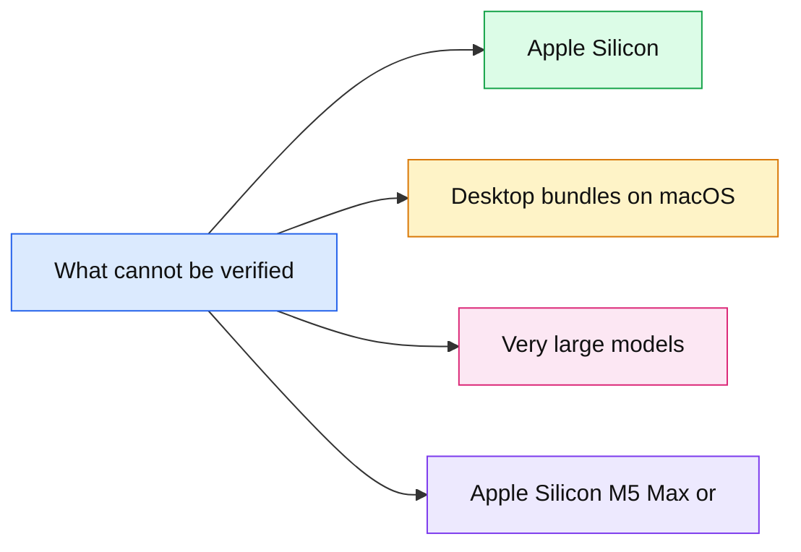

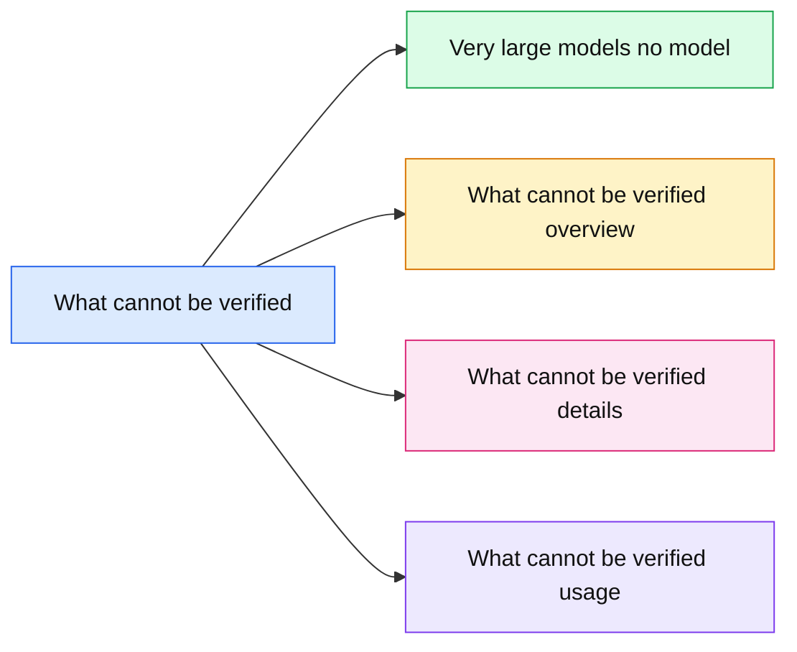


- **Apple Silicon** (M5 Max or any M-series): this machine is Linux with an NVIDIA MX330 (2 GB) and an Intel Xe. The macOS
  CI runner has a paravirtual GPU that already disagrees with the CPU in one test. Everything for Apple is built to be
  correct by construction and by parity tests against the CPU reference on the adapters available, and carries "not run on
  Apple Silicon" until a G5 report from real hardware exists. Speed and memory figures for such machines stay estimates.
- **Desktop bundles on macOS and Windows** (signing, notarisation, installers): configured, built in CI where the hosted
  runners allow, not tested by hand.
- **Very large models**: no model above 1.5B parameters is downloaded (project rule); large-model behaviour is tested with
  random-weight shapes, as in capability.md, and with limits lowered artificially.

## Rules that apply throughout

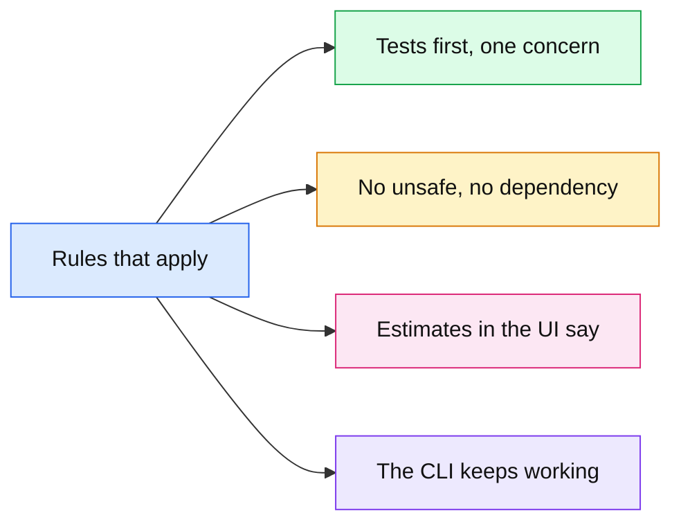


- Tests first, one concern per file, a `tests/` sibling per module; the suite passes with no GPU, no Chrome, no node.
- No unsafe, no dependency outside this repository except the registry crates the app needs (Tauri and its plugin, in the
  app crate only). Jobs run only the fixed list of commands; paths are values, never shell strings.
- Estimates in the UI say they are estimates; no invented figures in the docs.
- The CLI keeps working exactly as before at every step.
