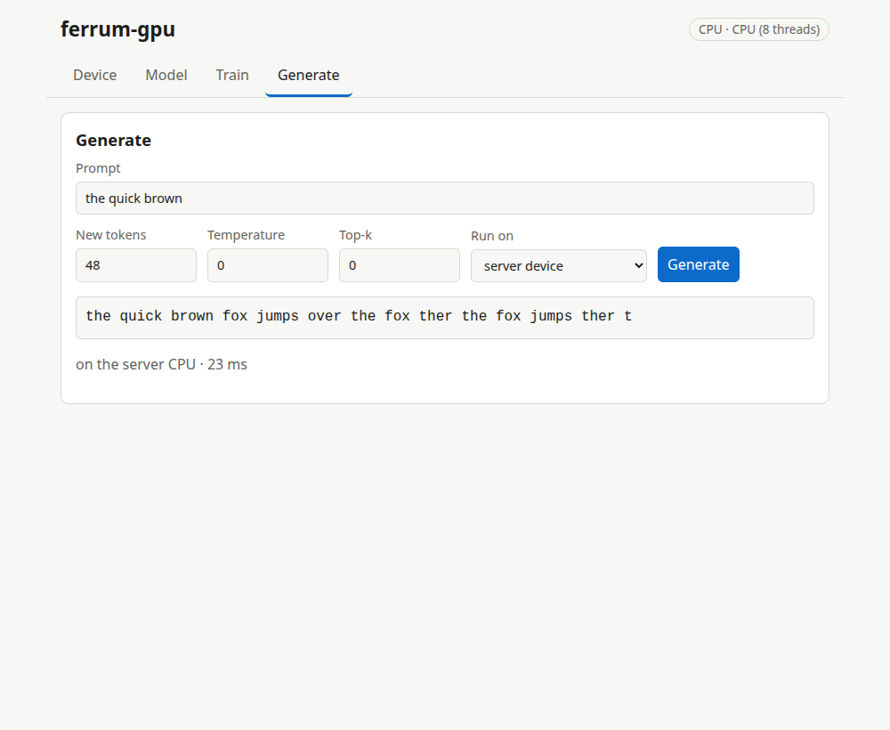

# The ferrum-gpu GUI (Phase 5a)

A local web GUI: pick a device, create a small Llama-style model, train it on text you paste, watch the loss fall, generate text, and move the model in and out as GGUF. It also runs the model **in your browser tab on WebGPU** (Phase 5b, [browser-webgpu.md](browser-webgpu.md)).

```
cargo run --release -p ferrum_gpu_gui                      # picks a free port, device auto
cargo run --release -p ferrum_gpu_gui -- --device gpu --gpu-adapter MX330 --port 7860
cargo run --release -p ferrum_gpu_gui -- --device cpu      # the CPU oracle
```

It prints `ferrum-gpu GUI: http://127.0.0.1:PORT/`; open that URL. Flags: `--port N` (0 = any free port), `--device cpu|gpu|auto` (auto uses a GPU if one opens, otherwise the CPU and says so), `--gpu-adapter NAME` (case-insensitive fragment), `--threads N` (CPU matmul threads). Unknown flags are errors.

## The Studio shell (2026-11-17)

The page is a tabbed Studio: the tabs are a keyboard-operable tab bar (Left and Right arrows, Home and End; hidden tabs are skipped). **Mode** (header): *Beginner* hides the Expert tabs and shows plain-language help; *Expert* shows the technical description. **Theme**: Auto, Light or Dark. Every control has a tool-tip (hover for a moment, or focus it with the keyboard; Escape hides it), and each tipped control carries `aria-describedby` pointing at a hidden copy of the text for screen readers. The mode, theme and last tab are remembered in the browser only. The plan for the remaining tabs is [gui-studio-plan.md](gui-studio-plan.md).

Long commands (prepare, tokenize, and later train, fine-tune, evaluate, export) run as **jobs, inside this process**: the GUI is self-contained and needs no `ferrum-gpu` binary. A job is a thread that runs the same command function the command line runs (`ferrum_gpu_core::commands::run`), collects its report line by line, parses the training progress lines, and ends when the command returns. A command that fails is an error job and a command that panics is caught, so a fault ends the job and not the GUI. **Stop** raises the job's cancel flag: training (both trainers) and generation notice it at the next step or token, end cleanly, and a training run writes the model it has so far. `prepare`, `tokenize` and the exports have no such check and run to their end. Commands that open a device (`info`, `train`, `finetune-gguf`, `run`, `generate`, `run-gguf`) take turns, because adapter enumeration is not safe from several threads; the others run beside them. Only a fixed list of commands can run, with arguments passed as separate strings and never through a shell.

## The desktop app (2026-11-17)

`ferrum_gpu_studio` is a native window (Tauri 2) around this GUI, the counterpart of ferrum-cpu's Studio. It starts the loopback server **in its own process** and points the window at it, so there is one page, one server and one guard (Host and Origin checks, and a strict Content-Security-Policy on every page: scripts and styles only from the app itself, no inline code, no framing); the window is granted no native commands. It takes the GUI's flags (`--device cpu|gpu|auto`, `--gpu-adapter NAME`, `--threads N`, `--port N`).

```bash
scripts/build-studio.sh --run               # release build, then start it
scripts/build-studio.sh --debug --run --device cpu
```

It is its own Cargo workspace with its own lockfile, so the Tauri dependency tree stays out of the main workspace; on Linux it needs `libwebkit2gtk-4.1-dev libgtk-3-dev libsoup-3.0-dev libayatana-appindicator3-dev librsvg2-dev`. Checked on 2026-11-17 on Linux (Zorin OS, X11) with the MX330 and Intel Xe: the app starts, serves the page with its policy, and opens a 1320 by 880 window titled "Ferrum GPU Studio"; its wiring is tested on Tauri's mock runtime (no display needed) and `cargo deny` passes for its tree. **Not run:** macOS and Windows builds, bundles (installers), signing, the in-window WebGPU runner (WebKitGTK has no WebGPU, so the page offers server-side generation there), and anything on Apple Silicon. Native file dialogs are not used; the page has its own server-side file picker.

## What each tab does

| Tab | What you can do |
|---|---|
| Datasets | Type a path (or **Browse** the server's folders) to a text file or folder; **Inspect** shows its kind, file count, size, line count and the start of the text, with warnings (empty, binary, very small, huge). **Use for training** hands the path to the other tabs. |
| Prepare (Expert) | Runs `ferrum-gpu prepare` as a background job (clean, deduplicate and split raw text into train, validation and test files) and `ferrum-gpu tokenize` (encode text with a tokenizer file into a token file). Output is streamed into a log; Stop ends the job. |
| Device | See the active device and every adapter the machine reports (name, backend, kind, largest buffer binding); see whether WebGPU works in this browser. |
| Model | Create a model (`tiny` 35K, `small` 171K, `medium` 771K parameters; byte vocabulary 256), download it as GGUF (f32, Q8_0 or Q4_0), or load a `llama`/`qwen2` GGUF from disk. |
| Train | Paste text, choose steps, learning rate, batch and context, start. **Validation share (%)** holds out the end of the text: the run trains on the rest and the status line shows the loss on the held-out part before and after (`validation 5.9 → 1.4`). A live loss chart and progress bar update while it runs; Stop keeps the weights reached so far. |
| Generate | Type a prompt, choose length, temperature and top-k, optionally **stop strings** (one per line; `\n`, `\t` and `\\` are unescaped; the text ends before the first match), and run it on the server's device or on this browser's WebGPU. |

## Tokens: bytes, deliberately

The CLI and the server have BPE (Phase 6); the GUI does not, and that is a decision, not a gap in progress: its engine trains and samples the byte-level Llama-style models directly, a BPE vocabulary would mean the GPT-2 path with its tokenizer files, and the GUI exists to show a model learning in seconds, which bytes do. Use `ferrum-gpu train --vocab 1024 --tokenizer tok.gguf` for BPE models. The GUI uses a **byte-level tokenizer** (one token per UTF-8 byte, vocabulary 256), so models trained here take text in and give text out. A GGUF with another vocabulary loads, shows its size and runs, but text generation is refused with an explanation (it would need that model's tokenizer).

## API

All JSON unless noted; errors are `{"error": "..."}` with a status code, never a crash.

| Route | Purpose |
|---|---|
| `GET /api/info` | device, adapters, presets, current model (with a `version` that changes when it is replaced), limits |
| `POST /api/model` `{preset, seed}` | create a model |
| `POST /api/train` `{text, steps, lr, batch, context, seed, val}` | start a background run (409 if one is running); `val` is the held-out share, 0 to 0.5 |
| `GET /api/train/status` | `{state: idle|running|done|stopped|error, step, total, losses[], error, val_before, val_after}` (the last two are `null` without a validation share) |
| `POST /api/train/stop` | stop after the current step |
| `POST /api/generate` `{prompt, max_new, temperature, top_k, seed, stop}` | continue the prompt; `stop` is an array of at most 8 strings of at most 64 bytes, and the returned `text` is cut before the first match (`tokens` is the full output) |
| `GET /api/model.gguf?quant=f32|q8_0|q4_0` | download the model |
| `PUT /api/model.gguf` (raw body) | replace the model with an uploaded GGUF (at most 60M parameters) |
| `GET /shaders/<group>/<name>.wgsl`, `/shaders/prelude.wgsl` | the native WGSL kernels (used by the in-browser runtime) |

Limits: training text 1 MiB, prompt 4096 bytes, 1024 new tokens per call, request body 256 MiB.

## Security notes

- It listens on **127.0.0.1 only** and has **no authentication**. Do not forward the port or bind it to another address: anyone who can reach it can run code on your GPU and make it allocate memory.
- Requests whose `Host` is not `127.0.0.1:PORT` or `localhost:PORT` get 403 (blocks DNS-rebinding), and so do cross-site `Origin`s (blocks other web pages from calling the API).
- The server never opens a file by path from a request: models travel as upload/download bodies, and static files are looked up by exact name in a table compiled into the binary (`/shaders/../x`, `%2e%2e` and the like are 404).
- Request heads are capped at 16 KiB and 64 headers, bodies at 256 MiB, reads time out after 10 s, JSON nesting is capped at 32, chunked bodies are refused.

## Tests

- Unit tests for the HTTP parser (hostile requests and their statuses), JSON (malformed documents, depth), tokenizer, engine loops, flags.
- `tests/api.rs`: the real server over TCP; the same train-then-generate journey on the CPU backend and the GPU backend, errors, limits, GGUF round trips in every precision, stop and failure handling.
- `tests/browser_ui.rs`: headless Chrome drives the real page (create, train, generate; then generates again in the browser and requires the same text). Skipped with a printed reason when Chrome is missing.
- Like the rest of the suite, run with `--test-threads 1`: opening several GPU devices at once in one process can crash some drivers (seen as a SIGSEGV here).



(Screenshots from the real run: the model was trained for 40 steps on one sentence, so its text is a demonstration that the pipeline works, not a quality claim.)
