# The ferrum-gpu GUI: Ferrum GPU Studio

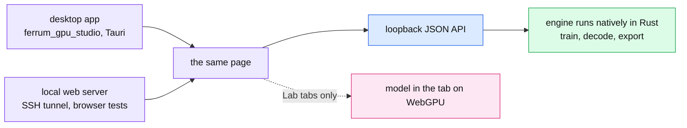


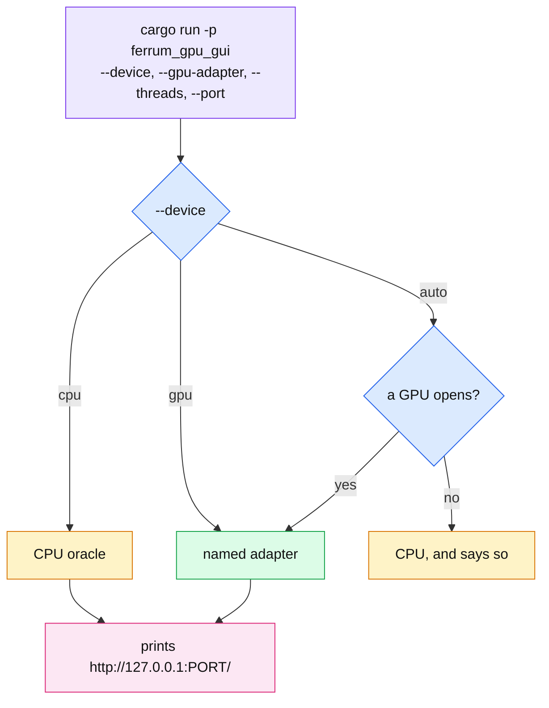


Ferrum GPU Studio is a tabbed interface to everything the command line does: prepare and tokenize text, train a GPT-2 style model with its own BPE tokenizer, fine-tune, evaluate, generate, inspect any GGUF, export it (precision, Ollama, LM Studio), serve it, work out what a machine can run, and check a GPU against the CPU reference. It is the same page in two forms: **a native desktop app** (`ferrum_gpu_studio`, below), and a local web server for headless use over an SSH tunnel and for the browser tests. It also runs a small model **in your browser tab on WebGPU** (the Lab tabs, [browser-webgpu.md](browser-webgpu.md)). The engine never runs in the page: training, decoding and the exports run natively in Rust inside the application, so the desktop window changes packaging, not speed. The plan and what was built is [gui-studio-plan.md](gui-studio-plan.md).

```
cargo run --release -p ferrum_gpu_gui                      # picks a free port, device auto
cargo run --release -p ferrum_gpu_gui -- --device gpu --gpu-adapter MX330 --port 7860
cargo run --release -p ferrum_gpu_gui -- --device cpu      # the CPU oracle
```

It prints `ferrum-gpu GUI: http://127.0.0.1:PORT/`; open that URL. Flags: `--port N` (0 = any free port), `--device cpu|gpu|auto` (auto uses a GPU if one opens, otherwise the CPU and says so), `--gpu-adapter NAME` (case-insensitive fragment), `--threads N` (CPU matmul threads). Unknown flags are errors.

## The Studio shell (2026-11-17)

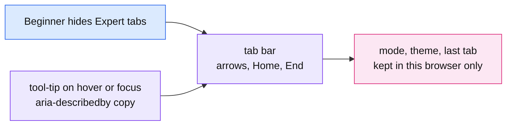


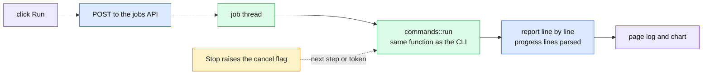


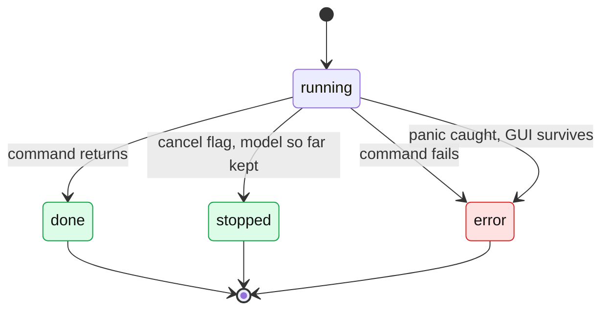


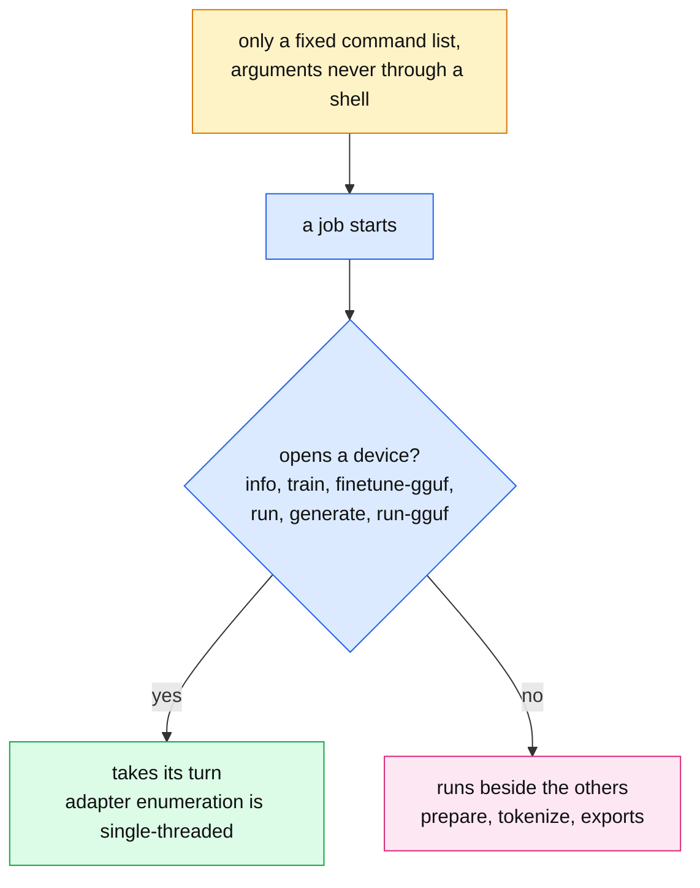


The page is a tabbed Studio: the tabs are a keyboard-operable tab bar (Left and Right arrows, Home and End; hidden tabs are skipped). **Mode** (header): *Beginner* hides the Expert tabs and shows plain-language help; *Expert* shows the technical description. **Theme**: Auto, Light or Dark. Every control has a tool-tip (hover for a moment, or focus it with the keyboard; Escape hides it), and each tipped control carries `aria-describedby` pointing at a hidden copy of the text for screen readers. The mode, theme and last tab are remembered in the browser only. The plan for the remaining tabs is [gui-studio-plan.md](gui-studio-plan.md).

Long commands (prepare, tokenize, and later train, fine-tune, evaluate, export) run as **jobs, inside this process**: the GUI is self-contained and needs no `ferrum-gpu` binary. A job is a thread that runs the same command function the command line runs (`ferrum_gpu_core::commands::run`), collects its report line by line, parses the training progress lines, and ends when the command returns. A command that fails is an error job and a command that panics is caught, so a fault ends the job and not the GUI. **Stop** raises the job's cancel flag: training (both trainers) and generation notice it at the next step or token, end cleanly, and a training run writes the model it has so far. `prepare`, `tokenize` and the exports have no such check and run to their end. Commands that open a device (`info`, `train`, `finetune-gguf`, `run`, `generate`, `run-gguf`) take turns, because adapter enumeration is not safe from several threads; the others run beside them. Only a fixed list of commands can run, with arguments passed as separate strings and never through a shell.

## The desktop app (2026-11-17)

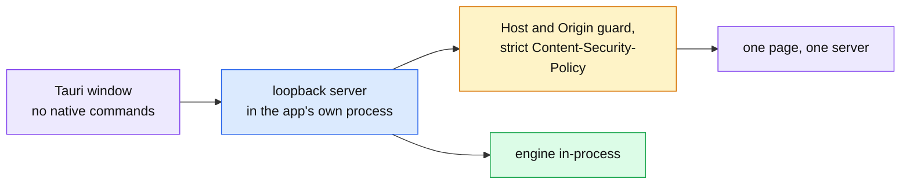


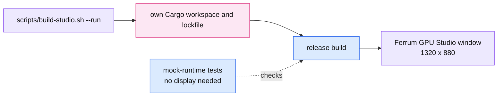


`ferrum_gpu_studio` is a native window (Tauri 2) around this GUI, the counterpart of ferrum-cpu's Studio. It starts the loopback server **in its own process** and points the window at it, so there is one page, one server and one guard (Host and Origin checks, and a strict Content-Security-Policy on every page: scripts and styles only from the app itself, no inline code, no framing); the window is granted no native commands. It takes the GUI's flags (`--device cpu|gpu|auto`, `--gpu-adapter NAME`, `--threads N`, `--port N`).

```bash
scripts/build-studio.sh --run               # release build, then start it
scripts/build-studio.sh --debug --run --device cpu
```

It is its own Cargo workspace with its own lockfile, so the Tauri dependency tree stays out of the main workspace; on Linux it needs `libwebkit2gtk-4.1-dev libgtk-3-dev libsoup-3.0-dev libayatana-appindicator3-dev librsvg2-dev`. Checked on 2026-11-17 on Linux (Zorin OS, X11) with the MX330 and Intel Xe: the app starts, serves the page with its policy, and opens a 1320 by 880 window titled "Ferrum GPU Studio"; its wiring is tested on Tauri's mock runtime (no display needed) and `cargo deny` passes for its tree. **Not run:** macOS and Windows builds, bundles (installers), signing, the in-window WebGPU runner (WebKitGTK has no WebGPU, so the page offers server-side generation there), and anything on Apple Silicon. Native file dialogs are not used; the page has its own server-side file picker.

## What each tab does

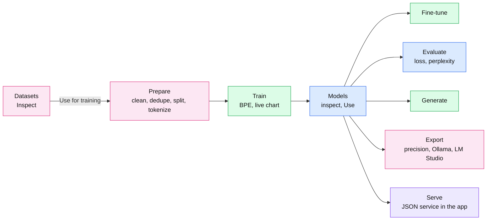


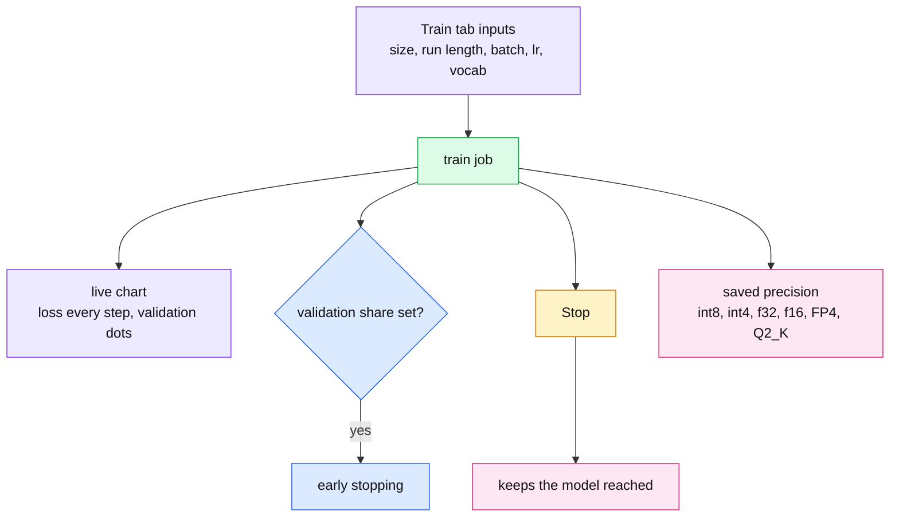


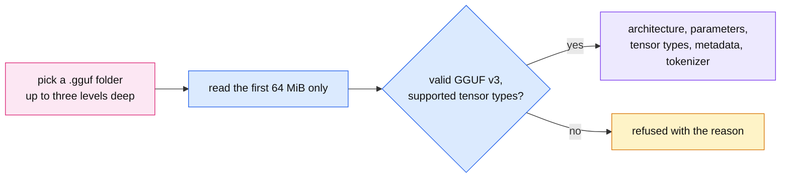


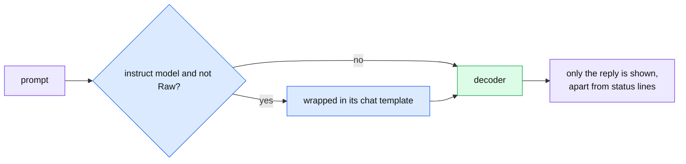


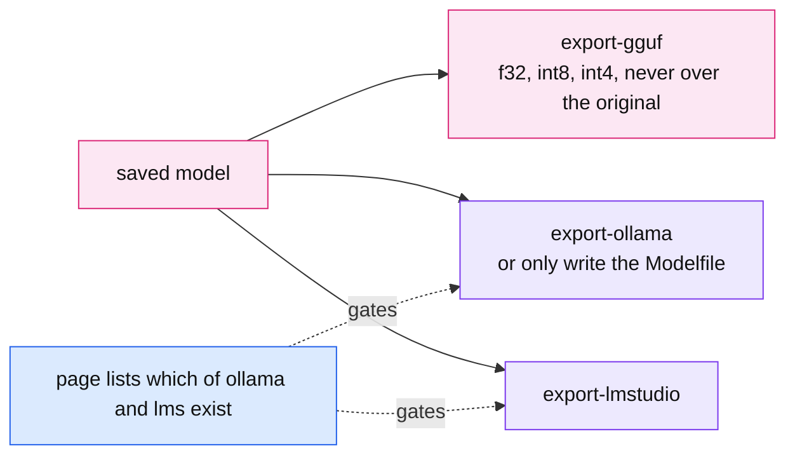


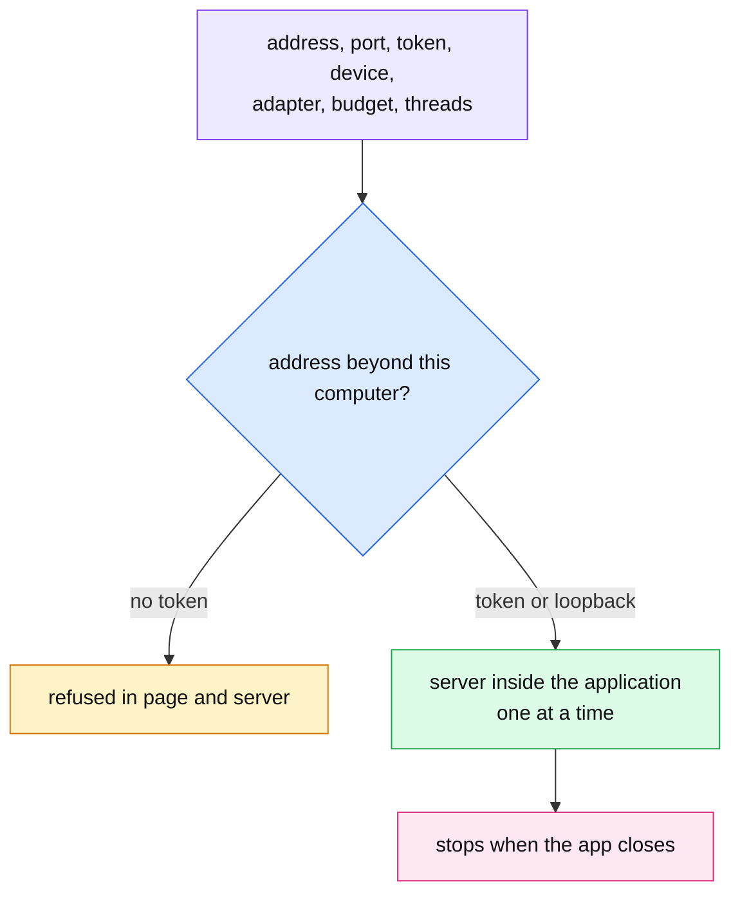


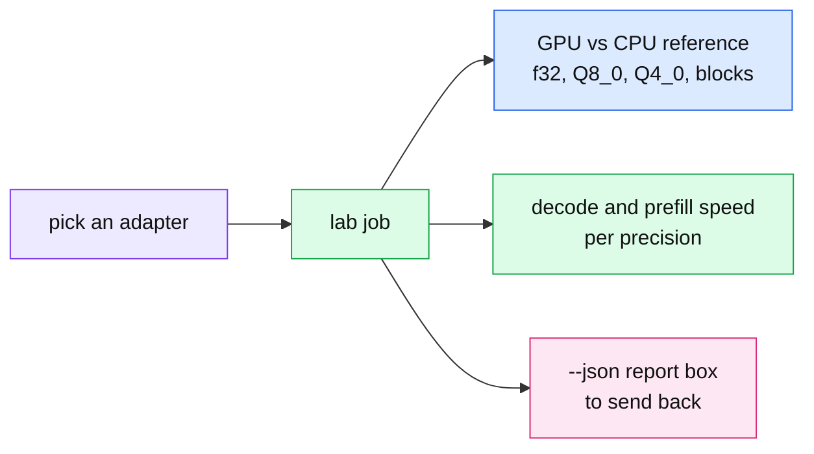


| Tab | What you can do |
|---|---|
| Datasets | Type a path (or **Browse** the server's folders) to a text file or folder; **Inspect** shows its kind, file count, size, line count and the start of the text, with warnings (empty, binary, very small, huge). **Use for training** hands the path to the other tabs. |
| Prepare (Expert) | Runs `ferrum-gpu prepare` as a background job (clean, deduplicate and split raw text into train, validation and test files) and `ferrum-gpu tokenize` (encode text with a tokenizer file into a token file). Output is streamed into a log; Stop ends the job. |
| Train | Train a GPT-2 style model with its own BPE tokenizer on a file, folder or token file (`train`, as a job): size, run length in epochs, steps or tokens, batch, learning rate, vocabulary; Expert shows the model shape (width, heads, blocks, hidden size, window stride), the optimiser (weight decay, clip, cosine schedule and warm-up, tied head, dropout, quantisation-aware training, saved precision: int8, int4, f32, f16, FP4 or Q2_K), validation share with early stopping, time limit, a metrics CSV file, checkpoints and resume, and the device (CPU, GPU, adapter, memory budget, threads). A live chart shows the loss at every reported step and the validation loss as dots; Stop ends the run cleanly and keeps the model reached. |
| Models | Find the `.gguf` files in a folder (up to three levels down) and look inside one: architecture, name, parameter count, file size, the mix of tensor types by bytes, every tensor with its shape and size (filterable, the first 2000 listed) all metadata, and the tokenizer (family, vocabulary size and, for an instruct model, the chat format Generate will wrap prompts in). Only the first 64 MiB of the file are read, so a model of any size opens at once; a file that is not a valid GGUF v3 is refused with the reason, and a tensor type the reader does not support is refused rather than guessed at. **Use** makes it the model for Fine-tune, Evaluate and Generate. |
| Fine-tune (Expert) | Continue training a saved model on new text (`finetune-gguf`, as a job): the model keeps its tokenizer and shape; run length, batch, learning rate, validation share with early stopping, quantisation-aware training, saved precision and the device. Same live chart as Train; the original model is left untouched. |
| Evaluate | Measure a model on a text (`eval`, always on the CPU): the loss and the perplexity over a number of tokens (and bits per byte for models that carry their own tokenizer) are shown as one sentence above the log; optional window size, precision and a JSON report file. Measure on text the model was not trained on. |
| Generate | Continue a prompt with a saved model (`generate`, as a job): new tokens, temperature, top-k and seed; Expert adds top-p, a repetition penalty, stop strings, "Raw prompt" (an instruct model's prompt is otherwise wrapped in its chat template and only the reply is shown), token ids instead of text, how a GPU decoder stores the weights (f16, Q8_0, Q4_0, FP4, FP8 E4M3 or E5M2, Q2_K), CPU threads and the device. The generated text is shown on its own, apart from the status lines the command prints. |
| Capable | Enter a memory size (and tick unified memory for shared memory) to see the largest model that fits at Q4_0, Q8_0 and f32 and for a full fine-tune, using the formulas of `hardware-caps.md` (a test checks they equal the script's table); add a memory bandwidth and a model size for the decode-speed ceiling. A second table shows this computer: OS, CPU threads, RAM, and for each adapter its memory budget and what that budget holds. Everything is an estimate. |
| GPU lab | Pick an adapter and run `ferrum-gpu lab` as a job: the GPU against the CPU reference (f32, Q8_0, Q4_0, and weights stored in blocks), then decode and prefill speed per precision and the adapter, driver and wgpu version; the same run with `--json` fills a box with the report to send back from other hardware. A table shows each adapter's free memory from nvidia-smi or the system, labelled with its source (no "used" figure: wgpu does not report one). |
| Export (Expert) | Hand a saved model to other tools, each as a job: write it in another precision (`export-gguf`: f32, int8 or int4, never over the original), register a GPT-2 model with Ollama (`export-ollama`, or only write the Modelfile, which needs no Ollama) or import it into LM Studio (`export-lmstudio`). The page lists which of `ollama` and `lms` it finds, and each form accepts only its own tool; names are checked in the page before a job starts. |
| Serve (Expert) | Run a model as the JSON web service of `ferrum-gpu-server` **inside this application**: address, port (0 picks a free one), optional bearer token, device, adapter, memory budget, threads. Status lines and the address appear on the page; only one server runs at a time; an address beyond this computer is refused without a token (in the page and in the server); it stops when the application closes. |
| Device | See the active device and every adapter the machine reports (name, backend, kind, largest buffer binding, **the optional features it reports** such as f16 and subgroups, and **its memory budget**, an estimate whose source is shown on hover); see whether WebGPU works in this browser. |
| Lab: model (Expert) | Create a model (`tiny` 35K, `small` 171K, `medium` 771K parameters; byte vocabulary 256), download it as GGUF (f32, Q8_0 or Q4_0), or load a `llama`/`qwen2` GGUF from disk. |
| Lab: train (Expert) | Paste text, choose steps, learning rate, batch and context, start. **Validation share (%)** holds out the end of the text: the run trains on the rest and the status line shows the loss on the held-out part before and after (`validation 5.9 → 1.4`). A live loss chart and progress bar update while it runs; Stop keeps the weights reached so far. |
| Lab: generate (Expert) | Type a prompt, choose length, temperature and top-k, optionally **stop strings** (one per line; `\n`, `\t` and `\\` are unescaped; the text ends before the first match), and run it on the server's device or on this browser's WebGPU. |

## Accessibility

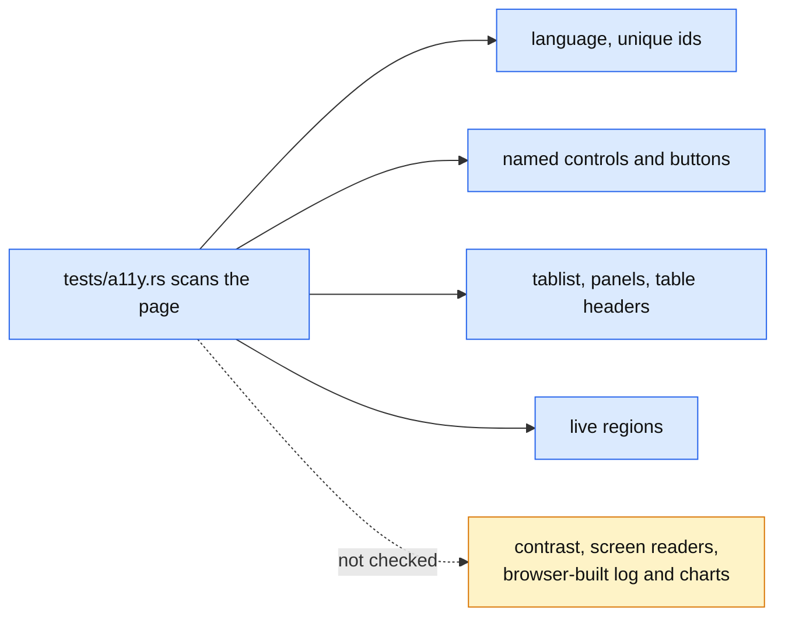


`tests/a11y.rs` scans the page and keeps these true: the page declares its language; every id is unique; every form control has a name (a wrapping label, a `for` label or an `aria-label`); every button has text or a label; every tab names its panel and every panel its tab, in a tablist; every table header says whether it heads a column or a row; the notes that change after an action are live regions. The tab bar works from the keyboard, tool-tips are available on focus and carry `aria-describedby`, and the theme respects the system's light or dark setting. What a static scan cannot promise is **not checked**: colour contrast, behaviour with a screen reader, and the job log and charts, which are built in the browser (the log is a focusable `role="log"`).

## Tokens: bytes, deliberately

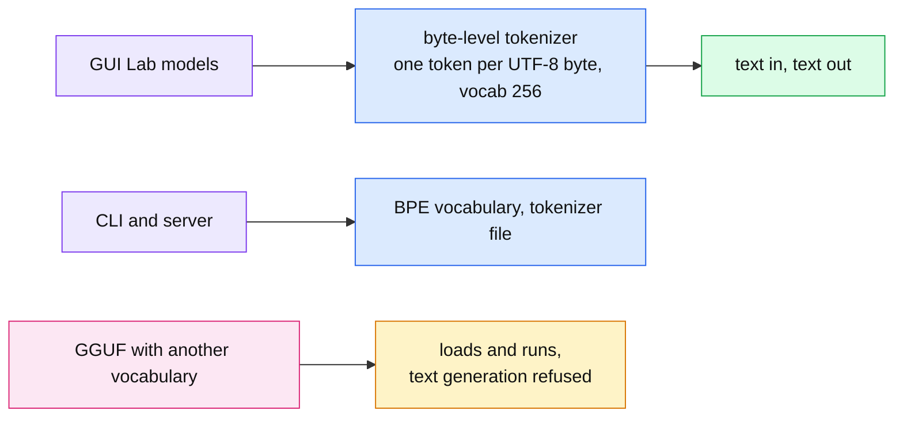


The CLI and the server have BPE (Phase 6); the GUI does not, and that is a decision, not a gap in progress: its engine trains and samples the byte-level Llama-style models directly, a BPE vocabulary would mean the GPT-2 path with its tokenizer files, and the GUI exists to show a model learning in seconds, which bytes do. Use `ferrum-gpu train --vocab 1024 --tokenizer tok.gguf` for BPE models. The GUI uses a **byte-level tokenizer** (one token per UTF-8 byte, vocabulary 256), so models trained here take text in and give text out. A GGUF with another vocabulary loads, shows its size and runs, but text generation is refused with an explanation (it would need that model's tokenizer).

## API

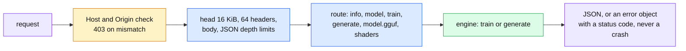


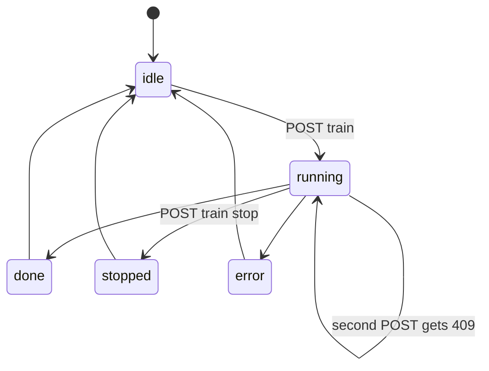


All JSON unless noted; errors are `{"error": "..."}` with a status code, never a crash.

| Route | Purpose |
|---|---|
| `GET /api/info` | device, adapters, presets, current model (with a `version` that changes when it is replaced), limits |
| `POST /api/model` `{preset, seed}` | create a model |
| `POST /api/train` `{text, steps, lr, batch, context, seed, val}` | start a background run (409 if one is running); `val` is the held-out share, 0 to 0.5 |
| `GET /api/train/status` | `{state: idle|running|done|stopped|error, step, total, losses[], error, val_before, val_after}` (the last two are `null` without a validation share) |
| `POST /api/train/stop` | stop after the current step |
| `POST /api/generate` `{prompt, max_new, temperature, top_k, seed, stop}` | continue the prompt; `stop` is an array of at most 8 strings of at most 64 bytes, and the returned `text` is cut before the first match (`tokens` is the full output) |
| `GET /api/model.gguf?quant=f32|q8_0|q4_0` | download the model |
| `PUT /api/model.gguf` (raw body) | replace the model with an uploaded GGUF (at most 60M parameters) |
| `GET /shaders/<group>/<name>.wgsl`, `/shaders/prelude.wgsl` | the native WGSL kernels (used by the in-browser runtime) |

Limits: training text 1 MiB, prompt 4096 bytes, 1024 new tokens per call, request body 256 MiB.

## Security notes

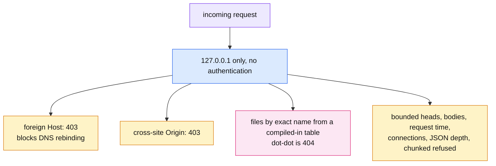


- It listens on **127.0.0.1 only** and has **no authentication**. Do not forward the port or bind it to another address: anyone who can reach it can run code on your GPU and make it allocate memory.
- Requests whose `Host` is not `127.0.0.1:PORT` or `localhost:PORT` get 403 (blocks DNS-rebinding), and so do cross-site `Origin`s (blocks other web pages from calling the API).
- The server never opens a file by path from a request: models travel as upload/download bodies, and static files are looked up by exact name in a table compiled into the binary (`/shaders/../x`, `%2e%2e` and the like are 404).
- Request heads are capped at 16 KiB and 64 headers, bodies at 256 MiB, JSON nesting is capped at 32, chunked bodies are refused.
- Time is bounded per request, not per read: the whole head must arrive within 10 s and the body within 10 s plus 10 s per started MiB of `Content-Length` (a 256 MiB upload gets 2,570 s), so a client sending one byte every few seconds is cut off with 408. One read waits at most 10 s, so a request ends at most 10 s past its budget.
- At most 128 connections are served at once (one thread each); a connection past that gets `503 too many connections` with `Retry-After: 1` straight from the accept loop and is closed, so a flood cannot start unbounded threads. Embedders can change both through `ferrum_gpu_core::http::ServeOptions` (`budget`, `max_connections`).

## Tests

```mermaid
flowchart LR
    u["unit: HTTP parser, JSON,<br/>tokenizer, loops, flags"]:::core --> a["tests/api: real server over TCP<br/>CPU and GPU journeys"]:::gpu
    a --> br["browser_ui: headless Chrome<br/>drives the real page"]:::host
    br -. "Chrome missing" .-> sk["skipped with a printed reason"]:::cpu
    th["--test-threads 1<br/>several GPU devices can crash drivers"]:::io -.-> a
    classDef core fill:#dbeafe,stroke:#2563eb,color:#111
    classDef gpu fill:#dcfce7,stroke:#16a34a,color:#111
    classDef cpu fill:#fef3c7,stroke:#d97706,color:#111
    classDef io fill:#fce7f3,stroke:#db2777,color:#111
    classDef host fill:#ede9fe,stroke:#7c3aed,color:#111
```


- Unit tests for the HTTP parser (hostile requests and their statuses), JSON (malformed documents, depth), tokenizer, engine loops, flags.
- `tests/api.rs`: the real server over TCP; the same train-then-generate journey on the CPU backend and the GPU backend, errors, limits, GGUF round trips in every precision, stop and failure handling.
- `tests/browser_ui.rs`: headless Chrome drives the real page (create, train, generate; then generates again in the browser and requires the same text). Skipped with a printed reason when Chrome is missing.
- Like the rest of the suite, run with `--test-threads 1`: opening several GPU devices at once in one process can crash some drivers (seen as a SIGSEGV here).


(Screenshots from the real run: the model was trained for 40 steps on one sentence, so its text is a demonstration that the pipeline works, not a quality claim.)
