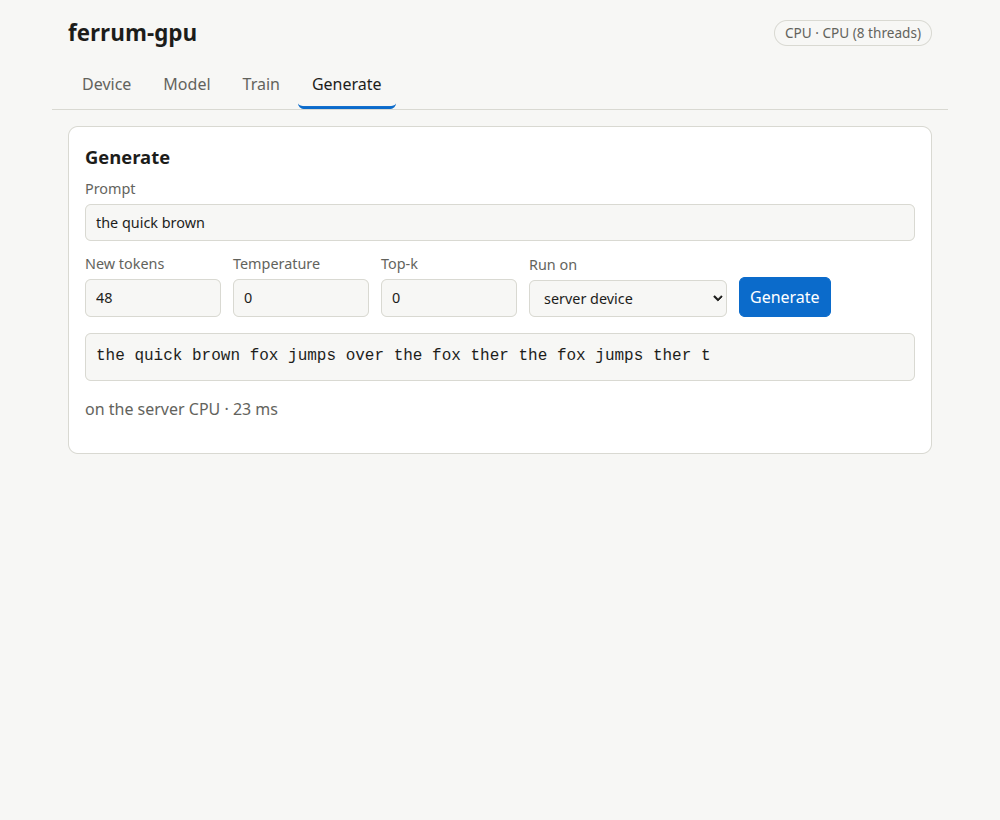

# The ferrum-gpu GUI (Phase 5a)

A local web GUI: pick a device, create a small Llama-style model, train it on text you paste, watch the loss fall, generate text, and move the model in and out as GGUF. It also runs the model **in your browser tab on WebGPU** (Phase 5b, [browser-webgpu.md](browser-webgpu.md)).

```
cargo run --release -p gpu_gui                      # picks a free port, device auto
cargo run --release -p gpu_gui -- --device gpu --gpu-adapter MX330 --port 7860
cargo run --release -p gpu_gui -- --device cpu      # the CPU oracle
```

It prints `ferrum-gpu GUI: http://127.0.0.1:PORT/`; open that URL. Flags: `--port N` (0 = any free port), `--device cpu|gpu|auto` (auto uses a GPU if one opens, otherwise the CPU and says so), `--gpu-adapter NAME` (case-insensitive fragment), `--threads N` (CPU matmul threads). Unknown flags are errors.

## What each tab does

| Tab | What you can do |
|---|---|
| Device | See the active device and every adapter the machine reports (name, backend, kind, largest buffer binding); see whether WebGPU works in this browser. |
| Model | Create a model (`tiny` 35K, `small` 171K, `medium` 771K parameters; byte vocabulary 256), download it as GGUF (f32, Q8_0 or Q4_0), or load a `llama`/`qwen2` GGUF from disk. |
| Train | Paste text, choose steps, learning rate, batch and context, start. A live loss chart and progress bar update while it runs; Stop keeps the weights reached so far. |
| Generate | Type a prompt, choose length, temperature and top-k, and run it on the server's device or on this browser's WebGPU. |

## Tokens: bytes, for now

The real tokenizer is Phase 6. Until then the GUI uses a **byte-level tokenizer** (one token per UTF-8 byte, vocabulary 256), so models trained here take text in and give text out. A GGUF with another vocabulary loads, shows its size and runs, but text generation is refused with an explanation (it would need that model's tokenizer).

## API

All JSON unless noted; errors are `{"error": "..."}` with a status code, never a crash.

| Route | Purpose |
|---|---|
| `GET /api/info` | device, adapters, presets, current model (with a `version` that changes when it is replaced), limits |
| `POST /api/model` `{preset, seed}` | create a model |
| `POST /api/train` `{text, steps, lr, batch, context, seed}` | start a background run (409 if one is running) |
| `GET /api/train/status` | `{state: idle|running|done|stopped|error, step, total, losses[], error}` |
| `POST /api/train/stop` | stop after the current step |
| `POST /api/generate` `{prompt, max_new, temperature, top_k, seed}` | continue the prompt |
| `GET /api/model.gguf?quant=f32|q8_0|q4_0` | download the model |
| `PUT /api/model.gguf` (raw body) | replace the model with an uploaded GGUF (at most 60M parameters) |
| `GET /shaders/<group>/<name>.wgsl`, `/shaders/prelude.wgsl` | the native WGSL kernels (used by the in-browser runtime) |

Limits: training text 1 MiB, prompt 4096 bytes, 1024 new tokens per call, request body 256 MiB.

## Security notes

- It listens on **127.0.0.1 only** and has **no authentication**. Do not forward the port or bind it to another address: anyone who can reach it can run code on your GPU and make it allocate memory.
- Requests whose `Host` is not `127.0.0.1:PORT` or `localhost:PORT` get 403 (blocks DNS-rebinding), and so do cross-site `Origin`s (blocks other web pages from calling the API).
- The server never opens a file by path from a request: models travel as upload/download bodies, and static files are looked up by exact name in a table compiled into the binary (`/shaders/../x`, `%2e%2e` and the like are 404).
- Request heads are capped at 16 KiB and 64 headers, bodies at 256 MiB, reads time out after 10 s, JSON nesting is capped at 32, chunked bodies are refused.

## Tests

- Unit tests for the HTTP parser (hostile requests and their statuses), JSON (malformed documents, depth), tokenizer, engine loops, flags.
- `tests/api.rs`: the real server over TCP; the same train-then-generate journey on the CPU backend and the GPU backend, errors, limits, GGUF round trips in every precision, stop and failure handling.
- `tests/browser_ui.rs`: headless Chrome drives the real page (create, train, generate; then generates again in the browser and requires the same text). Skipped with a printed reason when Chrome is missing.
- Like the rest of the suite, run with `--test-threads 1`: opening several GPU devices at once in one process can crash some drivers (seen as a SIGSEGV here).



(Screenshots from the real run: the model was trained for 40 steps on one sentence, so its text is a demonstration that the pipeline works, not a quality claim.)
