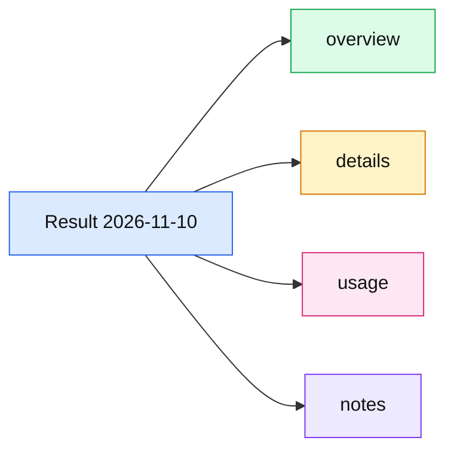

# Phase 1: device runtime

Starts only after the Phase 0 gate passes.

- [x] 1.1 `GpuTensor` (one buffer + shape), upload, readback through one helper (single place that would become async for WebGPU).
- [x] 1.2 Pipeline/bind-group cache keyed by shader and entry point; dispatch-count helper that splits across dimensions at the granted workgroup limit.
- [x] 1.3 Allocation inside out-of-memory error scopes mapped to errors; device-loss detection at submit.
- [x] 1.4 `BufferPlan` wired to real allocation (plan, sum, check, allocate).

**Tests:** odd-length round trips, dispatch counts at/over the limit, plan refusal before any buffer exists; GPU-needing tests skip without an adapter.
**Gate:** suite green with and without a GPU.

## Result (2026-11-10)

Done. `runtime.rs` holds error scopes (validation + out-of-memory), device-loss and uncaptured-error recording (`Gpu::check`), the pipeline cache, one generic `dispatch`, `groups_for`, and `alloc_plan`. `GpuBuf` carries a shape. Gate met: 38 + 4 + 6 tests pass with no adapter (all GPU tests skip), on the MX330, on Intel Xe and on llvmpipe. A destroyed device surfaces as an error ("GPU device lost"), not a panic. Real out-of-memory could not be provoked on this box (a binding-limit-sized allocation succeeded or was refused cleanly); the OOM mapping is unit-tested instead.
