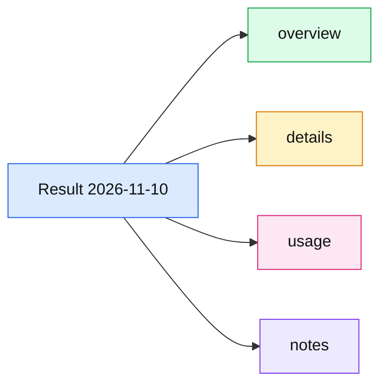

# Phase 3: GGUF I/O, sampling, GPT-2 inference

Copied or re-derived with provenance: GGUF v3 layout and the `gpt2` tensor convention (ferrum-cpu commit 56a9d3a), now our own code.

- [x] 3.1 `ferrum_gguf` (reader, writer, F32/F16/Q8_0/Q4_0) and `ferrum_model::gpt2_gguf` (the `gpt2` layout, tied head, quantised export). **Deviation:** there is no stored `.gguf` fixture file yet; tests generate files with our own writer. A file written by ferrum-cpu itself has not been loaded, so "loads on the other side" is verified only against ferrum-cpu's *source* conventions, not a real file. A stored fixture produced by ferrum-cpu belongs in Phase 6's end-to-end tests.
- [x] 3.2 Token-level sampling (`ferrum_model::sampling`). **The BPE tokenizer moved to Phase 6**: it is a text-level concern (it needs Unicode category tables) that nothing in Phases 3 to 5 requires.
- [x] 3.3 `GpuGpt2`: weights uploaded once, device KV cache, `feed` returns one logits row per token, `forward_all` for batched prefill, `score`. **Caveat:** `score` currently reads the logits back and re-uploads them before the score kernel (marked `ponytail`), so it is not yet fully resident.
- [x] 3.4 Parity against the CPU oracle: cached decode matches at every position of a full context (worst 1.0e-6 against a 1e-5 tolerance), `forward_all` and `score` match, greedy generation agrees token for token, a quantised-then-reloaded model runs. **Not tested:** seeded stochastic sampling driven from GPU logits (sampling is host code and is tested on its own).
- [x] 3.5 Decode crossover measured: see [`../decode-crossover.md`](../decode-crossover.md).

## Result (2026-11-10)

Gate met in the letter: parity is green and the crossover table is recorded. The measured answer is unfavourable to the GPU for single-stream decode: 0.02x to 0.93x of one CPU thread across 0.5M to 33.7M parameters. Batching all of a token's commands into one submit did not help (the cost is dependent-dispatch latency, not submit count); a 16-way K-split GEMV recovered the large model from 0.50x to 0.93x. Consequence for Phase 6: `auto` keeps this workload on the CPU. Phase 4 must show that training and batched scoring cross over, which is where the matmul measurements say the GPU should win.
