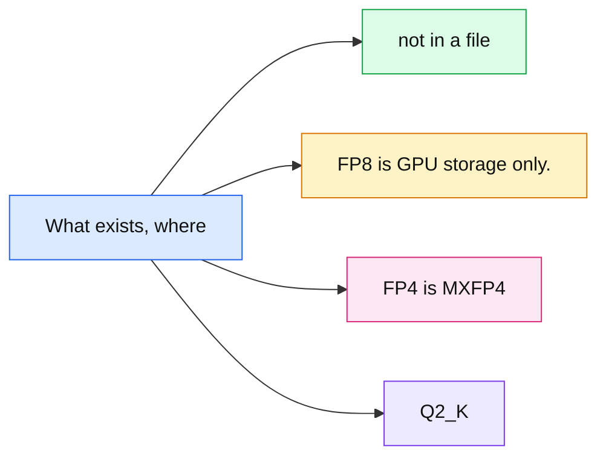
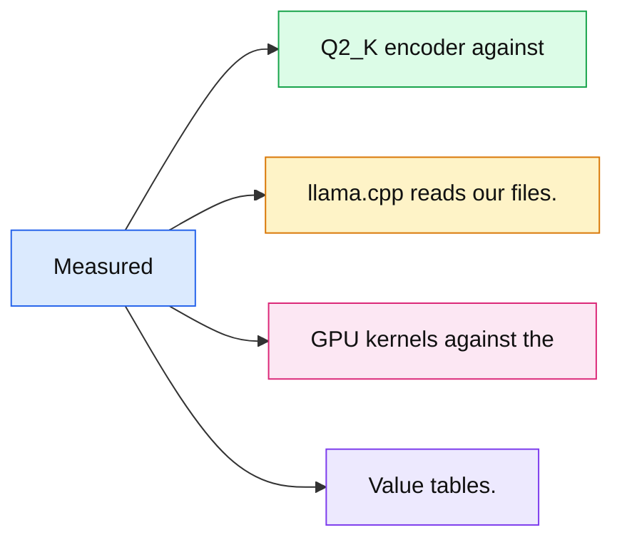
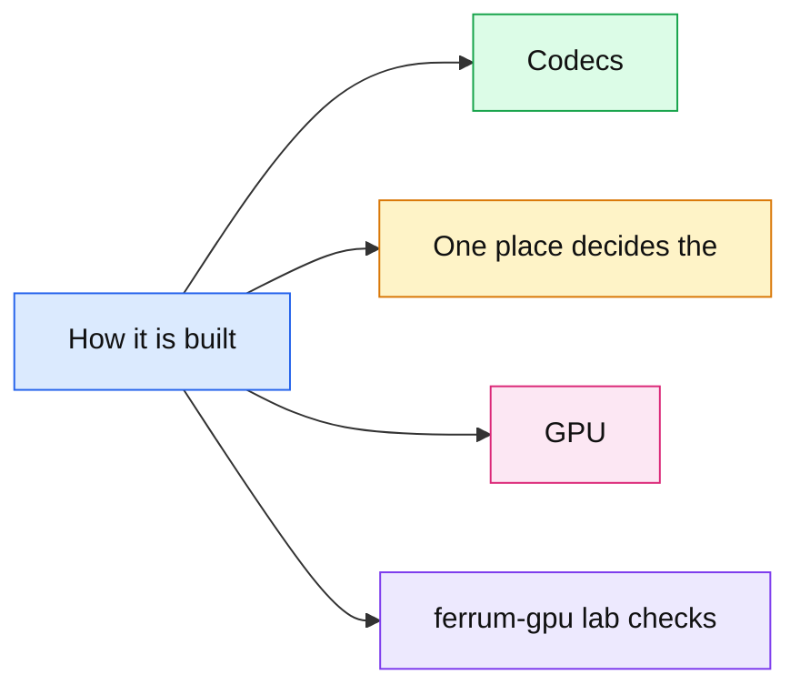
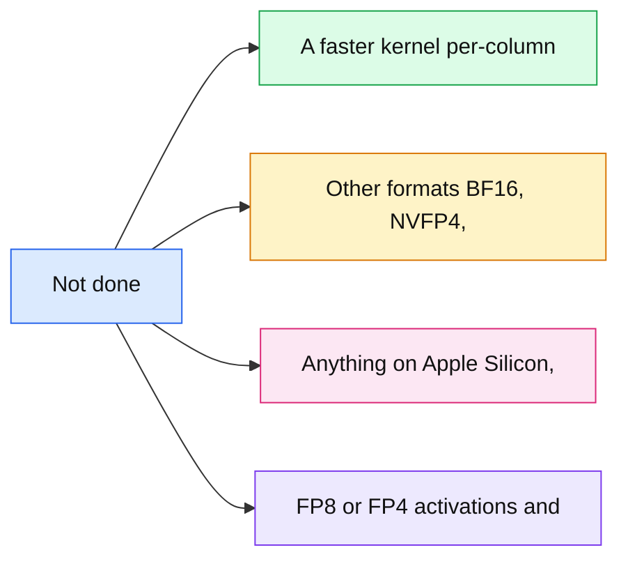

# Precisions: F16, FP8, FP4 (MXFP4), Q2_K (and the older Q8_0, Q4_0)

Written 2026-11-18. Every figure here comes from a real run on this machine (Linux, NVIDIA MX330 2 GB and
Intel Xe through wgpu 30, llama.cpp b11521 CPU build); what was not run is listed at the end.

## What exists, where

| Precision | In a GGUF file we write (`--quant`) | On the GPU (`--gpu-weights`) | llama.cpp reads the file | ferrum-cpu reads the file |
|---|---|---|---|---|
| f32 | `f32` | `f32` (no conversion) | yes | yes |
| FP16 | `f16` | `f16` | yes | no |
| Q8_0 | `int8` or `q8_0` | `q8_0` | yes | yes |
| Q4_0 | `int4` or `q4_0` | `q4_0` | yes | yes |
| FP4 = MXFP4 | `fp4` or `mxfp4` | `fp4` | yes (ggml type 39) | no |
| FP8 E4M3 | **not in a file** | `fp8` or `fp8e4m3` | not applicable | not applicable |
| FP8 E5M2 | **not in a file** | `fp8e5m2` | not applicable | not applicable |
| Q2_K | `q2` or `q2_k` | `q2_k` | yes (ggml type 10) | no |

- **FP8 is GPU storage only.** llama.cpp has no FP8 tensor type, and files must stay readable by llama.cpp, so no
  FP8 file is written. `--gpu-weights fp8` converts the loaded f32 weights to blocks of 32 (an f16 scale and one
  8-bit float per value) when the model is put on the device. E4M3 is the OCP "fn" variant (no infinities, largest
  value 448); E5M2 has infinities (largest finite value 57344).
- **FP4 is MXFP4**: 32 values per block, each a 4-bit E2M1 float, sharing one E8M0 (power of two) scale: 17 bytes
  per block, 4.25 bits per value. Matrices whose input width is not a multiple of 32 stay f32.
- **Q2_K** is llama.cpp's 2-bit k-quant: 256-value super-blocks, 84 bytes, 2.625 bits per value. A matrix whose
  input width is a multiple of 32 but not of 256 is written as Q4_0 instead (llama.cpp does the same); below 32 it
  stays f32.
- **FP16** is plain IEEE half precision, any width.
- Vectors, biases and norms stay f32 in every precision, as before. The position embedding of a GPT-2 model also
  stays f32.
- `--gpu-weights` converts at load and never changes a file. A model loaded from a Q2_K file and run with
  `--gpu-weights q2_k` is quantised again from its decoded f32 values, which is not always the identity for Q2_K
  (it is for MXFP4); the CPU reference for such a run is the `dequantised` model, which the lab checks.
- Training: `--quant` only chooses what is written at the end. Quantisation-aware training (default on) simulates
  Q8_0 rounding, so `int8` is the precision a model is trained for; the other precisions are post-training.

## Measured

- **Q2_K encoder against llama.cpp.** `llama-quantize` (b11521) turned the same f32 model into Q2_K, and ours did
  too: on both tensors that are Q2_K in both files (`token_embd.weight`, `blk.0.ffn_up.weight`) every byte is equal
  (22596 of 22596 and 43008 of 43008). The reconstruction error against f32 is therefore identical (rmse 0.005820
  and 0.009827). Test: `ferrum_gpu_cli/tests/interop/formats.rs`.
- **llama.cpp reads our files.** For F16, MXFP4 and Q2_K files of a 256-wide GPT-2 model, `llama-completion`
  continues the prompt with exactly the text we generate (greedy, CPU, one thread), and each matrix has the ggml
  type listed above.
- **GPU kernels against the CPU decode** (`ferrum_wgpu/src/ops/quant/ext_tests.rs`, run on the adapter this machine
  opens): the dequantised value of every element is bit-identical to the CPU decode for MXFP4 and both FP8 formats,
  and within 2e-6 relative for Q2_K (the device may fuse the multiply and the subtract); products agree with the CPU
  matmul on the dequantised weights within the repository's reducing tolerance, for 1, 3 and 17 rows. Whole models
  stored in these formats decode like their CPU oracle within the frozen forward tolerance (1e-5) for MXFP4 and FP8.
  Q2_K needs a looser one (`Q2K_FORWARD`, 5e-5): its value is `d*q - m`, two nearly equal terms, and a fused
  multiply-subtract on the device differs from the CPU's two roundings by more, relatively. Worst error seen on a
  256-wide model: 1.15e-5 on the MX330, 1.29e-5 on the Xe, 1.04e-5 on llvmpipe (2026-11-18).
- **Value tables.** The FP8 codes are checked against the published values of E4M3 and E5M2, and every finite code
  round-trips through the encoder (`ferrum_gguf/src/codec/fp8`). MXFP4 is not checked against a copy of ggml's table:
  its check is that llama.cpp decodes our files to the same text (above).

## How it is built

- Codecs: `ferrum_gguf/src/codec/{mxfp4,q2k,fp8}.rs`. MXFP4 and Q2_K are ggml types 39 and 10 in `blocks`/`quant`,
  so every reader and writer in the repository handles them; FP8 has its own block functions (Q8_0's layout) that
  never reach a file.
- One place decides the tensor type of each matrix: `ferrum_model::gguf::quant::Quant::tensor_type`.
- GPU: `ferrum_wgpu::ops_quant::QKind` gained `Fp4`, `Fp8E4M3`, `Fp8E5M2` and `Q2K`; they share the device layout
  of the older kinds (block-major records, scale first as f32 bits) and run in one kernel,
  `shaders/quant/qlinear_ext.wgsl` (one invocation per output element). There is no per-column or tiled variant for
  them yet, so they are not tuned for speed; no speed figure for them is claimed here.
- `ferrum-gpu lab` checks every format against the CPU reference, Q2_K on a 256-wide model (the small lab model has
  no 256-wide matrix).

## Not done

- A faster kernel (per-column and tiled) for the new formats, and any speed measurement of them.
- Other formats: BF16, NVFP4, the I-quants, Q3_K to Q6_K as a write target.
- Anything on Apple Silicon, AMD or Windows hardware; FP8 and MXFP4 kernels have run only on the two adapters here.
- FP8 or FP4 activations and KV cache: only weights are stored in these formats; compute stays f32.
- Real-model checks of the new formats (no model above 1.5B parameters is kept here; the files above are tiny
  trained models).
