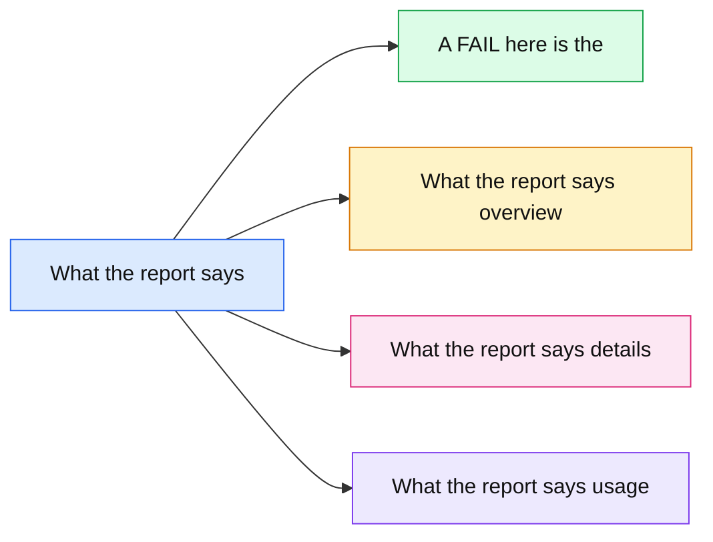
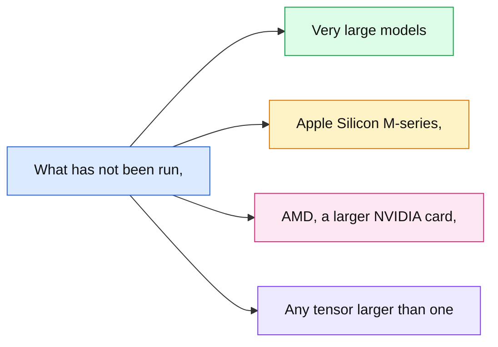

# Verification kit: run ferrum-gpu on your machine and send the report back

This project was built and measured on one Linux machine (an Intel Iris Xe and an NVIDIA MX330, plus the llvmpipe software
adapter). It has **never run on Apple Silicon (M1 to M5), on AMD, on Windows or on a bigger NVIDIA card**, and every document
says so. If you have such a machine, one command produces a report that turns a "not run" into a measured row.

## Run it

You need a Rust toolchain and a GPU driver that wgpu can use (Vulkan on Linux, Metal on macOS, Direct3D 12 or Vulkan on Windows).

```
git clone <this repository>
cd ferrum-gpu
cargo build --release -p ferrum_gpu_cli
./target/release/ferrum-gpu lab --size medium --json > lab-report.json
./target/release/ferrum-gpu lab --size medium            # the same report as readable text
```

On a machine with several adapters, name one with `--gpu-adapter NAME` (a fragment of its name; `ferrum-gpu info` lists them) and run
it once per adapter. `--parity-only` skips the timings and finishes in a couple of seconds. The desktop app (`scripts/build-apps.sh`,
then `dist/ferrum-gpu-studio`) has the same report on its **GPU lab** tab: choose the adapter, press **Make JSON report**, and copy
the box.

## What the report says




| Part | Meaning |
|---|---|
| `adapter`, `driver`, `backend`, `wgpu` | What was measured: copy these into any number you quote from it. |
| `features` | What the adapter reports (f16, subgroups, ...). Reported, not necessarily used: the engine does not use `shader-f16`. |
| `budget` | How much memory the engine will plan for, and where that figure came from. For unified memory it is an estimate (70% of available RAM). |
| `checks` | Six parity checks: the GPU's logits against the CPU reference, for f32 prefill, f32 decode with the KV cache, F16, Q8_0 and Q4_0 weights, and for weights stored in blocks (the path for tensors larger than one buffer). Each has an error and the tolerance it must stay under. **A FAIL here is the important result:** it means this adapter computes differently from the reference, and the report is the bug report. |
| `speeds` | Decode and prefill tokens per second per precision on a small random-weight model, and the CPU reference's prefill speed for scale. The model is small, so these show launch and dispatch cost more than memory bandwidth; they are not a large-model figure and must not be quoted as one. |

## Send it back

Attach `lab-report.json` (and the output of `ferrum-gpu info`) to an issue. Nothing in it identifies you beyond the adapter and driver
names and the operating system. Do not edit the numbers.

## What has not been run, said plainly




- **Apple Silicon (M-series, including M5 Max):** not run. Memory figures for it in `hardware-caps.md` are hand estimates. The macOS CI
  runner's paravirtual GPU already disagrees with the CPU in one test, which is why the checks here carry tolerances and print their errors.
- **AMD, a larger NVIDIA card, Windows, Direct3D 12:** not run.
- **Any tensor larger than one buffer binding (about 2 GiB on the adapters here):** the block path is tested by lowering the limit on a
  small model, never on a real oversized tensor.
- **Very large models:** the project never downloads a model above 1.5B parameters; large-model behaviour is tested with random weights.
