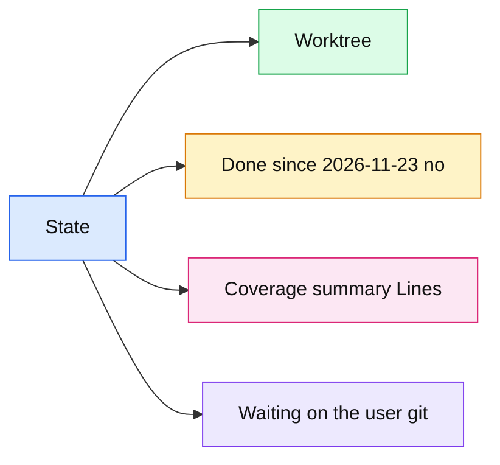
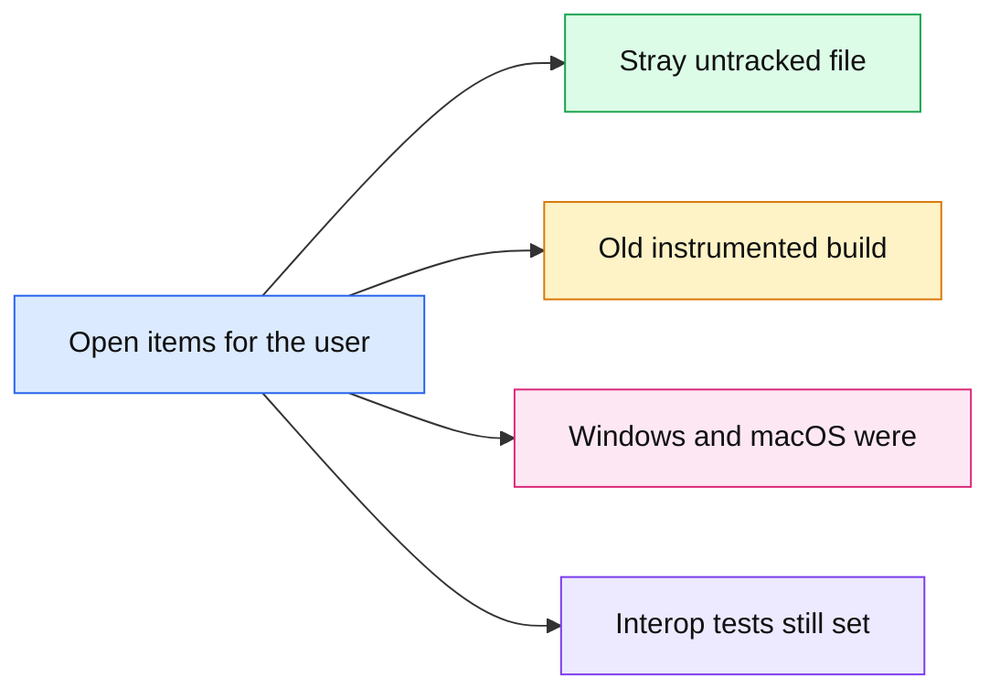

# Hand-off (2026-11-25)

Not yet consumed by a fresh session.

## Goal
Bring ferrum-gpu to AGENTS.md compliance and keep it there: gate before every commit (rule 19), files at most 100 lines
(HTML exempt), 100% coverage with simulated errors, hand-drawn diagrams on key pages, portable (Linux, macOS, Windows),
licence SSPL v1.0 or a paid commercial licence from Thomas Cherickal.

## State

``## State
- Worktree: `/home/thomas/Projects/ferrum-gpu-work` (branch `coverage100`; the old `.claude/worktrees` folder was
  deleted outside the session). Everything is pushed: `origin/main` = `coverage100` = `8cd21f6`, each step gated.
- Done since 2026-11-23: no duplicated code (167 runs to 0; WGSL composed from shared fragments), load and security
  tests (two bugs fixed: `--bin=PATH` allow-list bypass, conflicting Content-Length), a whole-request time budget
  and a 128-connection cap on the HTTP server, hooks no longer rewrite Python bytecode.
- Coverage: summary Lines 100%, Functions 100%, lcov 100%; Regions about 98%. Files at most 100 lines; 0 duplicates.
- Waiting on the user: `git branch -D perf quant-simplify` (superseded, unmerged; banned without a yes), a few
  `tmp*` folders left in /tmp by one early test run (needs `rm`), hardware rows (Apple Silicon, AMD, Windows).
- The local `main` branch in the user's checkout (`/home/thomas/Projects/ferrum/ferrum-gpu`) is behind `origin/main`
  and has the user's own uncommitted changes; it was left alone (`git pull` there when convenient).

to run first
- `git config core.hooksPath` must say `scripts/githooks` (it is set in the shared `.git/config`).
- `export TMPDIR=/home/thomas/.cache/ferrum-tmp CARGO_BUILD_JOBS=4` before any cargo command (writes stay under home).
- `bash scripts/gate.sh` (about 26 minutes) then commit; the pre-commit hook enforces the gate (`scripts/gate_key.py --check`).
- `bash scripts/coverage.sh` alone is about 13 minutes (nextest, GPU packages one at a time).

## Rules to respect (user's global instructions)
Banned without asking first: `rm`, `kill`, `chmod`/`chown`, writes outside /home, `sudo`, `git reset --hard`, `git clean`,
`git branch -D`, force push. If one is needed, ask the user, then run it. Pushing to `origin` is automatic by the user's decision.

## Open items for the user

- Stray untracked file `scripts/.coverage.sh.run` (an old copy of the coverage script): removing it needs `rm`; it is in `.gitignore`.
- Old instrumented build directories under `target/` (`llvm-cov-target`, `llvm-cov-fresh`, about 12 GB) are stale; removing them needs `rm`.
- Windows and macOS were only compile-checked (`cargo check --target`); nothing was run there.
- Interop tests still set `LD_LIBRARY_PATH`; the `/dev/null` and bash-hook tests stay Unix-only by design.

## Gotchas
- The Studio workspace (`ferrum_gpu_studio`) has its own `Cargo.lock`: after dependency changes run `cargo check` there (the gate uses `--locked`).
- Never edit a shell script while a long run is executing it; write a new file and move it over.
- `scripts/rules_check.py --update` records current debt as accepted: only run it when `--report` shows 0 long files.
