# Hardware capacity estimates

**These are hand estimates**, back-of-the-envelope arithmetic on stated assumptions. The only
measurements are the MX330 and Intel Xe rows in [capability.md](capability.md); every other row
was **not run**. Product bandwidths marked "published" are quoted from memory of vendor specifications and
should be checked before anyone buys hardware on the strength of this file. All tables were generated by a
`scripts/capability-estimates.py` from the formulas below (a test checks that the committed tables are its
output), so a changed assumption changes every row consistently.

## Method

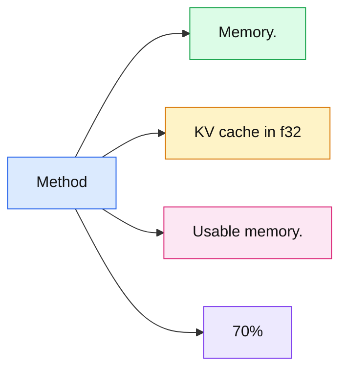

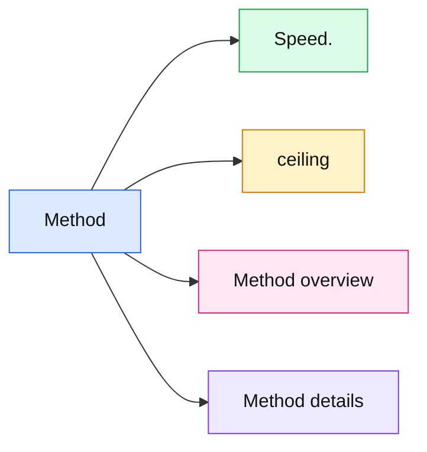

**Memory.** Weights are read from packed blocks: f32 = 4 bytes per weight, Q8_0 = 34/32 = 1.0625, Q4_0 =
18/32 = 0.5625 (each 32-weight block carries its scale). The engine keeps the token embedding, the norms and
the **KV cache in f32** whatever the weight precision, so the total is

`M(inference) = params x bytes per weight x 1.10 + 300 MB`

(10% for the f32 parts that scale with the model, 300 MB for a 2048-token KV cache, the embedding and
scratch of a small model). Training in f32 with AdamW holds weights, gradients and two moments, 16 bytes per
parameter, plus activations:

`M(train) = params x 16 x 1.08 + 300 MB` (batch 1; the measured plans were 2.6% to 8% above 16 B/param).

**Usable memory.** Discrete cards: 90% of VRAM (the display and driver take the rest; the headless MX330 had
97% free). Unified memory: **70%**, an assumption: the operating system and the application take their share,
and some systems cap the GPU's share of unified memory by default (a figure of about two thirds to three
quarters on Apple Silicon is commonly cited; it was not verified here).

**Speed.** Each token reads every weight once, so the memory-bandwidth **ceiling** is
`tokens/s = bandwidth / weight bytes`. ferrum-gpu today is far below that: its decode is a chain of small
dispatches, so the estimate adds a per-layer launch cost to a reduced effective bandwidth, both fitted to the
four MX330 Q4_0 rows. One card, extrapolated: a different driver or API (Metal, DX12) can change the
per-layer cost either way, and the effective bandwidth does not necessarily scale with the peak. Treat the
"est" column as a plausible order of magnitude, the ceiling as the physics.

## Check against what was measured

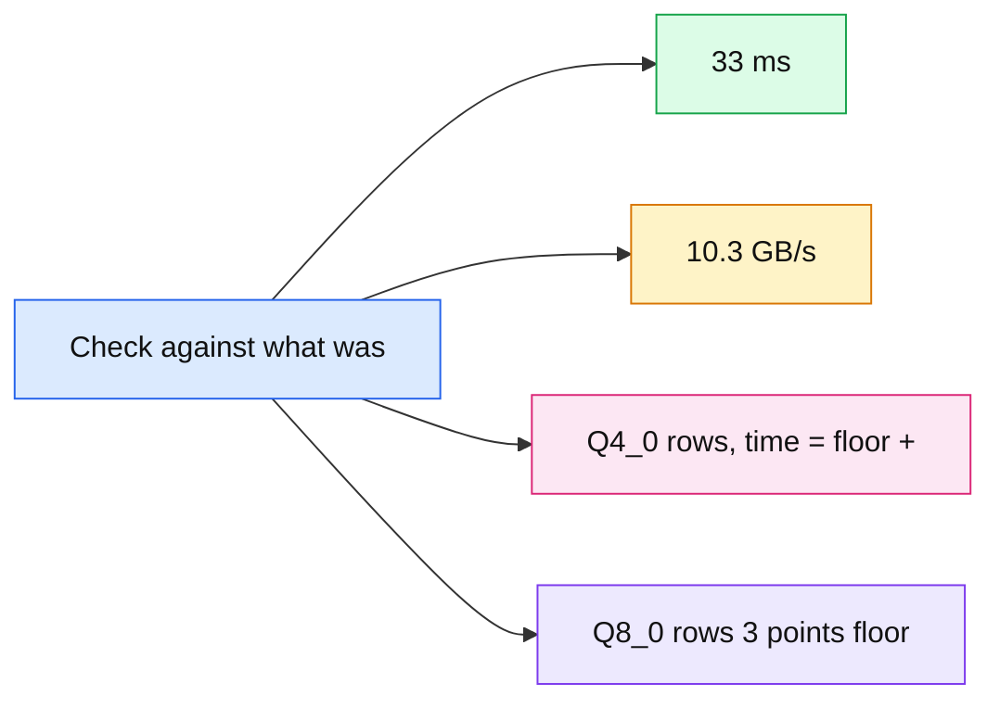

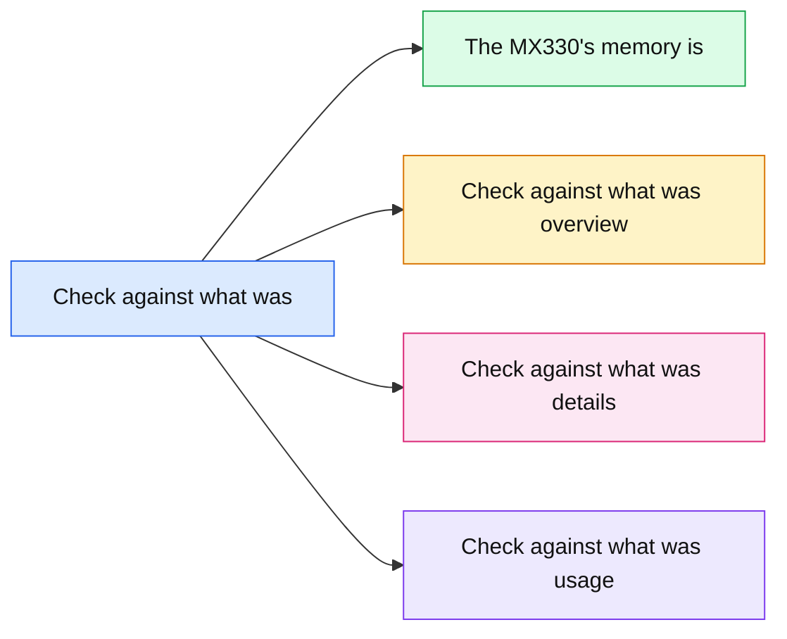

`M = params x bytes/weight x 1.10 + 300 MB` (inference). Plans are `ferrum_wgpu::llama::plan` totals.

| shape | params | precision | formula MB | measured plan MB | error |
|---|---|---|---|---|---|
| SmolLM-135M | 163M | Q4_0 | 401 | 293 | +37% |
| SmolLM-135M | 163M | Q8_0 | 491 | 360 | +36% |
| SmolLM-135M | 163M | f32 | 1017 | 747 | +36% |
| SmolLM-360M | 409M | Q4_0 | 553 | 584 | -5% |
| SmolLM-360M | 409M | Q8_0 | 778 | 764 | +2% |
| SmolLM-360M | 409M | f32 | 2100 | 1805 | +16% |
| Qwen2-0.5B | 630M | Q4_0 | 690 | 906 | -24% |
| Qwen2-0.5B | 630M | Q8_0 | 1036 | 1152 | -10% |
| TinyLlama-1.1B | 1100M | Q4_0 | 981 | 1002 | -2% |
| TinyLlama-1.1B | 1100M | Q8_0 | 1586 | 1519 | +4% |
| TinyLlama-1.1B | 1100M | f32 | 5140 | 4494 | +14% |

Error range -24% to +37%. Under-estimates are the big-vocabulary small models (the f32 embedding is large next to the rest).

- Q4_0 rows, time = floor + weight bytes / bandwidth: floor **33 ms**, effective bandwidth **10.3 GB/s** (4 points).
- Q8_0 rows (3 points): floor 44 ms, effective bandwidth 13.0 GB/s.
- The MX330's memory is 64-bit GDDR5; its published peak is about 56 GB/s (product specification, not measured here).
  So the engine reaches roughly 18% of the peak, plus a fixed cost per token (about 30 layers of small dispatches).

## Largest model that fits

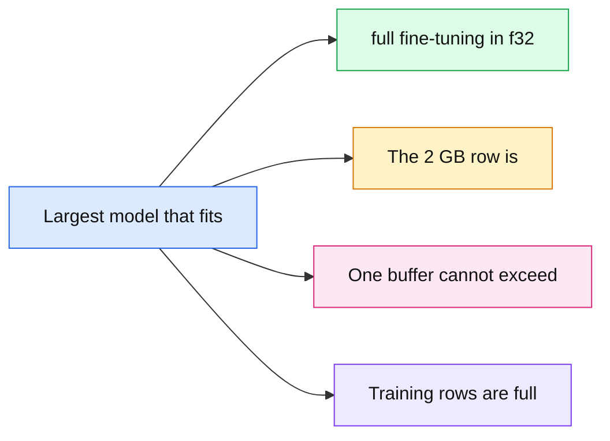

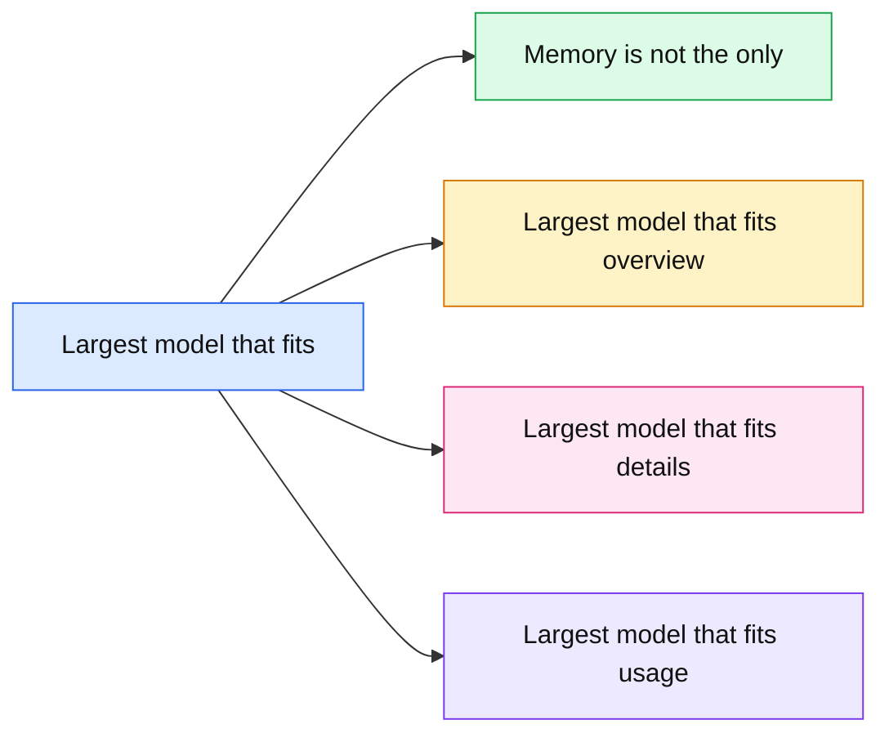

| memory | usable (discrete 90% / unified 70%) | infer Q4_0 | infer Q8_0 | infer f32 | train f32 (full fine-tune) |
|---|---|---|---|---|---|
| 2 GB | 1.8 / 1.4 GB | 2.4B / 1.8B | 1.3B / 941M | 341M / 250M | 87M / 64M |
| 4 GB | 3.6 / 2.8 GB | 5.3B / 4.0B | 2.8B / 2.1B | 750M / 568M | 191M / 145M |
| 8 GB | 7.2 / 5.6 GB | 11.2B / 8.6B | 5.9B / 4.5B | 1.6B / 1.2B | 399M / 307M |
| 16 GB | 14.4 / 11.2 GB | 22.8B / 17.6B | 12.1B / 9.3B | 3.2B / 2.5B | 816M / 631M |
| 24 GB | 21.6 / 16.8 GB | 34.4B / 26.7B | 18.2B / 14.1B | 4.8B / 3.7B | 1.2B / 955M |
| 32 GB | 28.8 / 22.4 GB | 46.1B / 35.7B | 24.4B / 18.9B | 6.5B / 5.0B | 1.6B / 1.3B |
| 48 GB | 43.2 / 33.6 GB | 69.3B / 53.8B | 36.7B / 28.5B | 9.8B / 7.6B | 2.5B / 1.9B |
| 64 GB | 57.6 / 44.8 GB | 92.6B / 71.9B | 49.0B / 38.1B | 13.0B / 10.1B | 3.3B / 2.6B |
| 96 GB | 86.4 / 67.2 GB | 139.2B / 108.1B | 73.7B / 57.2B | 19.6B / 15.2B | 5.0B / 3.9B |
| 128 GB | 115.2 / 89.6 GB | 185.7B / 144.3B | 98.3B / 76.4B | 26.1B / 20.3B | 6.6B / 5.2B |
| 192 GB | 172.8 / 134.4 GB | 278.8B / 216.7B | 147.6B / 114.7B | 39.2B / 30.5B | 10.0B / 7.8B |
| 256 GB | 230.4 / 179.2 GB | 371.9B / 289.1B | 196.9B / 153.1B | 52.3B / 40.7B | 13.3B / 10.4B |
| 512 GB | 460.8 / 358.4 GB | 744.2B / 578.7B | 394.0B / 306.4B | 104.7B / 81.4B | 26.6B / 20.7B |

Each cell is `discrete / unified`.

Read it with these limits in mind:

- **The 2 GB row is contradicted by measurement at its top end.** The formula says 2.4B at Q4_0 on 2 GB
  discrete; the machine ran a 1.1B shape and ran out of memory on a 1.78B one. Big-vocabulary models
  cost more than the formula says (Qwen2-0.5B's plan is 24% above it). Treat the upper cells as optimistic
  by up to a third for models under 2B, and closer for 7B and up, where the embedding is a small share.
- **One buffer cannot exceed the adapter's binding limit** (2047 MiB on the adapters measured; other
  adapters grant other limits, not measured here). An f32 embedding of a 128k vocabulary at width 8192 is
  4.2 GB, so the f32 rows of the largest models are refused regardless of free memory; quantised matrices
  are far smaller. The memory plan checks this before uploading.
- Training rows are **full fine-tuning in f32**. LoRA or any adapter method is not implemented.
- Memory is not the only limit: a 7B model at f32 would fit a 64 GB machine and still decode at a few tokens
  per second (the speed table says how few).

## Decode speed by hardware class

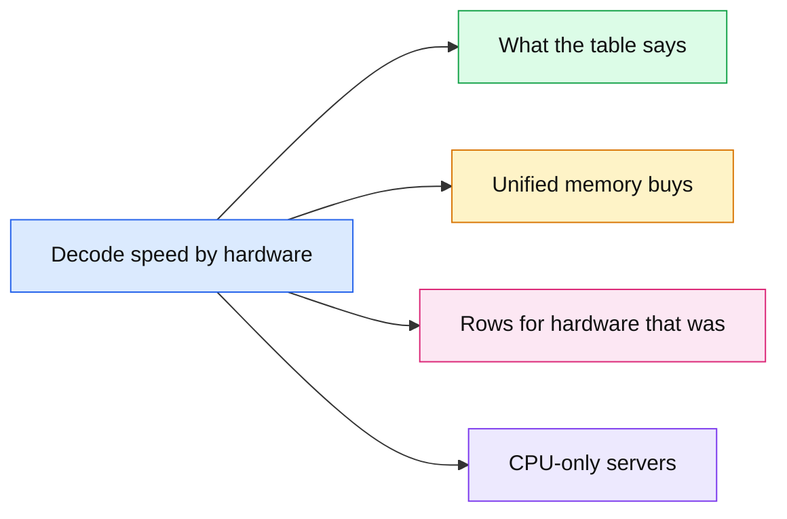

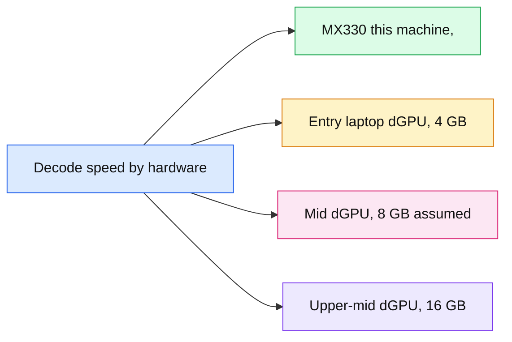

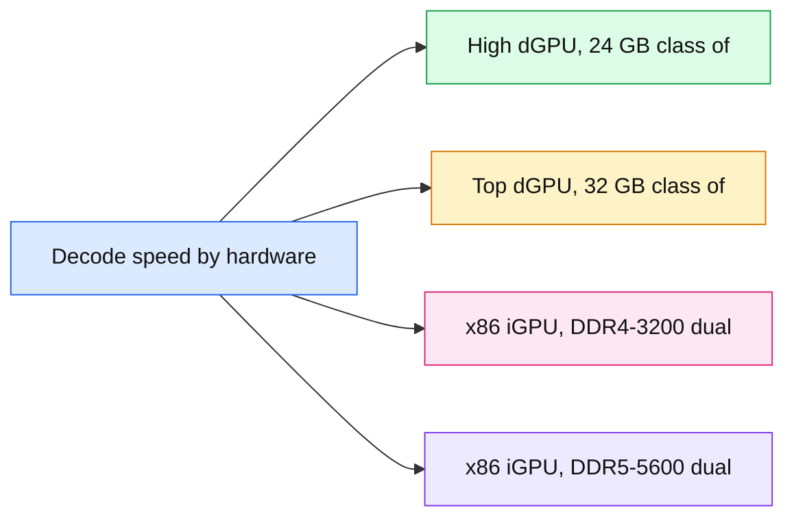

Ceiling = bandwidth / weight bytes (each token reads every weight once). ferrum-gpu estimate = 1 / (layers x 1.2 ms + weight bytes / effective bandwidth), layers 24/28/32/40/48/80 for 0.5/1.5/7/13/34/70B, with effective bandwidth scaled from the MX330 fit (10.3 GB/s at 56 GB/s peak, i.e. 18%). Q4_0 weights. **The estimate is calibrated on one card and extrapolated; no other row was run.**

| hardware | memory | bandwidth GB/s | 0.5B ceiling / est | 1.5B ceiling / est | 7B ceiling / est | 13B ceiling / est | 34B ceiling / est | 70B ceiling / est |
|---|---|---|---|---|---|---|---|---|
| MX330 (this machine, measured) | 2 GB | 56 | 199 / 17.7 | OOM (measured: 1.78B shape) | no fit | no fit | no fit | no fit |
| Entry laptop dGPU, 4 GB | 4 GB | 112 | 398 / 23.2 | 133 / 13.3 | no fit | no fit | no fit | no fit |
| Mid dGPU, 8 GB | 8 GB | 256 | 910 / 28.3 | 303 / 19.2 | 65 / 8.2 | no fit | no fit | no fit |
| Upper-mid dGPU, 16 GB | 16 GB | 448 | 1593 / 30.5 | 531 / 22.5 | 114 / 11.5 | 61 / 7.3 | no fit | no fit |
| High dGPU, 24 GB | 24 GB | 936 | 3328 / 32.2 | 1109 / 25.5 | 238 / 16.1 | 128 / 10.9 | 49 / 5.9 | no fit |
| Top dGPU, 32 GB | 32 GB | 1792 | 6372 / 33.0 | 2124 / 27.1 | 455 / 19.6 | 245 / 14.1 | 94 / 8.6 | no fit |
| x86 iGPU, DDR4-3200 dual channel | 16 GB | 51.2 | 182 / 16.9 | 61 / 8.1 | 13 / 2.2 | 7 / 1.2 | no fit | no fit |
| x86 iGPU, DDR5-5600 dual channel | 32 GB | 89.6 | 319 / 21.5 | 106 / 11.7 | 23 / 3.6 | 12 / 2.0 | 5 / 0.8 | no fit |
| Apple M1, 16 GB | 16 GB | 68 | 242 / 19.3 | 81 / 9.8 | 17 / 2.8 | 9 / 1.6 | no fit | no fit |
| Apple M-series base (M2/M3), 24 GB | 24 GB | 100 | 356 / 22.4 | 119 / 12.5 | 25 / 4.0 | 14 / 2.2 | no fit | no fit |
| Apple M4, 32 GB | 32 GB | 120 | 427 / 23.7 | 142 / 13.8 | 30 / 4.6 | 16 / 2.6 | 6 / 1.1 | no fit |
| Apple M-series Pro, 48 GB | 48 GB | 273 | 971 / 28.6 | 324 / 19.6 | 69 / 8.5 | 37 / 5.2 | 14 / 2.3 | no fit |
| Apple M-series Max, 128 GB | 128 GB | 546 | 1941 / 31.0 | 647 / 23.4 | 139 / 12.8 | 75 / 8.2 | 29 / 4.0 | 14 / 2.0 |
| Apple M-series Ultra, 192 GB | 192 GB | 819 | 2912 / 32.0 | 971 / 25.1 | 208 / 15.3 | 112 / 10.3 | 43 / 5.4 | 21 / 2.8 |
| Hypothetical M5-class Max, 128 GB | 128 GB | 600 | 2133 / 31.3 | 711 / 23.8 | 152 / 13.4 | 82 / 8.7 | 31 / 4.3 | 15 / 2.2 |
| Hypothetical M5-class Ultra, 256 GB | 256 GB | 1200 | 4267 / 32.6 | 1422 / 26.2 | 305 / 17.5 | 164 / 12.2 | 63 / 6.9 | 30 / 3.6 |
| LPDDR5X-8000 256-bit unified APU, 128 GB | 128 GB | 256 | 910 / 28.3 | 303 / 19.2 | 65 / 8.2 | 35 / 4.9 | 13 / 2.2 | 7 / 1.1 |
| Server 8-channel DDR5-4800, 512 GB | 512 GB | 307 | 1092 / 29.1 | 364 / 20.3 | 78 / 9.2 | 42 / 5.6 | 16 / 2.5 | 8 / 1.3 |
| Server 2 x 12-channel DDR5-4800, 1 TB+ | 1024 GB | 921.6 | 3277 / 32.2 | 1092 / 25.4 | 234 / 16.0 | 126 / 10.9 | 48 / 5.8 | 23 / 3.0 |

- MX330 (this machine, measured): discrete, 64-bit GDDR5, published peak
- Entry laptop dGPU, 4 GB: assumed class (128-bit GDDR5/6 around 112 to 128)
- Mid dGPU, 8 GB: assumed class (GDDR6, 128-bit to 256-bit)
- Upper-mid dGPU, 16 GB: assumed class (GDDR6/6X, 256-bit)
- High dGPU, 24 GB: class of the RTX 3090 and 4090 (936 to 1008 GB/s, published)
- Top dGPU, 32 GB: class of the RTX 5090 (published, from memory)
- x86 iGPU, DDR4-3200 dual channel: 3200 MT/s x 16 B
- x86 iGPU, DDR5-5600 dual channel: 5600 MT/s x 16 B
- Apple M1, 16 GB: published 68.25 GB/s
- Apple M-series base (M2/M3), 24 GB: published 100 GB/s
- Apple M4, 32 GB: published 120 GB/s
- Apple M-series Pro, 48 GB: M4 Pro published 273 GB/s
- Apple M-series Max, 128 GB: M4 Max published 546 GB/s (top bin)
- Apple M-series Ultra, 192 GB: M3 Ultra published 819 GB/s
- Hypothetical M5-class Max, 128 GB: ASSUMPTION: Max-class bandwidth near 600 GB/s; no M5 Max spec was checked
- Hypothetical M5-class Ultra, 256 GB: ASSUMPTION: two Max dies, 2 x 600 GB/s
- LPDDR5X-8000 256-bit unified APU, 128 GB: 8000 MT/s x 32 B (Strix-Halo-class)
- Server 8-channel DDR5-4800, 512 GB: 4800 MT/s x 64 B (one socket)
- Server 2 x 12-channel DDR5-4800, 1 TB+: 2 x 4800 MT/s x 96 B; NUMA cuts this in practice

### What the table says

- **Bandwidth is the ceiling, latency is the floor.** Up to about 1.5B parameters the estimate stays in the
  low tens of tokens per second on every class: the per-layer cost dominates, so a 936 GB/s card is
  barely faster than a 256 GB/s one on a 0.5B model. From 7B up, bandwidth matters and the classes separate.
- **Unified memory buys capacity, not speed.** An Apple-class Max or Ultra holds 70B-class models that no
  consumer discrete card can, at a few tokens per second for ferrum-gpu today; a 24 GB discrete card is
  faster on what it can hold.
- **Rows for hardware that was never seen** (the M5-class rows, the 4/8/16 GB card classes, the x86 and server
  rows) are classes with assumed bandwidth, not products. "M5 Max Ultra" is not a product this file can
  document; the two hypothetical rows extrapolate from the Max and Ultra pattern and say so.
- **CPU-only servers** (the two server rows) are included for their memory systems. ferrum-gpu has no tuned
  CPU inference path: its CPU backend is the parity oracle (single-digit GB/s on the 32M shape), and the GPU
  path needs an adapter. The ceiling there is what a bandwidth-tuned CPU runtime could approach, not what
  this repository does.
- **Multiple adapters or multiple machines are not supported.** The engine uses one adapter per process;
  pooling the memory of several cards is not implemented, so the "memory" column is per adapter.

## Summary by memory size

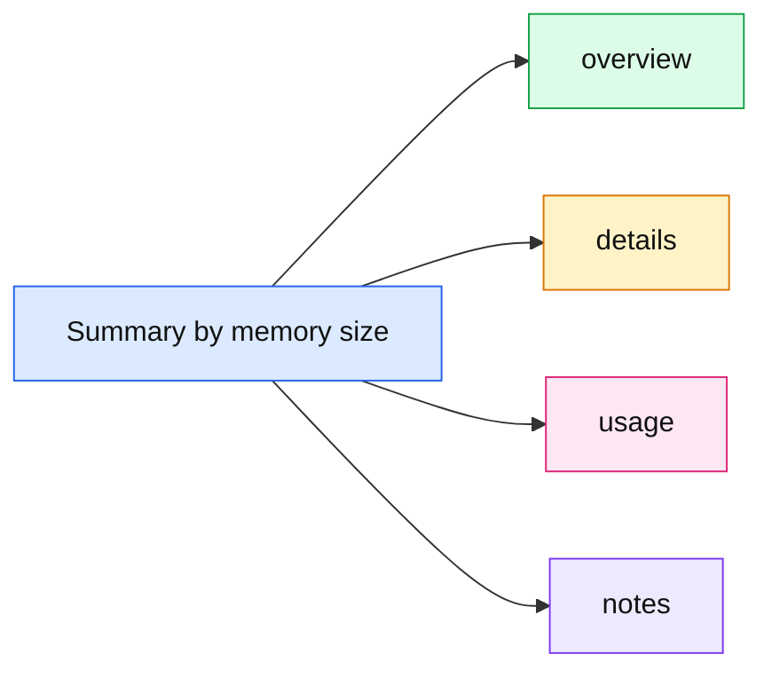

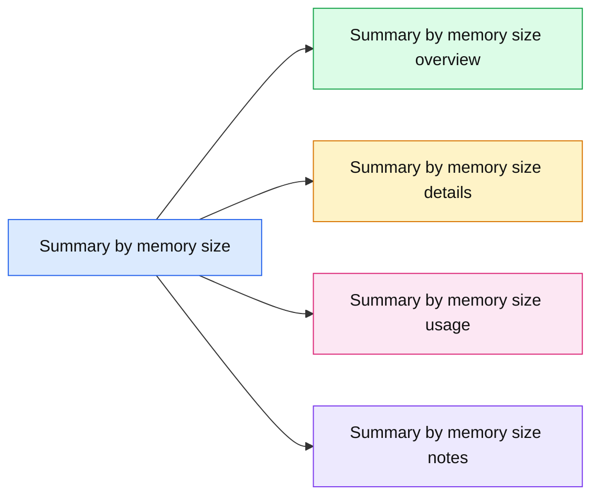

| memory | what it holds, inference at Q4_0 (discrete / unified) | training from scratch or full fine-tune (discrete / unified) |
|---|---|---|
| 4 GB | up to about 5B / 4B (measured: 2 GB card ran a 1.1B shape) | about 190M / 145M |
| 8 GB | about 11B / 8.6B | about 400M / 300M |
| 16 GB | about 23B / 18B | about 800M / 630M |
| 24 GB | about 34B / 27B | about 1.2B / 950M |
| 32 GB | about 46B / 36B | about 1.6B / 1.3B |
| 64 GB | about 93B / 72B | about 3.3B / 2.6B |
| 96 GB | about 139B / 108B | about 5.0B / 3.9B |
| 128 GB | about 186B / 144B | about 6.6B / 5.2B |

These are the cells of the big table, rounded. Subtract up to a third from the small-model end, per the 2 GB note.

## How this changes the project's own scope

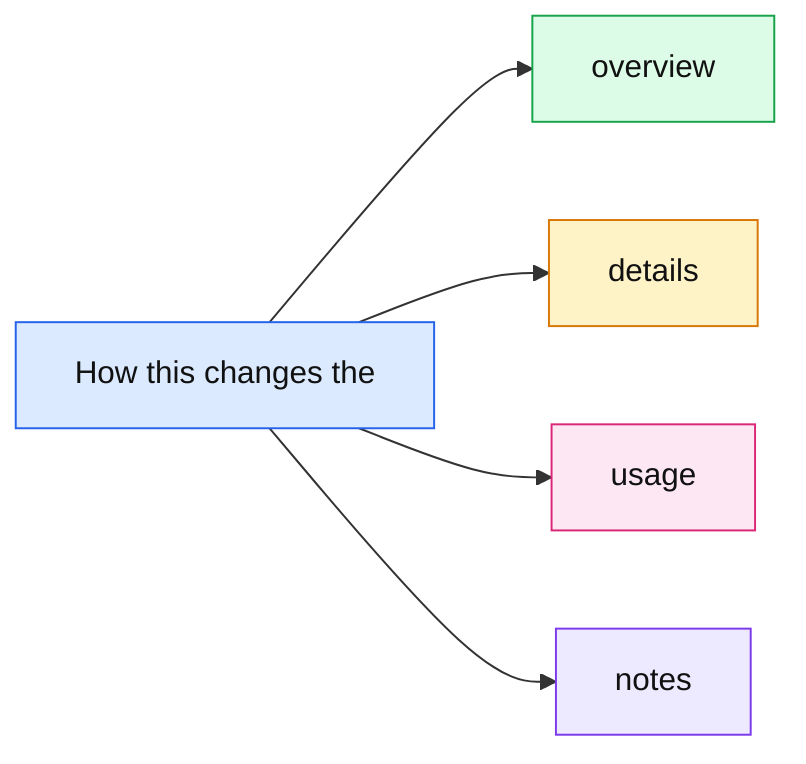

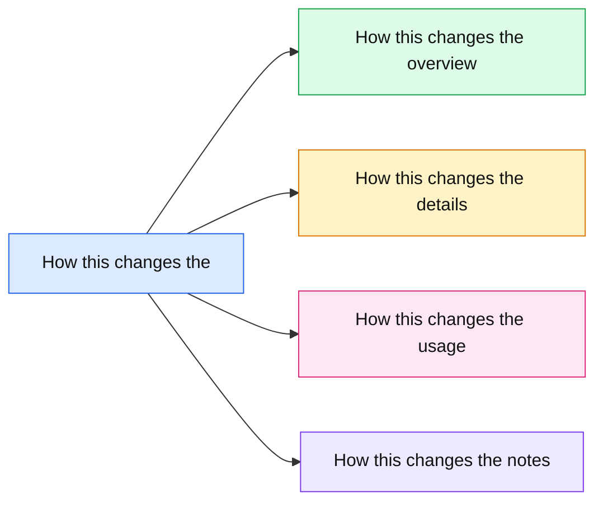

The repository's size limit is 1.5B parameters for models it downloads. The estimates above go well past
that on purpose: they answer what the hardware could hold, not what ferrum-gpu is meant to run. Within
1.5B, any class from 4 GB up holds the model at Q4_0 or Q8_0.
