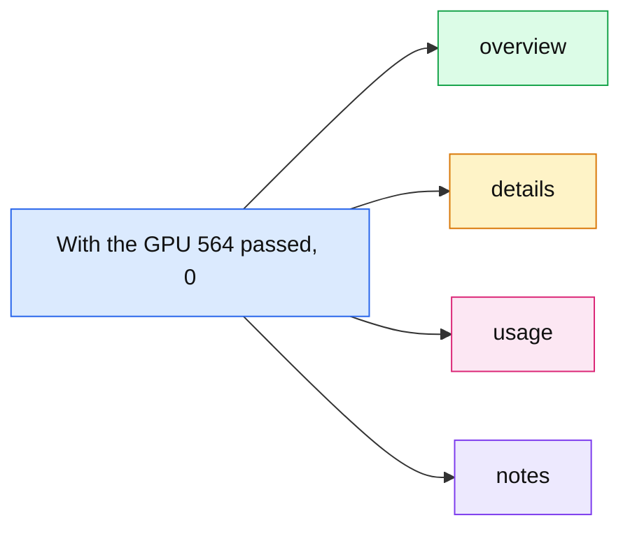

# Last test results

Generated by `scripts/test-all.sh` on 2026-11-11 19:30, commit 557579e. Overwritten on every run.

## With the GPU: 564 passed, 0 failed, 1 ignored

| test binary | passed | failed | ignored |
|---|---:|---:|---:|
| api | 12 | 0 | 0 |
| browser_bench | 0 | 0 | 1 |
| browser_ui | 1 | 0 | 0 |
| browser_webgpu | 2 | 0 | 0 |
| e2e | 8 | 0 | 0 |
| ferrum_gguf | 44 | 0 | 0 |
| ferrum_gpu_cli | 45 | 0 | 0 |
| ferrum_gpu_gui | 26 | 0 | 0 |
| ferrum_gpu_server | 29 | 0 | 0 |
| ferrum_model | 55 | 0 | 0 |
| ferrum_ref | 104 | 0 | 0 |
| ferrum_tok | 43 | 0 | 0 |
| ferrum_wgpu | 180 | 0 | 0 |
| forward_pass | 1 | 0 | 0 |
| test_context_scripts | 10 | 0 | 0 |
| test_independence | 4 | 0 | 0 |

## No GPU (every adapter hidden): 564 passed, 0 failed, 1 ignored

| test binary | passed | failed | ignored |
|---|---:|---:|---:|
| api | 12 | 0 | 0 |
| browser_bench | 0 | 0 | 1 |
| browser_ui | 1 | 0 | 0 |
| browser_webgpu | 2 | 0 | 0 |
| e2e | 8 | 0 | 0 |
| ferrum_gguf | 44 | 0 | 0 |
| ferrum_gpu_cli | 45 | 0 | 0 |
| ferrum_gpu_gui | 26 | 0 | 0 |
| ferrum_gpu_server | 29 | 0 | 0 |
| ferrum_model | 55 | 0 | 0 |
| ferrum_ref | 104 | 0 | 0 |
| ferrum_tok | 43 | 0 | 0 |
| ferrum_wgpu | 180 | 0 | 0 |
| forward_pass | 1 | 0 | 0 |
| test_context_scripts | 10 | 0 | 0 |
| test_independence | 4 | 0 | 0 |
