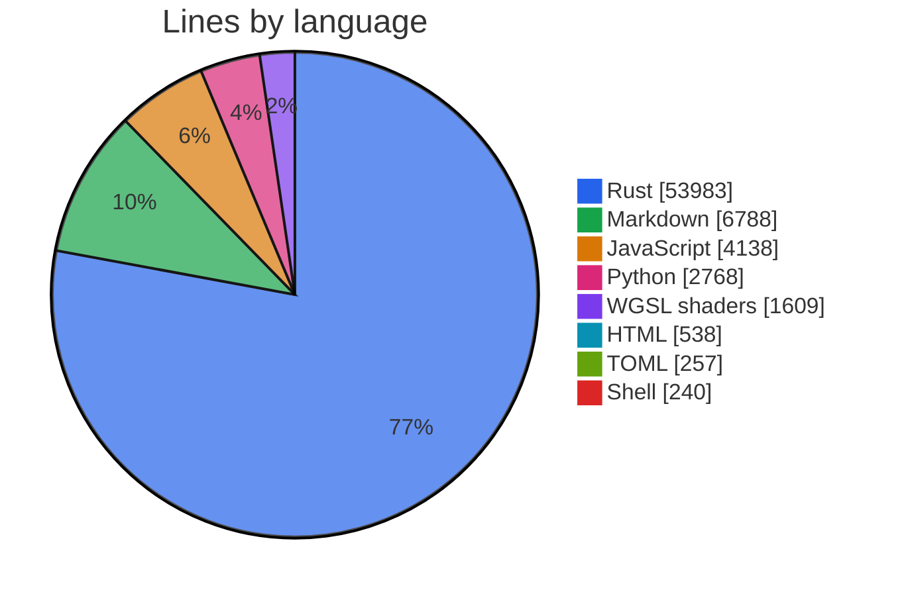
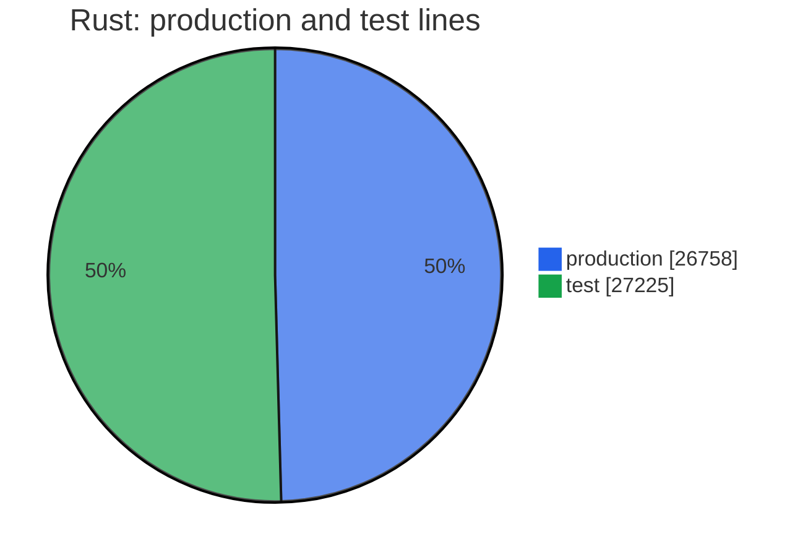

# Project metrics

Generated by `scripts/metrics.py`; do not edit by hand. The git pre-commit hook (`scripts/githooks`) refreshes everything below except the two measured sections; `scripts/coverage.sh` refreshes the coverage section and `scripts/gate.sh` the gate section. See [developing.md](docs/developing.md).

Snapshot: 2026-11-23 12:11 UTC, branch `coverage100`, after `d30e03e` plus the commit being made.

## Size

| language | files | lines |
|---|---|---|
| Rust | 1114 | 53983 |
| Markdown | 48 | 6788 |
| JavaScript | 90 | 4138 |
| Python | 58 | 2768 |
| WGSL shaders | 56 | 1609 |
| HTML | 2 | 538 |
| TOML | 15 | 257 |
| Shell | 12 | 240 |
| YAML | 3 | 199 |
| CSS | 2 | 117 |

Rust: **26758** lines of production code and **27225** lines of test code (test lines are 50.43% of the Rust), non-blank lines.

### Rust by crate

| crate | files | production lines | test lines | `#[test]` functions | ignored |
|---|---|---|---|---|---|
| ferrum_gguf | 50 | 1287 | 994 | 63 | 0 |
| ferrum_gpu_cli | 46 | 9 | 2132 | 33 | 0 |
| ferrum_gpu_core | 314 | 8030 | 7706 | 357 | 0 |
| ferrum_gpu_gui | 116 | 1714 | 3639 | 127 | 1 |
| ferrum_gpu_server | 6 | 20 | 280 | 8 | 0 |
| ferrum_gpu_studio | 8 | 136 | 140 | 7 | 0 |
| ferrum_model | 118 | 3267 | 2336 | 122 | 0 |
| ferrum_ref | 126 | 3847 | 2166 | 130 | 0 |
| ferrum_test_support | 9 | 258 | 240 | 12 | 0 |
| ferrum_tok | 35 | 859 | 741 | 43 | 0 |
| ferrum_wgpu | 268 | 7331 | 5958 | 261 | 1 |
| tests | 18 | 0 | 893 | 29 | 0 |

## Tests

**1192** `#[test]` functions counted in the source (2 marked `#[ignore]`, run by hand). The number of tests that ran, per run, is in `last-test-results.md`.

## Structure

Rule 11 asks for files of about 500 production lines or fewer: **0** Rust file(s) are over it.

| largest Rust files (production lines) | lines |
|---|---|
| ferrum_gpu_gui/src/api/export.rs | 97 |
| ferrum_gpu_core/src/commands/gpt2/error_paths/generate.rs | 95 |
| ferrum_gpu_core/src/modelinfo/max_header.rs | 92 |
| ferrum_wgpu/src/models/llama/feed.rs | 91 |
| ferrum_ref/src/training/trainer/run/train.rs | 91 |
| ferrum_gpu_core/src/commands/gpt2/error_paths/sweep.rs | 91 |
| ferrum_wgpu/src/models/llama/limits.rs | 90 |
| ferrum_wgpu/src/device/gpuerror.rs | 90 |
| ferrum_model/src/prepare/ingest.rs | 90 |
| ferrum_model/src/gguf/llama/tensor_read.rs | 90 |

## Dependencies

11 workspace members; 147 packages in `Cargo.lock` (every crate, ours included).

## History

| commits | first | latest | authors | local branches | tags |
|---|---|---|---|---|---|
| 205 | 2026-10-27 | 2026-11-23 | 1 | 10 | 0 |

## Gate

<!-- gate:begin -->
Last run of `scripts/gate.sh` (target: under 20 minutes with warm builds).

| step | result | time |
|---|---|---|
| fmt | pass | 0m 00s |
| clippy | pass | 0m 01s |
| rules | pass | 0m 00s |
| dups | pass | 0m 00s |
| scripts | pass | 0m 03s |
| llvmpipe | pass | 3m 04s |
| xe | pass | 3m 02s |
| timelimit | pass | 4m 51s |
| timing | pass | 0m 00s |
| coverage | pass | 11m 54s |
| deny | pass | 0m 01s |
| studio | pass | 0m 02s |
| studiodeny | pass | 0m 01s |
| **total** | PASS | 22m 59s |
<!-- gate:end -->

## Test coverage

<!-- coverage:begin -->
Measured 2026-11-23 12:10 UTC on commit `b9c61d4` by `scripts/coverage.sh` (the whole workspace on the default adapter, then on no adapter, merged).

| measure | covered | total | missed | coverage |
|---|---|---|---|---|
| lines | 17983 | 17983 | 0 | 100.00% |
| regions | 33655 | 34390 | 735 | 97.86% |
| functions | 2225 | 2225 | 0 | 100.00% |

Floor enforced by the gate: **100%** of lines.

### By crate

| crate | lines | missed | line coverage | region coverage |
|---|---|---|---|---|
| ferrum_gguf | 933 | 0 | 100.00% | 98.92% |
| ferrum_gpu_cli | 7 | 0 | 100.00% | 100.00% |
| ferrum_gpu_core | 5574 | 0 | 100.00% | 97.60% |
| ferrum_gpu_gui | 1166 | 0 | 100.00% | 99.39% |
| ferrum_gpu_server | 12 | 0 | 100.00% | 100.00% |
| ferrum_model | 2350 | 0 | 100.00% | 97.81% |
| ferrum_ref | 2720 | 0 | 100.00% | 99.58% |
| ferrum_test_support | 187 | 0 | 100.00% | 97.86% |
| ferrum_tok | 587 | 0 | 100.00% | 99.31% |
| ferrum_wgpu | 4447 | 0 | 100.00% | 96.54% |

### Least covered files

Every file is fully covered.
<!-- coverage:end -->
