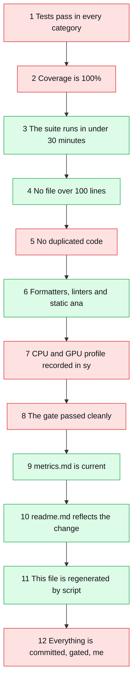

# Next steps

Generated by `scripts/next_steps.py` after each commit and push; do not edit by hand. Hand-kept follow-ups go in `docs/backlog.md` as `- [ ]` lines and appear here.

Snapshot: branch `coverage100` at `787110f`.

## Checklist (AGENTS.md section 7)

- [ ] 1. Tests pass in every category (last gate: -)
- [ ] 2. Coverage is 100% (measured 99.15%, 150 lines missed)
- [x] 3. The suite runs in under 30 minutes, timings in test-time-report.md (measured 4.5 min)
- [x] 4. No file over 100 lines (0 over)
- [ ] 5. No duplicated code (191 duplicated runs recorded)
- [x] 6. Formatters, linters and static analysis are clean (fmt, clippy, deny: see the gate)
- [ ] 7. CPU and GPU profile recorded in system-profile.md
- [ ] 8. The gate passed cleanly
- [x] 9. metrics.md is current
- [x] 10. readme.md reflects the change
- [x] 11. This file is regenerated by scripts/next_steps.py
- [ ] 12. Everything is committed, gated, merged and pushed (4 branches ahead of main)

## The way forward, in order

1. Commit the working tree (the pre-commit hook refreshes the generated reports).
2. Run `scripts/gate.sh` and fix what it reports.
3. Write tests for the uncovered lines until coverage is 100%: ferrum_gpu_core/src/engine/gpu/backend.rs (15), ferrum_gpu_core/src/http/head.rs (6), ferrum_ref/src/training/trainer/run/train.rs (6), ferrum_gpu_core/src/commands/gpt2/train/tokenizer.rs (5), ferrum_gguf/src/codec/quant/err.rs (4).
4. Remove duplicated code (`scripts/dup_check.py --report`), then `--update`.
5. After a green gate, merge `coverage100` (31 commits ahead of main: license: the licensing website is thomascherickal.com/licensing-html) and push `main`.
6. After a green gate, merge `perf` (3 commits ahead of main: perf: per-column and tiled kernels for MXFP4, FP8 and Q2_K, chosen from measurements on the MX330 and the Xe) and push `main`.
7. After a green gate, merge `perf-final` (9 commits ahead of main: style: clippy in the close-watcher test) and push `main`.
8. After a green gate, merge `quant-simplify` (1 commits ahead of main: wip: cleanup of the quantization commit (not built yet)) and push `main`.
9. GUI self-test: choose the packing kind from the file's real tensor type (`QKind::from_ggml`) instead of from the requested precision; this closes the last uncovered GUI lines.
10. Performance and load tests: a load test for the JSON server (many clients, in-flight cap, latency percentiles) and for the GUI API; record the figures in `system-profile.md`.
11. Security tests: path handling of the file API and the jobs allow-list, request-size and header limits, token handling (AGENTS.md section 1).
12. Delete branches and worktrees that are fully merged or superseded (`perf`, `perf-final`, `metrics`, `fast-gate`, `quant-formats`, `quant-simplify`, `gui-features`, `worktree-gui-studio`) once `main` contains their work.
13. Hardware rows that need a real machine: Apple Silicon, AMD, Windows (`docs/devices.md`).
