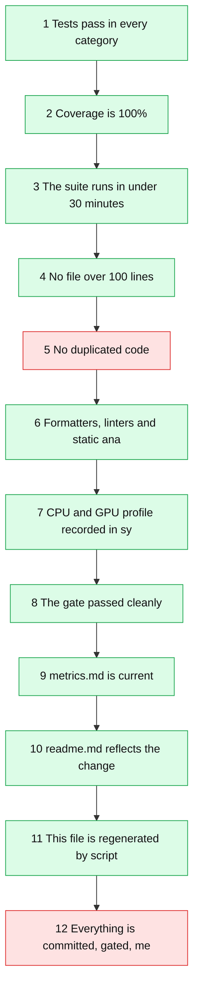
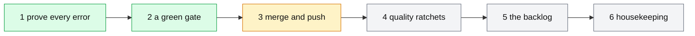

# Next steps

Generated by `scripts/next_steps.py` after each commit and push; do not edit by hand. Hand-kept follow-ups go in `docs/backlog.md` as `- [ ]` lines and appear here.

Snapshot: branch `coverage100` at `d30e03e`.

## Checklist (AGENTS.md section 7)

- [x] 1. Tests pass in every category (last gate: PASS)
- [x] 2. Coverage is 100% (measured 100.00%, 0 lines missed)
- [x] 3. The suite runs in under 30 minutes, timings in test-time-report.md (measured 4.8 min)
- [x] 4. No file over 100 lines (0 over)
- [ ] 5. No duplicated code (167 duplicated runs recorded)
- [x] 6. Formatters, linters and static analysis are clean (fmt, clippy, deny: see the gate)
- [x] 7. CPU and GPU profile recorded in system-profile.md
- [x] 8. The gate passed cleanly
- [x] 9. metrics.md is current
- [x] 10. readme.md reflects the change
- [x] 11. This file is regenerated by scripts/next_steps.py
- [ ] 12. Everything is committed, gated, merged and pushed (4 branches ahead of main)

## Plan in phases

### [x] Phase 1: prove every error path with simulated failures

- List the functions that never ran: `cargo llvm-cov report --json --output-path target/cov.json`, then `python3 scripts/missed_functions.py target/cov.json`.
- Cover each with a simulated failure (a directory where a file is expected, corrupt input, the failing writers, the GPU fault injection, an injected environment).
- Re-measure with `scripts/coverage.sh` (0 lines missed in the summary now; zero lines uncovered by lcov is enforced there).
- Done when: the summary reports 0 missed lines and 0 missed functions.

### [x] Phase 2: a green gate on this tree

- Run `scripts/gate.sh`: fmt, clippy, rules, duplicates, script tests, llvmpipe and Xe, timing, coverage, deny, the desktop app.
- Fix what it reports; it also writes `test-time-report.md` and `system-profile.md`.
- Done when: `.gate/gate.done` says PASS for this commit.

### [ ] Phase 3: merge and push **(current)**

- Merge `coverage100` (41 commits ahead of main: portable: Linux-only code and tests replaced with cross-platform versions; the gate scripts are Python).
- Merge `perf` (3 commits ahead of main: perf: per-column and tiled kernels for MXFP4, FP8 and Q2_K, chosen from measurements on the MX330 and the Xe).
- Merge `perf-final` (9 commits ahead of main: style: clippy in the close-watcher test).
- Merge `quant-simplify` (1 commits ahead of main: wip: cleanup of the quantization commit (not built yet)).
- Merge into `main`, re-check the merged result, then `git push origin main` (pushing is automatic by the user's standing decision).
- Done when: no branch is ahead of `main` and `main` is pushed.

### [ ] Phase 4: quality ratchets

- Remove duplicated code (167 runs recorded; `scripts/dup_check.py --report`), then `--update`.
- Narrow visibility further (`cargo clippy --workspace --all-targets -- -W unreachable_pub`), then SOLID review of the largest modules.
- Done when: `scripts/dup_check.py` reports 0 duplicated runs.

### [ ] Phase 5: the backlog

- GUI self-test: choose the packing kind from the file's real tensor type (`QKind::from_ggml`) instead of from the requested precision; this closes the last uncovered GUI lines.
- Performance and load tests: a load test for the JSON server (many clients, in-flight cap, latency percentiles) and for the GUI API; record the figures in `system-profile.md`.
- Security tests: path handling of the file API and the jobs allow-list, request-size and header limits, token handling (AGENTS.md section 1).
- Delete branches and worktrees that are fully merged or superseded (`perf`, `perf-final`, `metrics`, `fast-gate`, `quant-formats`, `quant-simplify`, `gui-features`, `worktree-gui-studio`) once `main` contains their work.
- Hardware rows that need a real machine: Apple Silicon, AMD, Windows (`docs/devices.md`).
- Done when: `docs/backlog.md` has no open item.

### [ ] Phase 6: housekeeping

- Delete branches and worktrees that are fully merged (`git branch -d`, never `-D`).
- Refresh `handoff.md` and the readme's measured numbers.
- Done when: nothing stale is left behind.

The working tree has uncommitted changes: commit them first (the pre-commit hook refreshes this file).

