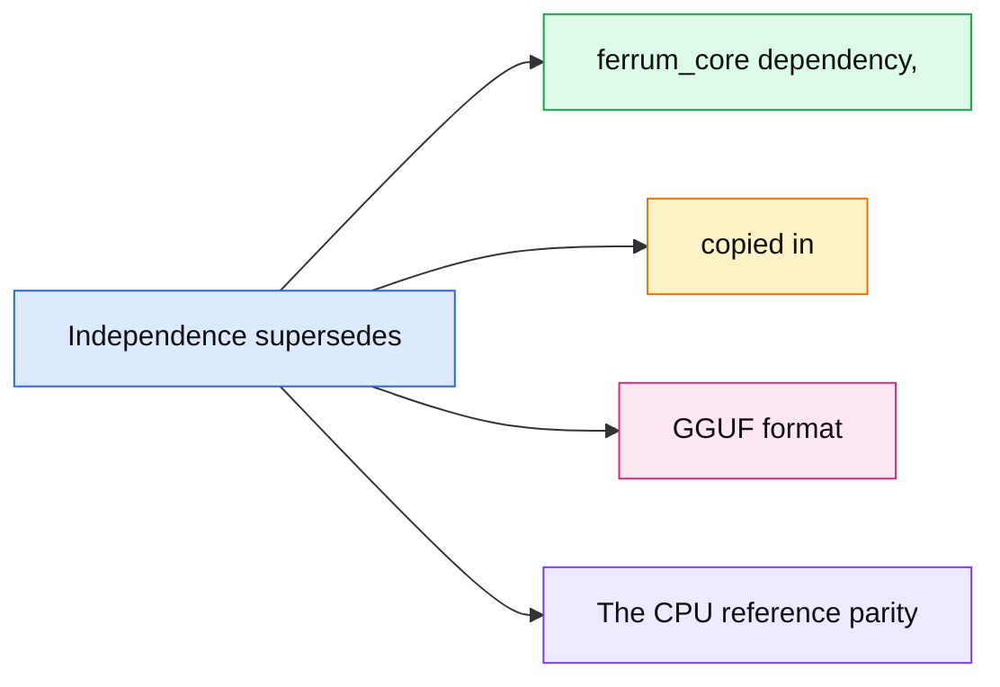
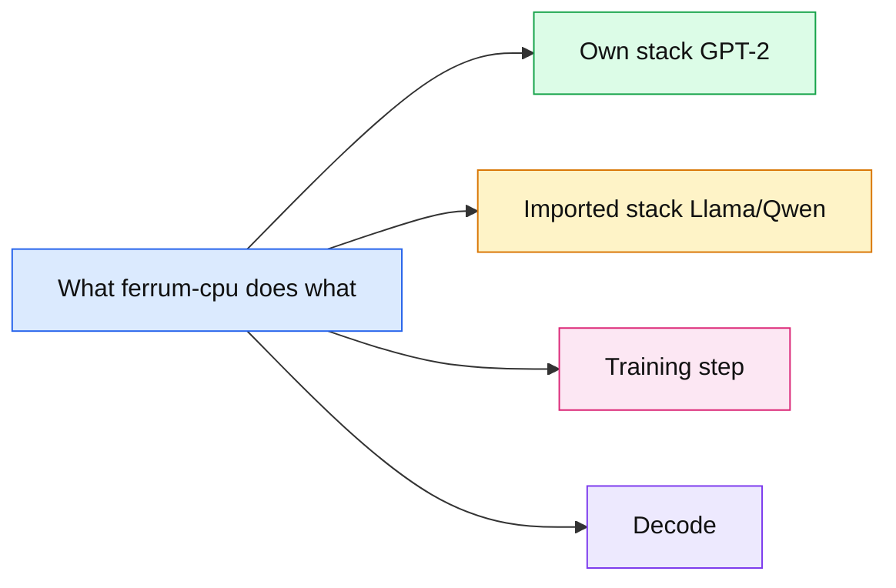
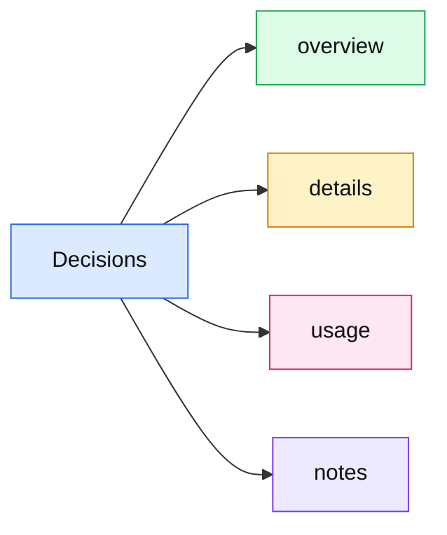
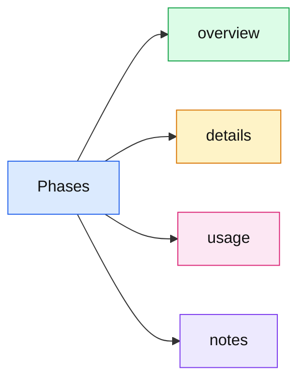

# ferrum-gpu plan (index)

**Goal:** train, fine-tune, score and run small causal Transformers on any GPU (NVIDIA, AMD, Intel, Apple Silicon) with GGUF in and out. Behaviour mirrors ferrum-cpu; the code does not depend on it.

**Status:** Phases 0 to 5 complete (training gate met: about 4x to 5x over an 8-thread CPU step on a 23M-parameter model; QAT done; Llama/Qwen inference and fine-tuning on the GPU). Phases 5a (GUI, `docs/gui.md`) and 5b (browser WebGPU, `docs/browser-webgpu.md`) are complete; Phase 6 (CLI `ferrum-gpu`, server `ferrum-gpu-server`, the `auto` device rule, the memory pre-flight; `docs/cli.md`) is complete; Phase 7 (device matrix, docs/devices.md) is complete for the hardware available; the follow-on parity work is in matcher-plan.md. Start with `readme.md` for the documentation set.

## Independence (supersedes the earlier plan)

ferrum-gpu is a standalone repo. There is **no** `ferrum_core` dependency, **no** traits added to ferrum-cpu, and ferrum-cpu is never modified. Everything the GPU engine needs from ferrum-cpu is **copied in** by the phase that needs it, with a provenance header (source path + commit). Consequences:

- The CPU reference (parity oracle) lives in `ferrum_ref/`, a small crate we own. It grows phase by phase: matmul in Phase 0; LayerNorm, GELU, attention, cross-entropy, Adam, Q8_0 and f16 in Phase 2; GGUF, tokenizer and sampling in Phase 3.
- The training loop, checkpoint format and CLI/server are our own. Compatibility is the **GGUF format**, proven with fixture files kept in `fixtures/`.
- ferrum-cpu's own `CLAUDE.md` still mentions this repo; that pointer is now informational only.

## What ferrum-cpu does (what must be reproduced)

- **Own stack (GPT-2):** learned positions, LayerNorm (eps 1e-5), tanh-GELU, dense MHA with `-1e9` causal mask, optional tied head; Adam/AdamW, global-norm clip, warmup+cosine, FFN dropout, int8 QAT = Q8_0 (blocks of 32 down columns, f16 scale, ties away from zero).
- **Imported stack (Llama/Qwen):** RMSNorm, RoPE (NORM/NEOX + scaling), GQA, SwiGLU; f32/Q8_0/Q4_0 inference, f32 AdamW fine-tune.
- **Training step:** whole batch as one `[B*T, C]` matrix: sync tied head, QAT snap, forward, CE, backward, restore masters, clip, Adam. Checkpoint = GGUF `ferrum-checkpoint` with `p{i}.data/m/v` F32 in canonical order.
- **Decode:** one token in, `[vocab]` logits out, KV cache between; sampling on the host.
- **Reference model:** 507,552 params (ctx 128, embed 96, 4 heads, 3 blocks, hidden 320, vocab 1024).

## Decisions

| Question | Decision |
|---|---|
| Backend | `wgpu` (pinned, 30.0.1 at time of writing) + WGSL. One safe-Rust path to Vulkan, Metal, DX12. |
| Precision | f32 on device; Q8_0/Q4_0 dequantised in-kernel for inference. No f16 requirement. |
| Determinism | Bit-identical across repeat runs on the same adapter/driver/wgpu version. CPU-vs-GPU by tolerance. |
| Default device | `auto` (training on a hardware GPU, decoding on the CPU, from the Phase 3/4 measurements); Phase 7's matrix (docs/devices.md): hardware Vulkan is trusted, OpenGL and software adapters are only used when named. |
| Layout | Workspace crates: `ferrum_ref` (CPU reference), `ferrum_wgpu` (engine), `ferrum_gpu_gui` (GUI server and in-browser runtime), `ferrum_gpu_cli`, `ferrum_gpu_server`, `tests`. |

## Baselines

Speedup gates from Phase 2 on are measured against the tuned CPU matmul ported into `ferrum_ref` in task 2.0, not the simple reference kernel, which is the parity oracle only.

## Portability rules

1. Ask the adapter for its limits; never assume more than the WebGPU baseline.
2. One buffer per tensor; refuse (naming tensor and limit) if it exceeds the binding size.
3. Memory budget is chosen by us (wgpu has no portable VRAM query): override > `nvidia-smi`/sysfs > half of RAM on integrated/unified-memory adapters > unknown. Apple Silicon counts host + device copies against one pool.
4. Plan, sum, then allocate: the estimate is the sum of the buffer table.
5. Allocation failure and device loss are error values, never panics.
6. WGSL only, f32/u32/i32 only, no optional features required.
7. Software adapters are chosen only when named explicitly.

## Parity rules

Round-half-away-from-zero in the Q8_0 snap; f16 scale via integer bit ops; `-1e9` mask with max-subtract softmax; every reduction in a fixed ascending order (no atomics); embedding gradient via sorted CSR index; Adam bias corrections, lr, clip scale and RoPE tables computed on the host; dropout masks from the host RNG.

## Phases

| # | File | Deliverable | Gate |
|---|---|---|---|
| 0 | [phase-0.md](docs/plans/phase-0.md) | Workspace, adapter selection, budget parsers, matmul spike, benchmark | 3x 8-thread CPU matmul at 1024+, else stop |
| 1 | [phase-1.md](docs/plans/phase-1.md) | Device, buffers, budget, kernel runtime | Parity on tiny ops, suite passes with no GPU |
| 2 | [phase-2.md](docs/plans/phase-2.md) | Forward kernels + CPU reference | Per-kernel parity on adversarial shapes |
| 3 | [phase-3.md](docs/plans/phase-3.md) | GGUF I/O, tokenizer, GPT-2 inference | Generate/score match reference |
| 4 | [phase-4.md](docs/plans/phase-4.md) | Backward, Adam, QAT, training, checkpoints | Loss curve parity, deterministic, 2x on larger model |
| 5 | [phase-5.md](docs/plans/phase-5.md) | Llama/Qwen inference + fine-tune | Parity on tiny llama |
| 5a | [phase-5a.md](docs/plans/phase-5a.md) | Local web GUI: device, train, generate, GGUF in/out (std-only server, byte tokenizer) | Same API behaviour on CPU and GPU; headless-Chrome run passes |
| 5b | [phase-5b.md](docs/plans/phase-5b.md) | Inference in the browser tab on WebGPU, sharing the native WGSL | Browser logits match the CPU oracle (headless Chrome) |
| 6 | [phase-6.md](docs/plans/phase-6.md) | Own CLI and server, `--device`, pre-flight | E2E through the binaries |
| 7 | [phase-7.md](docs/plans/phase-7.md) | Verification matrix, default flip | Only classes with a green row |

Not planned: per-vendor backends, f16/mixed precision, multi-GPU, activation recomputation, wasm builds of the engine, browser training.

## Risks

wgpu API churn (keep calls in three files, pin the version); driver variance in low bits; fixed submit/readback cost may make small models faster on CPU (an `auto` rule, not a failure); 2 GB VRAM locally; no real GPU in CI; Apple Silicon unverified until run; licences in wgpu's tree (checked with `cargo deny` in Phase 0).
