# ferrum-gpu

Train, fine-tune, score and run **small causal Transformers on the GPU**, in safe Rust with
[`wgpu`](https://wgpu.rs) and WGSL. Models come in and go out as **GGUF** files. The engine targets any GPU
`wgpu` can reach (Vulkan, Metal, DX12), including Apple Silicon, but it has so far been run only on the
hardware listed under [Status](#status).

ferrum-gpu mirrors the behaviour of the CPU project ferrum-cpu **without depending on it**: the two
meet only at the GGUF file format. Every GPU kernel is checked against a CPU reference written in this
repository (`ferrum_ref`), and every figure in the docs comes from a real run or is labelled an estimate.

## Contents

[What it is](#what-it-is) · [How it works](#how-it-works) · [What it does](#what-it-does) ·
[Quick start](#quick-start) · [Commands](#commands) · [Server](#the-server) · [GUI](#the-gui) ·
[Works with](#works-with-llamacpp-ollama-lm-studio-and-unsloth) · [What size can it run?](#what-size-can-it-run) ·
[Measured on this machine](#measured-on-this-machine) · [Hardware estimates](#hardware-estimates) ·
[Testing](#testing-and-quality) · [Status](#status) · [Repository map](#repository-map) ·
[Documentation](#documentation) · [Independence](#independence-from-ferrum-cpu) · [License](#license)

## What it is

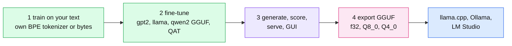


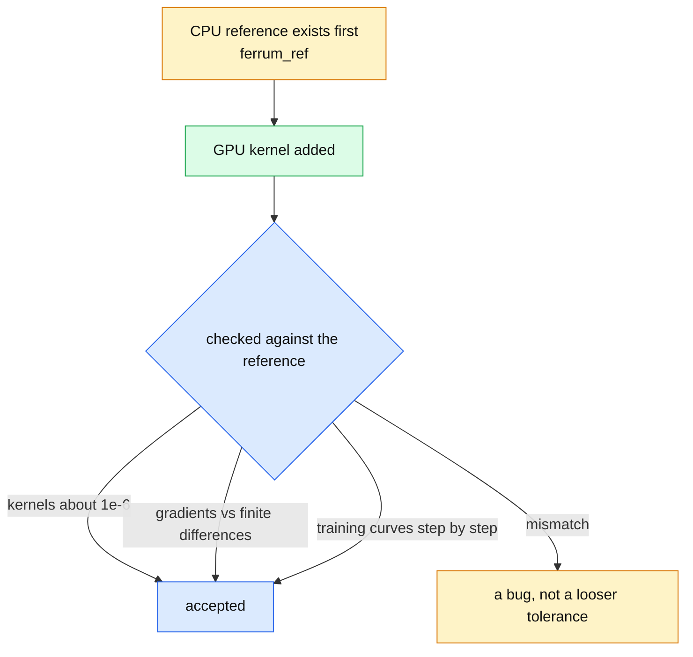


A small-model engine, not a general LLM runtime. It is meant for models from a few thousand to a few hundred
million parameters that you **train or fine-tune yourself** on a laptop or desktop GPU, and then use or hand to
other tools as an ordinary GGUF file. It covers the whole loop in one binary:

1. train a model on your text (with its own byte-pair-encoding tokenizer, or byte level),
2. fine-tune it (or an existing `gpt2`/`llama`/`qwen2` GGUF) with quantisation-aware training,
3. generate from it, score text with it, serve it over HTTP, or poke at it in a local web page,
4. export it as GGUF (f32, Q8_0 or Q4_0) for llama.cpp, Ollama or LM Studio.

Two design rules shape the code. **Parity first:** nothing is added to the GPU path until a CPU reference
implementation exists and the GPU result is checked against it (kernel outputs to about 1e-6, whole-model
gradients to finite differences, training curves step by step). **No unsafe, no outside dependencies:** every
crate is `#![forbid(unsafe_code)]`, and there is no dependency on ferrum-cpu or on anything outside this
repository.

What it is **not**: a runtime for 7B-and-up models (see [What size can it run?](#what-size-can-it-run)), a
multi-GPU engine (one adapter per process), or a hosted service (the server and GUI listen on loopback by
default).

## How it works

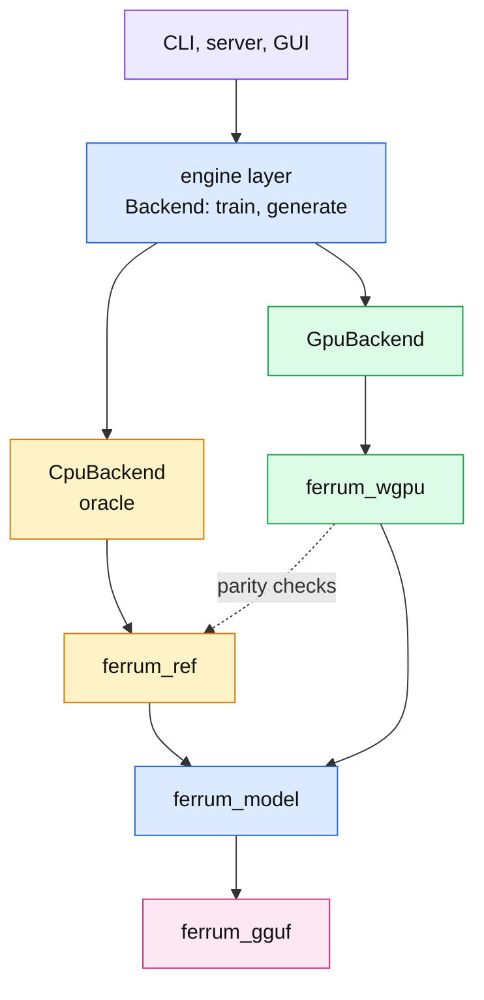


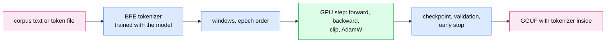


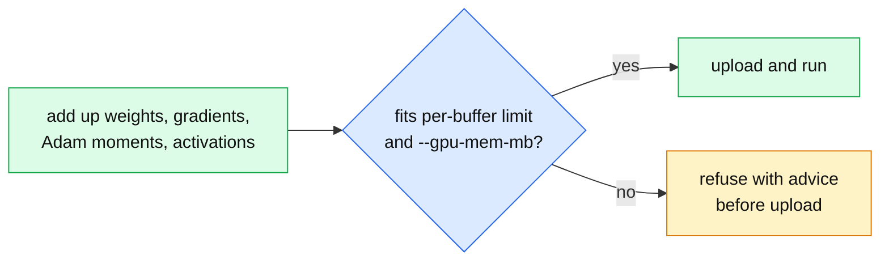


```
        ferrum-gpu (CLI)     ferrum-gpu-server     ferrum_gpu_gui (+ page in your browser)
                  \                  |                   /
                   +---------- engine layer -------------+     Backend: train / generate
                          /                        \
                CpuBackend (oracle)            GpuBackend
                        |                            |
  ferrum_ref  <--- parity checks --->   ferrum_wgpu  (device runtime, WGSL kernels,
  (CPU reference: models,                              resident models, trainers)
   gradients, AdamW)
        |                                            |
        +------------- ferrum_model -----------------+   (GGUF <-> models, checkpoints, sampling)
                              |
                         ferrum_gguf                       (container, f16 and block-quant codecs)
```

- **`ferrum_gguf`** reads and writes GGUF v3 (hostile-input safe, std only) and encodes and decodes the f16, Q8_0
  and Q4_0 blocks.
- **`ferrum_ref`** is the specification: plain `f32` Rust for the GPT-2 and Llama/Qwen2 models, their
  gradients, AdamW, quantisation-aware training and the training loop. It is also what `--device cpu` runs.
- **`ferrum_wgpu`** is the engine: a device runtime (error scopes, a pipeline cache, one generic dispatch path,
  plan-then-allocate memory budgeting), WGSL kernels for the forward and backward passes, models kept resident
  on the device with packed Q8_0/Q4_0 weights, and trainers that run forward, backward, global-norm clipping
  and AdamW entirely on the GPU. Training is bit-identical across repeat runs on the same adapter.
- **`ferrum_model`** maps GGUF files to models and back (`gpt2`, `llama`, `qwen2`), holds checkpoints and the
  token sampler.
- **The front ends** share one engine layer: the CLI, a JSON server, and a std-only HTTP GUI whose page can also
  run a model in the browser on WebGPU.
- **`--device auto`** follows the measurements: training goes to a hardware GPU, one-token-at-a-time decode
  stays on the CPU where that is faster (see [Measured](#measured-on-this-machine)). Software adapters such as
  llvmpipe and OpenGL ones are never picked unless named.
- **Memory is planned before anything is uploaded:** weights, gradients, Adam moments and activations (or
  weights, KV cache and scratch for decoding) are added up and checked against the adapter's per-buffer limit
  and, with `--gpu-mem-mb`, against a total. See [docs/architecture.md](docs/architecture.md).

## What it does

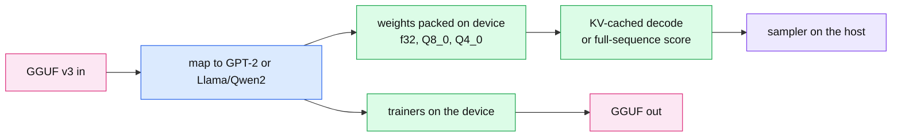


| | |
|---|---|
| Models | GPT-2 style (learned positions, LayerNorm, GELU) and Llama / Qwen2 style (RMSNorm, RoPE, grouped-query attention, SwiGLU, optional q/k/v biases, tied or untied head) |
| Inference | KV-cached single-token decode and full-sequence scoring, with f32, Q8_0 or Q4_0 weights kept packed on the device |
| Training | Forward, backward, global-norm clipping and AdamW entirely on the device; optional Q8_0 quantisation-aware training; `--tie` (shared embedding and head) and `--dropout` on the GPT-2 path; checkpoints and resume; validation hold-out with early stopping |
| Tokenizers | A byte-pair-encoding tokenizer trained with the model and embedded in the GGUF, or byte level (`--vocab 0`) |
| Formats | GGUF v3 in and out (`gpt2`, `llama`, `qwen2`; f32, f16 read, Q8_0, Q4_0; the k-quants Q2_K to Q6_K are read) |
| Front ends | `ferrum-gpu` command line, `ferrum-gpu-server` JSON API, a local web GUI, and in-browser inference on WebGPU |
| Exports | `export-gguf`, `export-ollama` (registers with a running Ollama), `export-lmstudio` (`lms import`) |

## Quick start

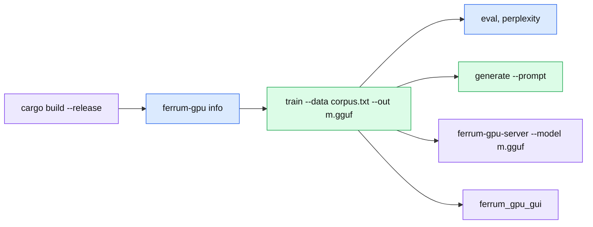


Requirements: Rust 1.87 or newer, and a GPU driver with Vulkan, Metal or DX12 if you want the GPU path
(everything also runs on the CPU, and the test suite passes on a machine with no GPU).

```bash
cargo build --release -p ferrum_gpu_cli -p ferrum_gpu_server -p ferrum_gpu_gui

# train a tiny GPT-2 model with its own BPE tokenizer on a text file, then use it.
# The file is a GPT-2 GGUF that llama.cpp, Ollama and LM Studio can load.
target/release/ferrum-gpu info
target/release/ferrum-gpu train    --preset tiny --data corpus.txt --out m.gguf --epochs 30 --batch 16 --vocab 300
target/release/ferrum-gpu eval     --model m.gguf --data corpus.txt
target/release/ferrum-gpu generate --model m.gguf --prompt "the c" --max-new 24

# serve it (--token to protect it), or open the GUI
target/release/ferrum-gpu-server --model m.gguf --port 8787
target/release/ferrum_gpu_gui

# a Llama-style byte-level model is still available
target/release/ferrum-gpu train --arch llama --preset tiny --data corpus.txt --out l.gguf --steps 150 --batch 4 --context 32 --lr 0.01
```

`--device cpu|gpu|auto` (default `auto`) picks where it runs; see the [user guide](docs/user-guide.md) for
what `auto` does and why. Before a GPU run the memory plan is checked against a budget: 80% of a discrete card's
free memory (read from `nvidia-smi`), or 70% of the available RAM for an integrated or unified-memory adapter
(both estimates), or `--gpu-mem-mb` if you set it; `ferrum-gpu info` shows each adapter's budget, its features and
where the figure came from ([capability.md](capability.md), finding 1). With no figure for an adapter (an AMD card
with several GPUs, say) only the per-buffer limit is checked.

## Commands

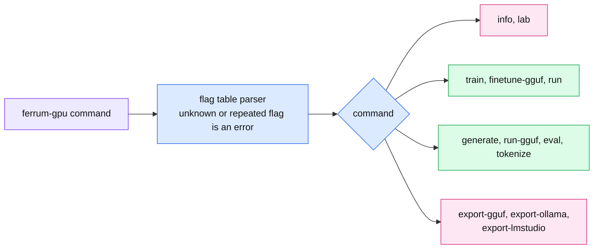


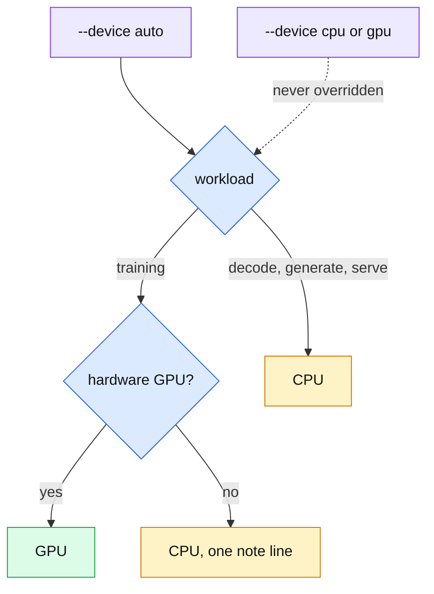


`ferrum-gpu help` prints every flag; unknown, repeated and valueless flags are errors.

| Command | Purpose |
|---|---|
| `info` | The device that would be used, every adapter, optionally a model's shape |
| `train` | Train a fresh model (GPT-2 style by default, `--arch llama` for byte-level Llama) and write a GGUF |
| `finetune-gguf` | Continue training a GGUF model (GPT-2 files keep their tokenizer) |
| `generate`, `run-gguf` | Continue a prompt (greedy, or `--temperature`, `--top-k`, `--top-p`, `--seed`) |
| `run` | Train on `--data` if the model file does not exist yet, then generate from `--prompt` |
| `tokenize` | Encode a text file or directory into a token file, so a corpus need not fit in memory |
| `eval` | Mean next-token loss and perplexity of a file under a model |
| `export-gguf` | Re-write a model as f32, int8 or int4 |
| `export-ollama`, `export-lmstudio` | Register or import a GPT-2 model with Ollama or LM Studio |
| `lab` | Check the GPU against the CPU reference (f32, F16, Q8_0, Q4_0, weights stored in blocks), measure decode and prefill speed per precision, and print the adapter, driver and wgpu version; `--json` is the report to send back from other hardware ([docs/verification-kit.md](docs/verification-kit.md)) |

`--gpu-weights f32|f16|q8_0|q4_0` (with `--device gpu`) stores a decoder's weights on the device in that precision, converted at load
(f16 halves the weight memory and needs no `shader-f16` feature; a weight larger than one buffer binding is stored in blocks).

Training flags, device flags, checkpoint and resume behaviour, and what each refuses are in
[docs/user-guide.md](docs/user-guide.md) and [docs/cli.md](docs/cli.md) (a walkthrough with real output).

## The server

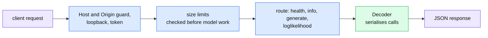


```bash
ferrum-gpu-server --model m.gguf [--host 127.0.0.1] [--port 8080] [--token T] [--device cpu|gpu|auto]
```

Routes: `GET /health`, `GET /v1/info`, `POST /v1/generate`, `POST /v1/loglikelihood`,
`POST /v1/loglikelihood_rolling`, compatible with ferrum-cpu's `ferrum-serve`. Loopback only by default; a
non-loopback host is refused unless a token is set. Limits are checked before any model work.

## The desktop app

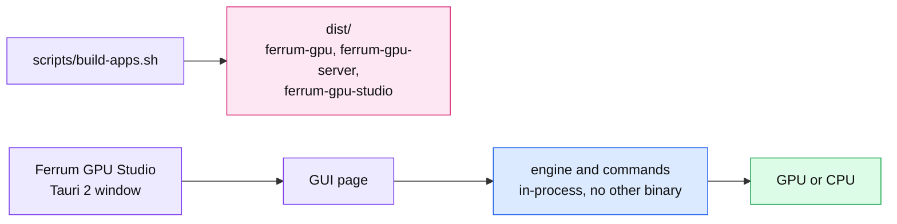


`scripts/build-apps.sh` builds the command line and the desktop app and puts them side by side in `dist/`
(`ferrum-gpu`, `ferrum-gpu-server` and `ferrum-gpu-studio`); both are thin programs over the same core, so a command run
from either does the same thing. `scripts/build-studio.sh --run` builds and starts **Ferrum GPU Studio**, a native window (Tauri 2) around the GUI below,
self-contained: the engine and every command run inside the app, with no other binary to find. It has its own
Cargo workspace (`ferrum_gpu_studio`), so the Tauri dependency tree stays out of the main workspace. Run on
Linux so far; macOS and Windows builds and installers are configured in CI but not run by hand (on Windows the app builds in CI but its unit tests do not start, a known Tauri manifest issue). See [docs/gui.md](docs/gui.md).

## The GUI

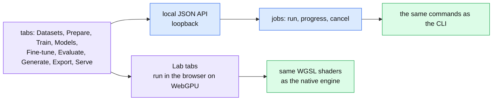


The Studio has tabs for Datasets, Prepare, Train (GPT-2 style with BPE, with a live loss chart), Models (inspect any GGUF),
Fine-tune, Evaluate, Generate, Export (precision, Ollama, LM Studio), Serve, Capable (what fits in a given memory), GPU lab
(the `lab` report and each adapter's memory) and Device, plus Lab tabs that run a small byte-level Llama model, optionally in your
browser tab on WebGPU. Beginner mode hides the Expert tabs and explains every control in plain words; the page keeps a checked
accessibility contract (`tests/a11y.rs`). The web form starts with `scripts/run-gui.sh` (loopback, port 8080, no authentication);
the first run picks the adapter and thread count for the machine and saves them in `.gui-prefs`. See [docs/gui.md](docs/gui.md) and
[docs/browser-webgpu.md](docs/browser-webgpu.md).

## Works with llama.cpp, Ollama, LM Studio and Unsloth

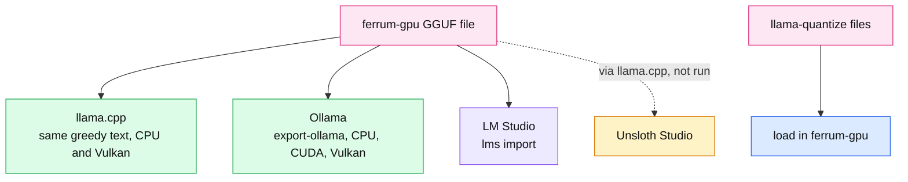


The meeting point is the GGUF file, and it is tested against real tools ([docs/interop.md](docs/interop.md)):

| Tool | What was checked |
|---|---|
| GGUF | v3 container rules, alignment, tensor offsets; reads v2/v3 files with F32, F16, Q4_0, Q4_1, Q5_0, Q5_1, Q8_0, Q8_1 and Q2_K to Q6_K |
| llama.cpp b11521 | our files load and give **the same greedy text** (f32, Q8_0, Q4_0) on CPU and on **Vulkan, on both the NVIDIA MX330 and the Intel Xe**; files from `llama-quantize` load in ours |
| Ollama 0.40.2 | `export-ollama` registers the model against a real server; Ollama's text equals ours on CPU, **CUDA and Vulkan** (the GPU runs were confirmed from `/api/ps` showing the model in video memory) |
| LM Studio (`lms`) | a real `lms import` registered the model and the imported file ran in llama.cpp with our text; the test cleans up after itself |
| Unsloth Studio | **not tested against a real Studio.** It loads local GGUF files through llama.cpp, so the llama.cpp results above are the evidence; there is no import command to call |

The runs that touch `~/.lmstudio` or use the GPU through an outside tool are opt-in
(`FERRUM_INTEROP_LMS=1`, `FERRUM_INTEROP_GPU=1`) and log every step; the default suite never does either.

## What size can it run?

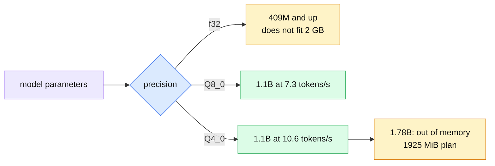


Short answer for the machine this is developed on (an NVIDIA MX330 with 2 GB, plus an Intel Xe sharing 15 GB of
RAM): **models up to about 1.1 billion parameters decode on the 2 GB card at Q4_0 or Q8_0**, and up to about
0.6 billion on the integrated GPU in what was run; full fine-tuning is measured up to 32 million
parameters. For other hardware there are hand estimates, clearly separated from measurements:

- **[capability.md](capability.md)**: what was measured, on which machine, with the method, the limits found, and
  the real-size shapes that did and did not fit.
- **[hardware-caps.md](hardware-caps.md)**: back-of-the-envelope estimates from 2 GB to 512 GB of memory,
  discrete VRAM, unified memory (Apple-class up to hypothetical M5-class Max and Ultra rows), integrated GPUs and
  multi-channel server RAM, with the formulas and every assumption stated.

## Measured on this machine

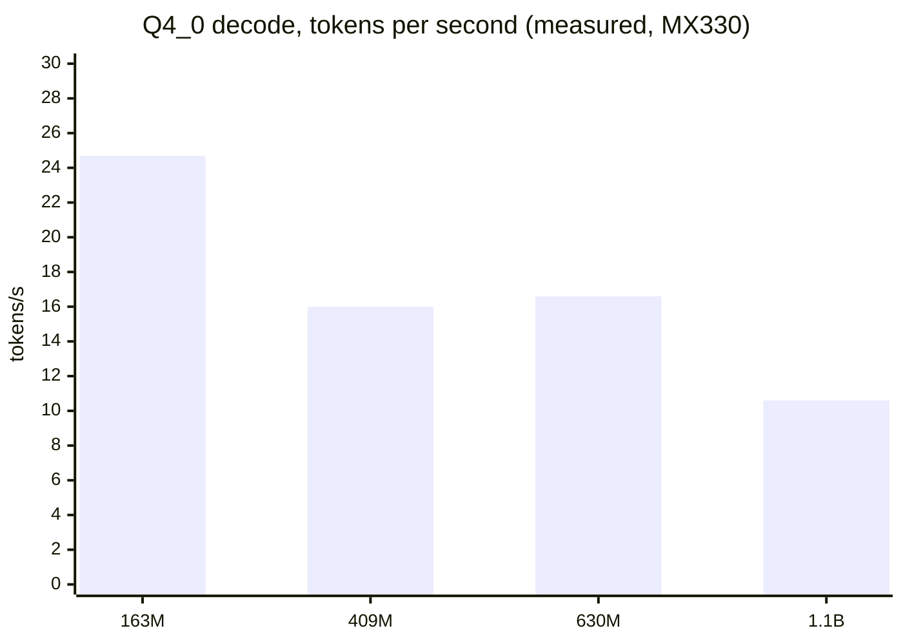


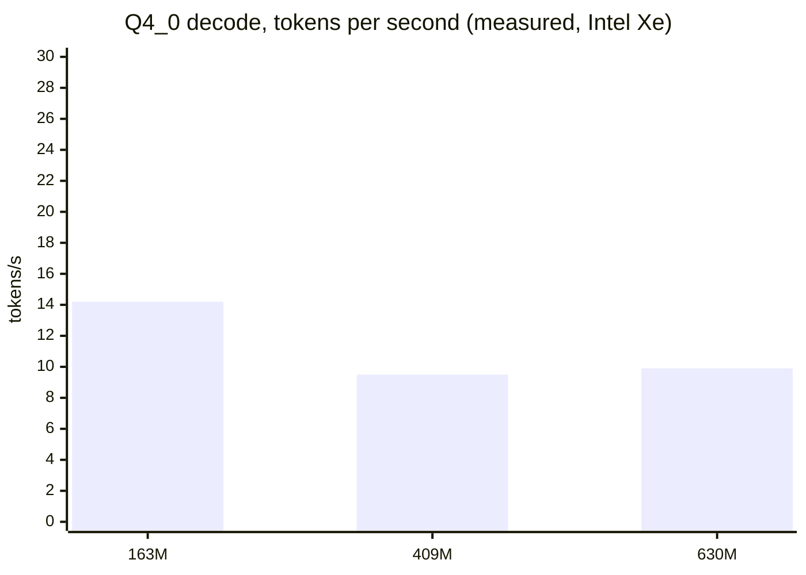


Linux 7.0, rustc 1.96, `wgpu` 30.0.1, Vulkan, release profile, 2026-11-14. Random weights (speed depends on the
shape, not the values), single-stream decode, one run per row, one process per row. Full tables, the raw logs in
`docs/logs/` and the caveats are in [capability.md](capability.md).

| Shape (random weights), Q4_0 | params | MX330 (2 GB) tokens/s | Intel Xe tokens/s |
|---|---|---|---|
| SmolLM-135M | 163M | 24.7 | 14.2 |
| SmolLM-360M | 409M | 16.0 | 9.5 |
| Qwen2-0.5B | 630M | 16.6 | 9.9 |
| TinyLlama-1.1B | 1.1B | 10.6 | not run (the benchmark's RAM guard) |
| Qwen2.5-1.5B | 1.78B | out of memory (1925 MiB plan) | not run |

- f32 does not fit the 2 GB card from 409M parameters up; Q8_0 runs the 1.1B shape at 7.3 tokens/s.
- **Training wins on the GPU, decode of one token does not** (up to 32M parameters): a fine-tuning step is 1.5x
  to 6.4x faster than 8 CPU threads on the two adapters, more as the model grows, while single-token decode on
  the GPU is slower than one CPU thread at those sizes. `--device auto` follows this.
- **Found while measuring:** the memory budget used the card's total memory, about 20% more than a load
  could really use (fixed: it now uses 80% of the free memory), and a failed load leaves buffers allocated
  until the process ends ([capability.md](capability.md), findings 1 and 2).

## Hardware estimates

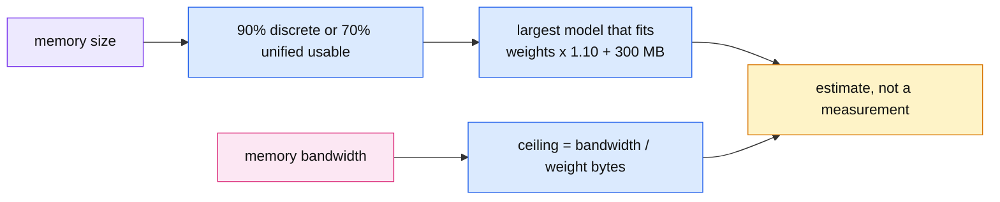


Hand estimates (formulas in [hardware-caps.md](hardware-caps.md); **only the MX330 and Xe rows above were run**).
Inference at Q4_0, context 2048, `discrete VRAM / unified memory` (90% / 70% of the memory usable); the small-model
end is optimistic by up to a third, see the notes there:

| memory | largest model, inference Q4_0 | largest model, full fine-tune f32 |
|---|---|---|
| 4 GB | about 5B / 4B | about 190M / 145M |
| 8 GB | about 11B / 8.6B | about 400M / 300M |
| 16 GB | about 23B / 18B | about 800M / 630M |
| 24 GB | about 34B / 27B | about 1.2B / 950M |
| 32 GB | about 46B / 36B | about 1.6B / 1.3B |
| 64 GB | about 93B / 72B | about 3.3B / 2.6B |
| 128 GB | about 186B / 144B | about 6.6B / 5.2B |

Speed is bounded by memory bandwidth (tokens per second is at most bandwidth divided by the weight bytes) and,
for ferrum-gpu today, by a per-layer launch cost fitted from the MX330: an estimated few tokens per second for
a 70B-class model on an Apple-Max-class machine and roughly 8 to 30 tokens per second for models under 2B on
any class that holds them (the MX330's measured 10 to 25 is inside that). "M5 Max Ultra" is not a product these docs can describe; the M5-class rows are labelled hypothetical.
Multiple adapters are not supported, and CPU-only servers appear for their memory systems only, because
ferrum-gpu has no tuned CPU inference path.

## Testing and quality

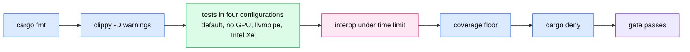


Tests first, every file has unit tests, and the suite must pass on a machine with no GPU. The gate runs
`cargo fmt`, `cargo clippy -D warnings`, the tests in four configurations (the default adapter, no GPU, llvmpipe,
the Intel Xe), a coverage check and `cargo deny`. Coverage details are in [docs/coverage.md](docs/coverage.md).
CI runs on Linux, Windows and macOS (the macOS runner's paravirtual GPU is known to differ from the CPU in one
test; see [docs/devices.md](docs/devices.md)).

<!-- stats:begin -->
Measured figures, written from [`metrics.md`](metrics.md) by `scripts/readme_stats.py` (snapshot `b9c61d4`); do not edit by hand.

| measure | value |
|---|---|
| `#[test]` functions | 1192 |
| Rust production lines | 26758 |
| Rust test lines | 27225 |
| line coverage | 100.00% |
| function coverage | 100.00% |
| region coverage | 97.86% |
| last gate | PASS in 22m 59s |
<!-- stats:end -->

```bash
scripts/test-all.sh                  # every test, with and without a GPU, plus a coverage summary
scripts/test-time-limit.sh [LIMIT]   # one test per process: none over the limit (interop tests 10 min)
```

Tests that need an outside tool (llama.cpp, Ollama, `lms`) skip with a printed reason when it is absent.
Each real external run is opt-in and logged; see [docs/interop.md](docs/interop.md) and
[docs/developing.md](docs/developing.md).

## Status

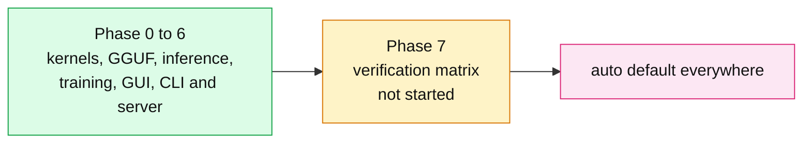


Phases 0 to 6 are complete: kernels and parity, GGUF I/O, GPT-2 and Llama/Qwen inference, training and
fine-tuning, the GUI and browser WebGPU runtime, and the CLI and server. Phase 7 (a verification matrix
over more devices, then making `auto` the default everywhere) has not started. The plan is in
[plan.md](plan.md); per-phase notes and outcomes are in [docs/plans/](docs/plans/).

Hardware actually run: NVIDIA GeForce MX330 (2 GB, Vulkan and, through Ollama, CUDA), Intel Iris Xe (Vulkan),
llvmpipe (software Vulkan), on Linux. **Not run:** Apple Silicon, AMD, desktop NVIDIA, Windows, macOS,
Firefox, Safari, more than 2 GB of dedicated memory, any real (non-random) checkpoint beyond the small fixtures.

## Repository map

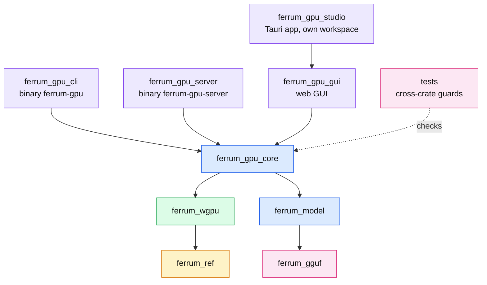


| Crate | Role |
|---|---|
| [`ferrum_gguf`](ferrum_gguf) | GGUF v3 reader and writer, f16 and block-quant codecs. std only, hostile-input safe |
| [`ferrum_ref`](ferrum_ref) | CPU reference: kernels, GPT-2 and Llama models, gradients, AdamW, QAT, the training loop. The parity oracle |
| [`ferrum_model`](ferrum_model) | GGUF mappings for `gpt2` / `llama` / `qwen2`, training checkpoints, token sampling |
| [`ferrum_gpu_core`](ferrum_gpu_core) | The shared core under every front end: the commands (train, finetune, eval, generate, prepare, tokenize, exports), the `auto` device rule and memory pre-flight, the engine layer (CPU and GPU backends), jobs, cancel, std-only HTTP and JSON helpers |
| [`ferrum_wgpu`](ferrum_wgpu) | The GPU engine: device runtime, WGSL kernels, resident models, trainers, benchmarks |
| [`ferrum_gpu_cli`](ferrum_gpu_cli) | The `ferrum-gpu` binary (a thin `main` over the core's commands) and the interoperability tests |
| [`ferrum_gpu_server`](ferrum_gpu_server) | The `ferrum-gpu-server` binary (a thin `main` over `ferrum_gpu_core::serving::boot`); the server itself is in the core, where the Studio runs it in-process |
| [`ferrum_gpu_gui`](ferrum_gpu_gui) | Local web GUI, std-only HTTP server, in-browser WebGPU runtime |
| [`ferrum_gpu_studio`](ferrum_gpu_studio) | The desktop app (Tauri 2), its own workspace: a native window around the GUI with the engine in-process |
| [`tests`](tests) | Cross-crate guards (independence from ferrum-cpu, the context-window scripts, the capability tables) |

## Documentation

| Document | For |
|---|---|
| [capability.md](capability.md) | What this machine can run, measured: model sizes, speeds, limits and findings |
| [hardware-caps.md](hardware-caps.md) | Hand-estimated capacity and speed from 4 GB to 512 GB, unified memory and server RAM |
| [docs/user-guide.md](docs/user-guide.md) | Using the CLI, server and GUI: devices, training, quantisation, memory, troubleshooting |
| [docs/architecture.md](docs/architecture.md) | How it is built: layers, the device runtime, kernels, determinism, training, memory planning |
| [docs/gguf.md](docs/gguf.md) | Exactly which GGUF files load and what is refused |
| [docs/interop.md](docs/interop.md) | llama.cpp, Ollama, LM Studio and Unsloth: versions run, results, how to rerun |
| [docs/developing.md](docs/developing.md) | Building, testing, coverage, benchmarks, adding a kernel or a command, project rules |
| [docs/cli.md](docs/cli.md) | CLI and server walkthrough with real output |
| [docs/gui.md](docs/gui.md), [docs/browser-webgpu.md](docs/browser-webgpu.md) | The GUI and the in-browser runtime |
| [docs/gui-studio-plan.md](docs/gui-studio-plan.md) | The Studio and GPU-scale plan: what was built, what was measured, what was not done |
| [docs/verification-kit.md](docs/verification-kit.md) | Run the lab report on your hardware (Apple Silicon, AMD, Windows) and send it back |
| [docs/spike-matmul.md](docs/spike-matmul.md), [docs/train-speed.md](docs/train-speed.md), [docs/decode-crossover.md](docs/decode-crossover.md), [docs/llama-speed.md](docs/llama-speed.md) | Measurement reports from earlier phases |
| [docs/devices.md](docs/devices.md), [docs/parity.md](docs/parity.md) | The device verification matrix; parity with ferrum-cpu feature by feature |
| [docs/coverage.md](docs/coverage.md) | Test coverage numbers |
| [plan.md](plan.md), [docs/plans/](docs/plans/) | The phase plan and what each phase delivered |
| [CLAUDE.md](CLAUDE.md) | The binding project rules |

## Independence from ferrum-cpu

```mermaid
flowchart LR
    cpu["ferrum-cpu<br/>never modified"]:::cpu -. "code copied in once,<br/>with provenance header" .-> gpu["ferrum-gpu"]:::gpu
    cpu --> fx["GGUF fixtures<br/>stored in this repo"]:::io
    fx --> gpu
    t["test_independence.rs"]:::core -- "no path or git dependency,<br/>no file read outside the repo" --> gpu
    classDef core fill:#dbeafe,stroke:#2563eb,color:#111
    classDef gpu fill:#dcfce7,stroke:#16a34a,color:#111
    classDef cpu fill:#fef3c7,stroke:#d97706,color:#111
    classDef io fill:#fce7f3,stroke:#db2777,color:#111
    classDef host fill:#ede9fe,stroke:#7c3aed,color:#111
```


No dependency (path, git or otherwise) on ferrum-cpu, no file read outside this repository, and
ferrum-cpu is never modified. Code that originated there is copied in with a provenance header naming the
source file and commit. A test (`tests/tests/test_independence.rs`) enforces this. Models trained on either
side load on the other through GGUF fixtures stored in this repository.

## License

ferrum-gpu is available under **either** of these, as set out in [`LICENSE`](LICENSE):

- the **Server Side Public License v1.0** ([`LICENSE-SSPL.txt`](LICENSE-SSPL.txt)), free of charge, or
- a paid **commercial license** from Thomas Cherickal, for proprietary, hosted or OEM use.

Every manifest says `SSPL-1.0 OR LicenseRef-Commercial`.
