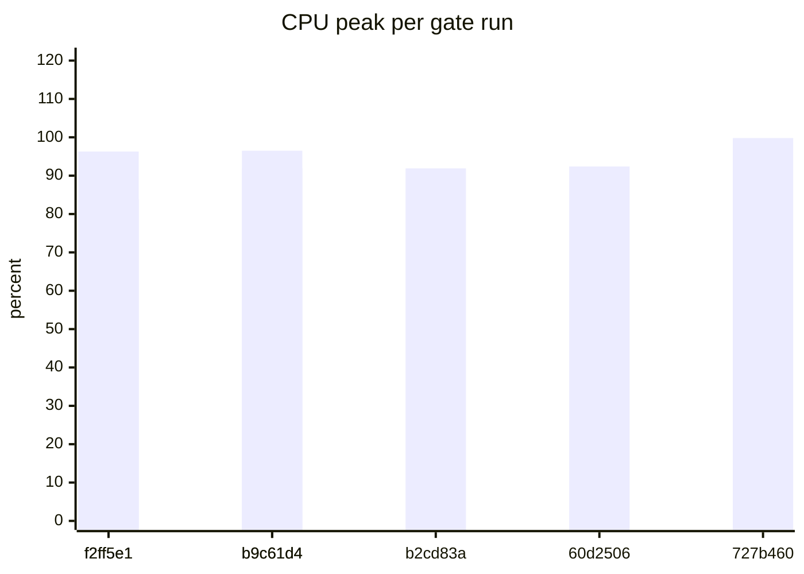

# System profile

CPU and GPU usage during the gate (`scripts/gate.sh` samples every 2 s with `scripts/system_profile.py`); do not edit by hand. A GPU column is `-` when `nvidia-smi` reported nothing. Look for rising memory or CPU peaks across rows: that is a resource regression.

<!-- profile:begin -->
| when | commit | label | seconds | CPU avg % | CPU peak % | memory peak MiB | GPU avg % | GPU peak % | GPU memory peak MiB |
|---|---|---|---|---|---|---|---|---|---|
| 2026-11-25 18:14 | `727b460` | gate | 1425 | 40.6 | 99.8 | 11171 | 1.1 | 33.0 | 205 |
| 2026-11-25 17:28 | `60d2506` | gate | 1331 | 34.0 | 92.4 | 12310 | 1.3 | 33.0 | 207 |
| 2026-11-25 16:39 | `b2cd83a` | gate | 1517 | 39.4 | 91.9 | 11837 | 1.3 | 35.0 | 207 |
| 2026-11-23 12:10 | `b9c61d4` | gate | 1380 | 37.6 | 96.5 | 10883 | 1.3 | 34.0 | 205 |
| 2026-11-23 11:46 | `b9c61d4` | gate | 1447 | 38.3 | 91.9 | 9792 | 1.3 | 35.0 | 207 |
| 2026-11-23 10:36 | `f2ff5e1` | gate | 1563 | 40.7 | 96.3 | 10994 | 1.2 | 37.0 | 329 |
| 2026-11-23 10:09 | `f2ff5e1` | gate | 692 | 23.8 | 83.9 | 9252 | 1.5 | 37.0 | 207 |
<!-- profile:end -->

<!-- load:begin -->
Load tests, measured 2026-11-25 17:50 on `727b460` (debug; heavy runs included build; `scripts/load_profile.py run`). Latency is per request, from connect to the last byte; a refusal is the documented 503 past the in-flight cap.

| name | clients | requests | ok | refused | seconds | rps | p50_ms | p95_ms | p99_ms | max_ms |
|---|---|---|---|---|---|---|---|---|---|---|
| json-server-heavy | 96 | 3840 | 3812 | 28 | 1.39 | 2756 | 34.2 | 36.8 | 43.9 | 51.2 |
| json-server | 48 | 192 | 192 | 0 | 0.14 | 1408 | 32.5 | 37.7 | 38.1 | 38.3 |
| connection-cap | 16 | 32 | 0 | 32 | 0.01 | 5199 | 0.6 | 5.0 | 5.0 | 5.0 |
| connection-cap-after | 4 | 32 | 32 | 0 | 0.08 | 393 | 10.1 | 10.2 | 10.2 | 10.2 |
| gui-api-heavy | 96 | 3840 | 3840 | 0 | 1.41 | 2732 | 30.6 | 63.6 | 84.5 | 124.4 |
| gui-api | 32 | 192 | 192 | 0 | 0.10 | 1963 | 10.1 | 36.8 | 40.9 | 41.3 |
<!-- load:end -->
