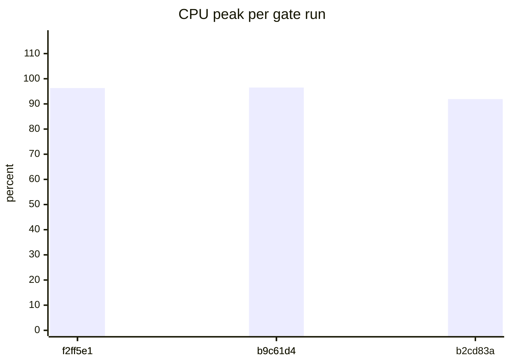

# System profile

CPU and GPU usage during the gate (`scripts/gate.sh` samples every 2 s with `scripts/system_profile.py`); do not edit by hand. A GPU column is `-` when `nvidia-smi` reported nothing. Look for rising memory or CPU peaks across rows: that is a resource regression.

<!-- profile:begin -->
| when | commit | label | seconds | CPU avg % | CPU peak % | memory peak MiB | GPU avg % | GPU peak % | GPU memory peak MiB |
|---|---|---|---|---|---|---|---|---|---|
| 2026-11-25 16:39 | `b2cd83a` | gate | 1517 | 39.4 | 91.9 | 11837 | 1.3 | 35.0 | 207 |
| 2026-11-23 12:10 | `b9c61d4` | gate | 1380 | 37.6 | 96.5 | 10883 | 1.3 | 34.0 | 205 |
| 2026-11-23 11:46 | `b9c61d4` | gate | 1447 | 38.3 | 91.9 | 9792 | 1.3 | 35.0 | 207 |
| 2026-11-23 10:36 | `f2ff5e1` | gate | 1563 | 40.7 | 96.3 | 10994 | 1.2 | 37.0 | 329 |
| 2026-11-23 10:09 | `f2ff5e1` | gate | 692 | 23.8 | 83.9 | 9252 | 1.5 | 37.0 | 207 |
<!-- profile:end -->
