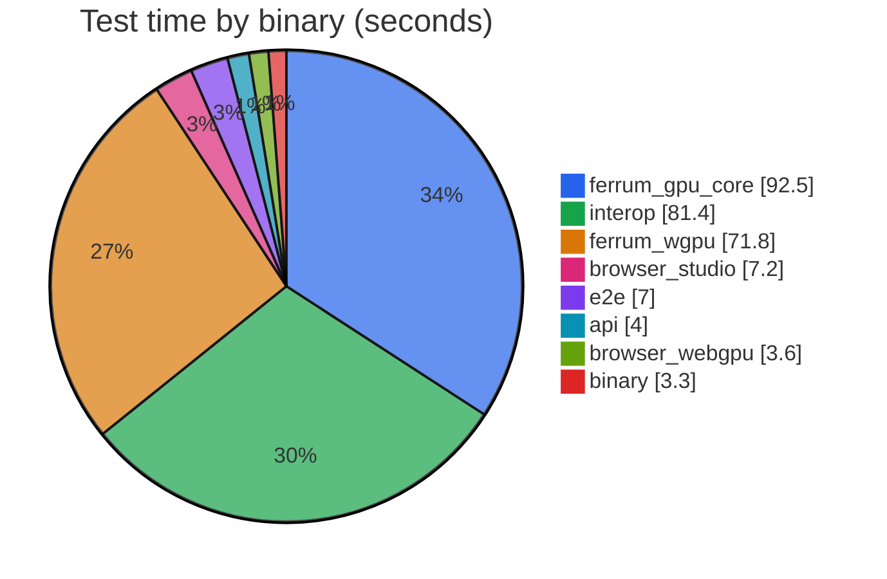

# Test time report

Generated by `scripts/timing_report.py` from `scripts/test-time-limit.sh` (every test in its own process); do not edit by hand.

Measured 2026-11-23 11:58 UTC on commit `b9c61d4`: **1200** tests, **4.8 minutes** in total (limit 30 minutes: within the limit).

## By test binary

| binary | tests | seconds |
|---|---|---|
| ferrum_gpu_core | 357 | 92.5 |
| interop | 31 | 81.4 |
| ferrum_wgpu | 260 | 71.8 |
| browser_studio | 4 | 7.2 |
| e2e | 10 | 7.0 |
| api | 14 | 4.0 |
| browser_webgpu | 5 | 3.6 |
| binary | 10 | 3.3 |
| test_metrics_script | 5 | 3.0 |
| ferrum_ref | 130 | 2.8 |
| gui_extras | 27 | 2.5 |
| jobs_real | 3 | 2.2 |
| browser_ui | 4 | 2.0 |
| ferrum_test_support | 12 | 1.8 |
| ferrum_model | 122 | 1.7 |
| ferrum_gpu_gui | 46 | 0.9 |
| js_shell | 4 | 0.9 |
| ferrum_tok | 43 | 0.6 |
| browser_bench | 4 | 0.3 |
| js_stop | 4 | 0.3 |
| test_context_scripts | 11 | 0.3 |
| forward_pass | 1 | 0.2 |
| test_independence | 4 | 0.2 |
| ferrum_gguf | 63 | 0.1 |
| test_capability_docs | 4 | 0.0 |
| a11y | 8 | 0.0 |
| studio_help | 5 | 0.0 |
| csp | 4 | 0.0 |
| test_architecture | 5 | 0.0 |

## Slow tests (at least 5 s each: optimise these first)

| seconds | test |
|---|---|
| 12.8 | interop: formats::each_precision_writes_the_ggml_type_llama_cpp_expects::llama_cpp_continues_the_prompt_exactly_as_we_do_for_f16_fp4_and_q2 |
| 12.5 | ferrum_gpu_core: commands::lab::tests::bad_flags_are_refused_before_any_device_is_opened::the_text_report_on_an_available_adapter_passes_and_names_everything |
| 11.7 | interop: formats::each_precision_writes_the_ggml_type_llama_cpp_expects::our_q2_k_is_as_accurate_as_llama_quantizes |
| 11.7 | interop: formats::each_precision_writes_the_ggml_type_llama_cpp_expects::each_precision_writes_the_ggml_type_llama_cpp_expects |
| 11.0 | ferrum_gpu_core: commands::lab::speed::tests::every_precision_measures_a_speed_on_an_available_adapter |
| 9.4 | ferrum_gpu_core: commands::gpt2::error_paths::sweep::info_generate_eval_and_export_report_a_closed_output_at_every_write |
| 9.1 | ferrum_gpu_core: commands::lab::speed::fault_tests::a_fault_in_any_stage_of_a_measurement_is_reported |
| 7.4 | ferrum_wgpu: training::gpt2::tests::split_steps_are_deterministic::a_fault_at_any_command_of_a_split_step_applies_nothing |
| 6.9 | browser_studio: the_new_tabs_work_in_a_real_browser_with_the_real_commands::the_new_tabs_work_in_a_real_browser_with_the_real_commands |
| 5.9 | ferrum_wgpu: training::llama::tests::bad_input_and_tied_models_are_refused::a_fault_at_any_command_leaves_the_training_state_untouched |
| 5.8 | ferrum_gpu_core: commands::gpt2::error_paths::sweep::training_reports_a_closed_output_at_every_write |

## Ten slowest

| seconds | test |
|---|---|
| 12.80 | interop: formats::each_precision_writes_the_ggml_type_llama_cpp_expects::llama_cpp_continues_the_prompt_exactly_as_we_do_for_f16_fp4_and_q2 |
| 12.55 | ferrum_gpu_core: commands::lab::tests::bad_flags_are_refused_before_any_device_is_opened::the_text_report_on_an_available_adapter_passes_and_names_everything |
| 11.74 | interop: formats::each_precision_writes_the_ggml_type_llama_cpp_expects::our_q2_k_is_as_accurate_as_llama_quantizes |
| 11.74 | interop: formats::each_precision_writes_the_ggml_type_llama_cpp_expects::each_precision_writes_the_ggml_type_llama_cpp_expects |
| 11.04 | ferrum_gpu_core: commands::lab::speed::tests::every_precision_measures_a_speed_on_an_available_adapter |
| 9.42 | ferrum_gpu_core: commands::gpt2::error_paths::sweep::info_generate_eval_and_export_report_a_closed_output_at_every_write |
| 9.11 | ferrum_gpu_core: commands::lab::speed::fault_tests::a_fault_in_any_stage_of_a_measurement_is_reported |
| 7.43 | ferrum_wgpu: training::gpt2::tests::split_steps_are_deterministic::a_fault_at_any_command_of_a_split_step_applies_nothing |
| 6.94 | browser_studio: the_new_tabs_work_in_a_real_browser_with_the_real_commands::the_new_tabs_work_in_a_real_browser_with_the_real_commands |
| 5.89 | ferrum_wgpu: training::llama::tests::bad_input_and_tied_models_are_refused::a_fault_at_any_command_leaves_the_training_state_untouched |
